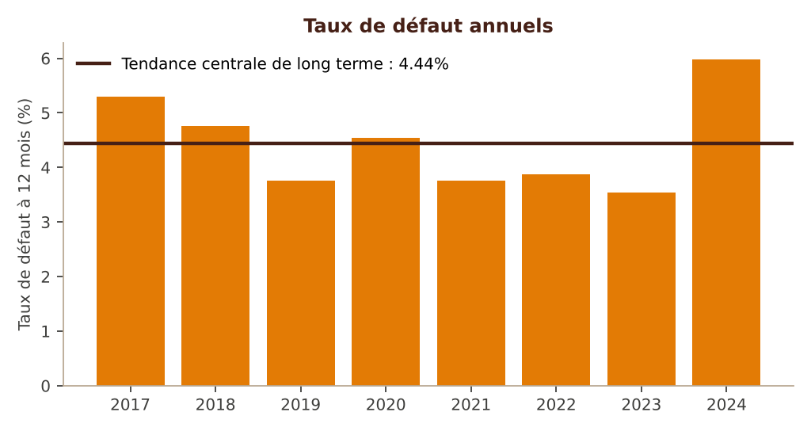
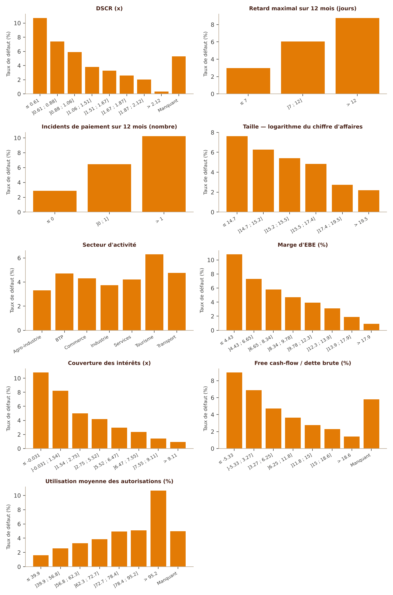
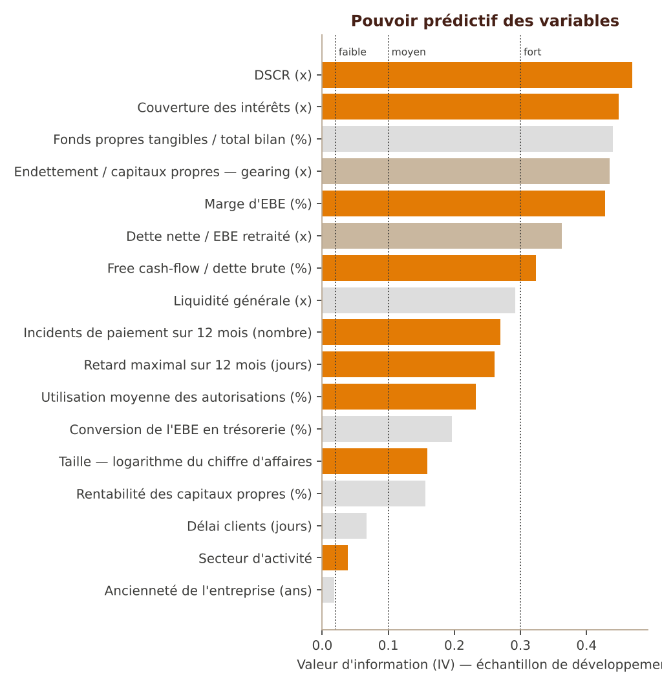
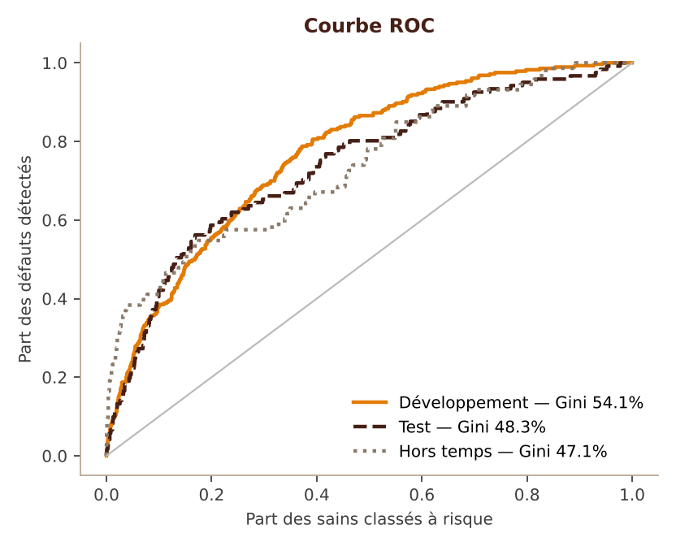
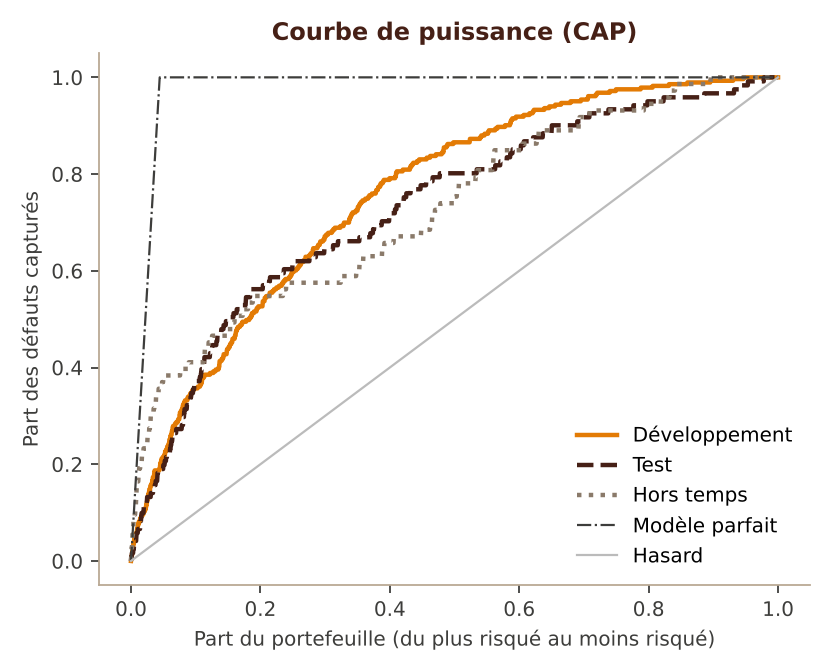
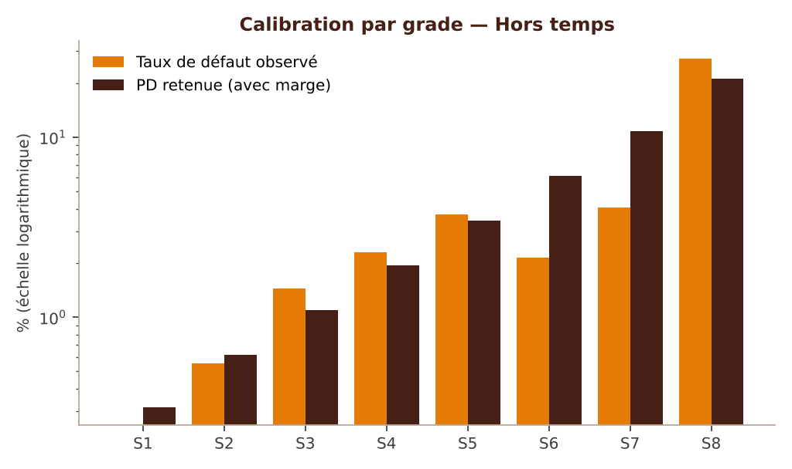
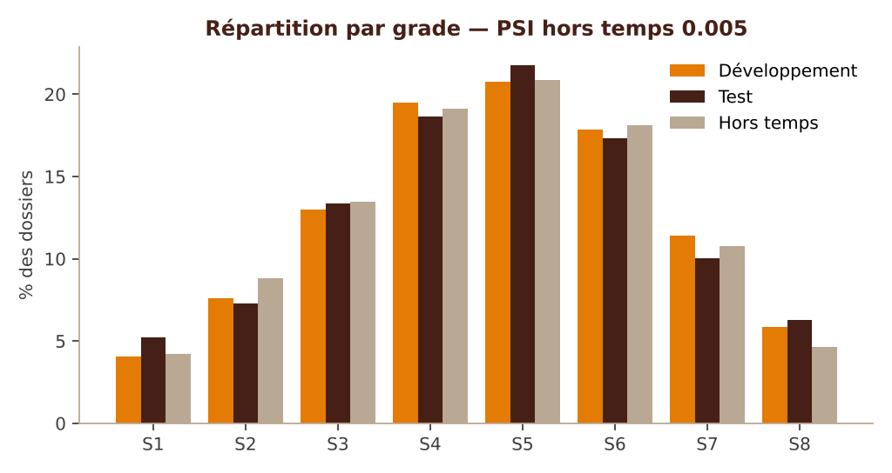

# Modélisation statistique de la probabilité de défaut des entreprises

**Version :** 1.0 — novembre 2026
**Script :** `scripts/modelisation/modelisation.py` (version 1.0.0)
**Périmètre :** entreprises notées par l'outil (TPE, PME, grandes entreprises)
**Statut :** méthode de référence ; tout modèle produit est un projet soumis à la validation indépendante et au comité modèles

> Ce document décrit pas à pas la chaîne de modélisation statistique qui doit prendre le relais de la grille experte quand l'historique de défauts le permettra. Les chiffres et graphiques d'illustration viennent du mode démonstration du script, sur un portefeuille synthétique : ils montrent la méthode et ce qu'il faut regarder, ils ne calibrent rien.

## Sommaire

1. Pourquoi un modèle statistique, et pourquoi pas tout de suite
2. Vue d'ensemble de la chaîne
3. Données d'entrée
4. Définition du défaut et construction de la cible
5. Échantillons de développement, de test et hors temps
6. Discrétisation, poids de l'évidence et valeur d'information
7. Sélection des variables
8. Régression logistique
9. Carte de score et conversion en grille de l'outil
10. Calibration de la PD et échelle maîtresse
11. Validation
12. Livrables du script et utilisation
13. Gouvernance, limites et suivi
14. Annexes : formules, seuils et glossaire

## 1. Pourquoi un modèle statistique, et pourquoi pas tout de suite

La grille actuelle est un **modèle expert** : les critères, les barèmes et les poids traduisent le jugement des analystes et les pratiques de place. Elle est transparente, robuste aux petits échantillons et immédiatement utilisable. Sa limite est connue : ses poids ne sont pas estimés sur les défauts observés de la banque, et la probabilité de défaut (PD) associée à chaque grade reste une hypothèse tant qu'elle n'est pas confrontée à l'historique.

Un modèle statistique répond à cette limite : il **estime** le lien entre les caractéristiques d'une entreprise et sa probabilité de faire défaut dans les douze mois, sur les dossiers réels de la banque, puis il **mesure** sa propre qualité (pouvoir discriminant, justesse des PD, stabilité).

Il exige en contrepartie un historique suffisant :

- **profondeur** : au moins cinq années d'observations, idéalement un cycle économique complet, pour estimer une tendance centrale de long terme ;
- **volume de défauts** : quelques centaines de défauts au total, et au moins une vingtaine par grade ou par segment modélisé ; en deçà, les intervalles de confiance du Gini et des taux de défaut sont trop larges pour conclure ;
- **qualité** : des bilans saisis de manière homogène (c'est l'objet du module Bilan de l'outil, qui applique le plan comptable CGNC et les mêmes formules pour tous) et des défauts datés selon une définition unique.

Le script est prêt pour ce moment. D'ici là, l'outil collecte exactement les données dont il aura besoin : chaque notation archive les postes du bilan, les ratios calculés, les réponses qualitatives et le grade, avec leur date. L'historique de modélisation se constitue donc sans effort supplémentaire, notation après notation.

**Le passage au statistique n'est pas une rupture.** Le script produit une grille au format même de l'outil (critères, barèmes, poids en points de base) : le modèle statistique peut être exécuté en parallèle de la grille experte (mode « challenger »), comparé dossier par dossier, puis substitué quand la validation le permet.

## 2. Vue d'ensemble de la chaîne

| Étape | Objet | Contrôle principal | Feuille du classeur de résultats |
|---|---|---|---|
| 1 | Chargement et qualité des données | taux de manquants, valeurs extrêmes, doublons | Données |
| 2 | Cible : défaut à 12 mois | exclusions motivées et comptées | Synthèse |
| 3 | Échantillons | pas de contrepartie à cheval entre développement et test | Échantillons |
| 4 | Discrétisation monotone, WoE, IV | monotonie du taux de défaut, effectif minimal | Classes WoE |
| 5 | Sélection des variables | IV, sens économique, corrélations, VIF | IV et sélection, Corrélations |
| 6 | Régression logistique pas à pas | p-valeurs, signes, colinéarité | Pas à pas, Coefficients |
| 7 | Carte de points et grille de l'outil | perte de Gini due aux paliers de 25 | Carte de points, Grille outil |
| 8 | Calibration et échelle maîtresse | tendance centrale, marge de prudence, plancher | Échelle maîtresse |
| 9 | Validation | Gini, KS, Jeffreys, Hosmer-Lemeshow, PSI | Validation, Tests par grade, Stabilité |
| 10 | Livrables | modèle réutilisable à l'identique | — |

Chaque étape est **déterministe** (graine aléatoire fixée) et **traçable** : le classeur de résultats garde la décision motivée prise pour chaque variable, et le fichier `modele.json` contient tout ce qu'il faut pour renoter un dossier à l'identique.

## 3. Données d'entrée

### 3.1 Format

Un fichier CSV (séparateur virgule ou point-virgule, détecté automatiquement ; décimale virgule acceptée avec le point-virgule) ou un classeur Excel. **Une ligne par contrepartie et par date d'arrêté** (en pratique, par exercice comptable).

| Colonne | Obligatoire | Contenu |
|---|---|---|
| `id_contrepartie` | oui | identifiant stable de l'entreprise |
| `date_arrete` | oui | date d'observation (clôture de l'exercice utilisé pour la notation) |
| `defaut_12m` | oui, ou `date_defaut` | 1 si défaut dans les 12 mois suivant la date d'arrêté, sinon 0 |
| `date_defaut` | sinon | date d'entrée en défaut ; la cible est alors calculée par le script |
| `defaut_a_l_arrete` | recommandé | 1 si l'entreprise était déjà en défaut à la date d'arrêté (exclue) |
| `segment` | recommandé | TPE, PME ou GE |
| `score_expert` | facultatif | score 0-100 de la grille experte, pour la comparaison |
| variables candidates | — | ratios, données de comportement et de profil (§ 3.2) |

Les noms de colonnes sont paramétrables (`config.json`, rubrique `colonnes`), ce qui permet de lire directement un export de l'entrepôt de données sans le retraiter.

### 3.2 Variables candidates

La liste par défaut reprend les ratios calculés par le module Bilan de l'outil — avec exactement les mêmes définitions — et les variables les plus utilisées dans le système bancaire pour apprécier le risque de crédit d'une entreprise, y compris celles que la grille experte n'a pas retenues :

| Famille | Variables | Critère de la grille experte |
|---|---|---|
| Structure | fonds propres tangibles / total bilan | D1.4 |
| Endettement | dette nette / EBE retraité ; gearing (endettement / capitaux propres) | D1.5 ; non retenu |
| Liquidité | liquidité générale | D1.6 |
| Flux | conversion de l'EBE en trésorerie ; free cash-flow / dette brute | D1.8 ; D2.3 |
| Service de la dette | couverture des intérêts ; DSCR | D2.1 ; D2.2 |
| Rentabilité | rentabilité des capitaux propres ; marge d'EBE | non retenus |
| Exploitation | délai clients | non retenu |
| Taille et profil | logarithme du chiffre d'affaires ; ancienneté ; secteur | non retenus |
| Comportement | retard maximal sur 12 mois ; utilisation des autorisations ; incidents de paiement | TPE comportementale |

Pour chaque variable, la configuration indique son **sens attendu** (+1 : une valeur plus élevée augmente le risque ; −1 : elle le diminue). Ce sens est une contrainte : une variable dont le lien observé contredit l'intuition économique est écartée, même si elle améliore le Gini. C'est le premier rempart contre le sur-apprentissage.

### 3.3 Contrôle qualité

La feuille « Données » donne, pour chaque variable : présence, taux de manquants, minimum, 1er centile, médiane, 99e centile, maximum et nombre de valeurs distinctes. Points à examiner avant d'aller plus loin :

- un taux de manquants supérieur à 30 % rend la variable fragile : son traitement (§ 6.4) pèsera plus que son information ;
- un écart très grand entre le 99e centile et le maximum signale une erreur de saisie ou d'unité (milliers contre unités) ;
- une variable presque constante n'apportera rien ;
- un taux de manquants qui varie fortement d'une année à l'autre trahit un changement de processus de collecte : à documenter, car il menace la stabilité.

## 4. Définition du défaut et construction de la cible

### 4.1 Définition du défaut

La cible est le **défaut à 12 mois** : l'entreprise fait défaut dans les douze mois qui suivent la date d'arrêté. Le défaut retenu est celui de la réglementation prudentielle et de la politique de risque de la banque : **impayé de plus de 90 jours** sur une obligation significative, ou **probabilité d'impayé** avérée (restructuration en difficulté, procédure collective, passage en créance en souffrance, abandon de créance). C'est la même définition que celle qui déclenche le grade de défaut dans l'outil.

La définition doit être **la même sur toute la période**. Si elle a changé (seuil de matérialité, règles de contagion au groupe), il faut reconstituer l'historique selon la définition actuelle, ou à défaut quantifier l'écart et l'intégrer à la marge de prudence de catégorie A (§ 10.3).

### 4.2 Calcul et exclusions

Si le fichier fournit la date de défaut, le script calcule la cible : défaut si `date_arrete < date_defaut ≤ date_arrete + 12 mois`. Il exclut ensuite, en les comptant :

- les lignes sans cible valide ;
- les entreprises **déjà en défaut à la date d'arrêté** : elles ne sont pas notées, elles sont en défaut ;
- les doublons (même contrepartie, même année) ;
- les dates d'arrêté illisibles.

Le nombre de lignes exclues par motif figure dans la synthèse. Une exclusion importante et non expliquée est un signal d'alerte.

**Fenêtre d'observation.** La dernière année d'arrêté doit être antérieure d'au moins douze mois à la date d'extraction, sinon une partie des défauts n'est pas encore observable et le taux de défaut de cette année est sous-estimé.

## 5. Échantillons de développement, de test et hors temps

Le script découpe l'historique en trois échantillons :

| Échantillon | Composition | Rôle |
|---|---|---|
| Développement | 70 % des contreparties des années anciennes | estimer les classes, sélectionner, estimer les coefficients |
| Test | 30 % des contreparties des mêmes années, tirées au hasard en respectant la proportion de défauts | vérifier l'absence de sur-apprentissage |
| Hors temps | la ou les dernières années | vérifier que le modèle tient dans le temps |

Deux règles évitent les fausses bonnes performances :

1. **Le tirage se fait au niveau de la contrepartie**, pas de la ligne : une même entreprise n'apparaît jamais à la fois en développement et en test. Sinon, le test retrouverait des dossiers presque identiques à ceux de l'apprentissage et surestimerait la performance.
2. **Rien n'est estimé sur le test ni sur le hors temps** : ni les classes, ni la sélection, ni les coefficients. Ils ne servent qu'à mesurer.



## 6. Discrétisation, poids de l'évidence et valeur d'information

### 6.1 Pourquoi discrétiser

Chaque variable continue est découpée en classes. Ce choix, standard pour les cartes de score bancaires, a quatre avantages : il capte les relations non linéaires (un DSCR de 5 n'est pas dix fois meilleur qu'un DSCR de 0,5) ; il neutralise les valeurs extrêmes ; il traite les valeurs manquantes comme une classe à part entière ; et il produit un barème lisible par les analystes, de même forme que la grille experte.

### 6.2 Algorithme de discrétisation monotone

1. Découpage initial en 10 classes de même effectif (déciles), bornes arrondies à trois chiffres significatifs pour rester lisibles dans une grille.
2. Fusion des classes adjacentes, une à une, tant que l'une des conditions suivantes n'est pas remplie :
   - chaque classe contient au moins 5 % des observations ;
   - chaque classe contient au moins un défaut et au moins un dossier sain ;
   - le taux de défaut évolue **strictement dans le sens attendu** d'une classe à la suivante.
3. Le résultat est un barème monotone : la relation entre la variable et le risque ne peut pas « zigzaguer », ce qui garantit que le score d'une entreprise ne baisse jamais quand son ratio s'améliore.

Pour une variable catégorielle (le secteur), chaque modalité forme une classe ; les modalités trop rares sont regroupées dans « Autres ».

### 6.3 Poids de l'évidence (WoE) et valeur d'information (IV)

Pour la classe *j* d'une variable :

- **WoE** = ln( part des défauts de la classe / part des sains de la classe ). Convention retenue : un WoE positif signale une classe plus risquée que la moyenne, négatif une classe moins risquée. Un lissage de 0,5 évite les divisions par zéro.
- **IV** = somme sur les classes de ( part des défauts − part des sains ) × WoE.

L'IV résume le pouvoir de séparation d'une variable prise seule. Lecture usuelle :

| IV | Lecture |
|---|---|
| moins de 0,02 | non prédictive |
| 0,02 à 0,10 | faible |
| 0,10 à 0,30 | moyenne |
| 0,30 à 0,50 | forte |
| plus de 0,50 | suspecte : vérifier une fuite d'information (variable mesurée après le défaut) |



### 6.4 Valeurs manquantes

Une valeur manquante forme sa propre classe quand elle est assez fréquente (au moins 5 % des observations) et contient des défauts : son WoE est alors estimé comme celui des autres classes. Dans le cas contraire, elle reçoit **le WoE de la classe la plus risquée**. C'est le même principe que dans l'outil, où une information absente prend la borne basse : une absence ne doit jamais valoir mieux qu'une mauvaise valeur, sans quoi ne pas fournir un document deviendrait avantageux.

## 7. Sélection des variables

La sélection procède en quatre filtres successifs, chacun motivé dans la feuille « IV et sélection » :

1. **Pouvoir prédictif** : IV au moins égale à 0,02.
2. **Sens économique** : le sens observé doit être le sens attendu.
3. **Redondance** : pour chaque paire de variables dont la corrélation de rang (Spearman) entre WoE dépasse 0,60, celle d'IV la plus faible est écartée. Deux variables qui disent la même chose ne doivent pas compter deux fois : c'est le principe de non-double comptage de la grille experte.
4. **Apport conjoint** : régression logistique pas à pas (§ 8.2), puis contrôle de la colinéarité résiduelle (VIF au plus 5).

Deux listes de la configuration permettent d'exercer le jugement métier, à condition de le documenter : `forcer` (variable gardée quoi qu'il arrive, par exemple un critère réglementaire) et `exclure` (variable écartée a priori, par exemple parce que sa collecte n'est pas fiable).



**Exemple tiré de la démonstration.** Le gearing a une IV forte (0,43), mais il est corrélé à 0,69 avec les fonds propres tangibles / total bilan, qui portent la même information et sont plus robustes (pas de dénominateur qui s'annule ou devient négatif) : il est écarté pour redondance. C'est l'arbitrage que la grille experte a fait, ici retrouvé par les données. Le levier dette nette / EBE est écarté pour la même raison au profit de la marge d'EBE. Enfin, les fonds propres tangibles entrent en premier dans la régression, puis en sortent quand le DSCR, la couverture des intérêts et le free cash-flow sont présents : leur information est alors déjà portée par les variables de flux. Une variable forte seule n'est pas forcément utile une fois les autres présentes.

## 8. Régression logistique

### 8.1 Le modèle

La probabilité de défaut à 12 mois est modélisée par une régression logistique sur les WoE :

ln( PD / (1 − PD) ) = b0 + b1 × WoE1 + b2 × WoE2 + … + bk × WoEk

Avec la convention de signe retenue (WoE positif = plus risqué), **chaque coefficient doit être positif**. Un coefficient négatif signale une colinéarité ou un effet contre-intuitif ; la variable est retirée. La régression sur WoE a l'avantage de rester proche d'une grille : chaque variable contribue par classe, de façon additive.

### 8.2 Procédure pas à pas

- **Entrée** : à chaque étape, parmi les variables candidates, celle qui augmente le plus la vraisemblance entre, à condition que sa p-valeur soit inférieure à 5 % et son coefficient positif.
- **Sortie** : après chaque entrée, toute variable devenue non significative (p-valeur supérieure à 5 %) ou de signe inversé est retirée.
- **Arrêt** : quand plus aucune variable ne remplit les conditions d'entrée, ou au plafond de 10 variables (un modèle de crédit lisible dépasse rarement 8 à 12 facteurs).
- **Colinéarité** : le facteur d'inflation de la variance (VIF) de chaque variable retenue doit rester inférieur à 5.

La feuille « Pas à pas » trace chaque étape (entrée ou sortie, vraisemblance, p-valeur), ce qui permet d'expliquer en comité pourquoi une variable connue n'est pas dans le modèle final.

### 8.3 Lecture des coefficients

La feuille « Coefficients » donne pour chaque variable : coefficient, erreur-type, p-valeur, VIF et **contribution** (part du coefficient multiplié par l'écart-type du WoE). La contribution est l'équivalent statistique du poids d'un critère dans la grille experte. Dans la démonstration, aucune variable ne pèse plus de 15 % : le modèle ne dépend pas d'un seul facteur, ce qui le rend plus robuste à une erreur de saisie isolée.

## 9. Carte de score et conversion en grille de l'outil

### 9.1 Carte de points

Le logit est converti en points selon la convention bancaire usuelle : **600 points** pour une cote de **50 sains pour 1 défaut**, et **20 points de plus** chaque fois que la cote double. Chaque classe de chaque variable reçoit un nombre de points entier (feuille « Carte de points ») ; le score d'une entreprise est la somme de ses points. Ces paramètres n'ont aucun effet sur le classement ni sur la PD : ils ne servent qu'à la lecture.

### 9.2 Conversion en grille de l'outil

Le moteur de l'outil applique une grille de critères notés 0, 25, 50, 75 ou 100 et pondérés en points de base (somme 10 000). Le script traduit le modèle logistique dans ce format :

- **score d'une classe** : 100 pour la classe la moins risquée de la variable, 0 pour la plus risquée, linéairement entre les deux selon la contribution au logit, puis **arrondi au palier de 25** que le moteur accepte ;
- **poids d'une variable** : proportionnel à l'amplitude de sa contribution au logit (écart entre sa meilleure et sa pire classe), exprimé en points de base ;
- **donnée absente** : score de la classe « Manquant ».

Sans l'arrondi, le score de la grille serait une transformation affine du logit et classerait les dossiers exactement comme le modèle. L'arrondi au palier de 25 a un coût, que le script **mesure** : la colonne « Gini grille (paliers 25) » de la validation. Dans la démonstration, la perte est de quelques dixièmes de point (53,9 % contre 54,1 % en développement) : le format de l'outil n'est pas un obstacle au statistique.

Le fichier `grille_outil.json` est un **projet** : son statut l'indique et il ne doit être publié dans l'outil qu'après validation. Le secteur, variable catégorielle, devient un critère qualitatif dont chaque modalité est rattachée à un repère.

## 10. Calibration de la PD et échelle maîtresse

### 10.1 Tendance centrale de long terme

Le taux de défaut varie avec la conjoncture. Une PD destinée à l'appétit pour le risque, à la tarification ou au capital doit refléter la **moyenne de long terme**, pas la dernière année. Le script calcule la tendance centrale comme la **moyenne des taux de défaut annuels** (chaque année pèse autant, quelle que soit la taille du portefeuille cette année-là), sur l'historique hors échantillon hors temps.

### 10.2 Ajustement de l'ordonnée à l'origine

Le modèle classe bien mais son niveau moyen dépend de l'échantillon de développement. Le script décale la constante du logit jusqu'à ce que la **PD moyenne prédite égale la tendance centrale**. Ce décalage ne change pas le classement : le Gini est inchangé.

### 10.3 Marge de prudence

La PD retenue ajoute à la PD centrale une marge de prudence, en trois catégories (terminologie des orientations européennes sur l'estimation des PD, reprise comme bonne pratique) :

| Catégorie | Origine | Traitement dans le script |
|---|---|---|
| A | déficiences des données (historique reconstitué, définition du défaut modifiée, manquants) | paramètre `moc_a`, à justifier |
| B | changements de méthode ou de processus non encore reflétés dans les données | paramètre `moc_b`, à justifier |
| C | erreur d'estimation de la tendance centrale | calculée : borne supérieure à 90 % de la moyenne des taux annuels |

Dans la démonstration (8 années), la marge C ressort à 8,9 % de la PD centrale.

### 10.4 Échelle maîtresse

Les dossiers sont répartis en **8 grades** (paramétrable) dont les bornes de PD sont **géométriques** : chaque grade correspond à un risque environ 1,8 fois supérieur au précédent. Pour chaque grade, la PD retenue est la PD centrale moyenne du grade majorée de la marge de prudence, avec un **plancher de 0,03 %** et une monotonie stricte d'un grade au suivant.

| Grade | PD min | PD max | Effectif | Défauts | Taux observé | PD retenue |
|---|---:|---:|---:|---:|---:|---:|
| S1 | 0,00 % | 0,40 % | 405 | 2 | 0,49 % | 0,31 % |
| S2 | 0,40 % | 0,72 % | 688 | 6 | 0,87 % | 0,62 % |
| S3 | 0,72 % | 1,30 % | 1 204 | 7 | 0,58 % | 1,10 % |
| S4 | 1,30 % | 2,33 % | 1 765 | 39 | 2,21 % | 1,94 % |
| S5 | 2,33 % | 4,19 % | 1 936 | 63 | 3,25 % | 3,43 % |
| S6 | 4,19 % | 7,53 % | 1 626 | 85 | 5,23 % | 6,11 % |
| S7 | 7,53 % | 13,53 % | 1 008 | 103 | 10,22 % | 10,84 % |
| S8 | 13,53 % | 100 % | 549 | 99 | 18,03 % | 21,06 % |

*Échelle de la démonstration (données synthétiques), développement et test réunis.*

La correspondance avec les grades de l'outil (STD-P1 à P8, TPE-B1 à B6) se fait par les bornes de PD : quand le modèle statistique sera validé, chaque grade de l'outil recevra la PD de l'échelle maîtresse, et le statut de calibration de l'outil passera de « non calibré » à « calibré ».

## 11. Validation

La validation répond à trois questions : le modèle **classe-t-il** bien les entreprises ? Ses **PD sont-elles justes** et prudentes ? Est-il **stable** dans le temps ?

### 11.1 Discrimination

- **Gini** (ou AUC = (Gini + 1) / 2) : capacité à donner un score plus risqué aux entreprises qui feront défaut. 0 = hasard, 100 % = parfait. Pour un modèle entreprises, un Gini de 40 % à 60 % est usuel ; au-dessus de 70 %, il faut chercher une fuite d'information.
- **Intervalle de confiance à 95 %** du Gini, par rééchantillonnage (500 tirages) : il montre si deux Gini diffèrent vraiment.
- **KS** : écart maximal entre les répartitions cumulées des défauts et des sains.
- **Gini des grades** : discrimination après regroupement en 8 grades (une échelle trop grossière détruit de l'information).



| Échantillon | Effectif | Défauts | Gini | IC 95 % | KS | Gini grille (paliers 25) | Gini des grades |
|---|---:|---:|---:|---|---:|---:|---:|
| Développement | 6 380 | 283 | 54,1 % | [48,6 % ; 59,7 %] | 41,6 % | 53,9 % | 52,9 % |
| Test | 2 801 | 121 | 48,3 % | [38,7 % ; 57,2 %] | 39,3 % | 48,2 % | 46,0 % |
| Hors temps | 2 058 | 73 | 47,1 % | [34,0 % ; 59,6 %] | 37,3 % | 47,3 % | 45,8 % |

*Démonstration (données synthétiques).*

**Lecture.** La baisse du développement au test (≈ 6 points) est normale ; une baisse de plus de 10 points signalerait un sur-apprentissage. Le hors temps confirme le test. L'intervalle de confiance du hors temps est large (73 défauts) : c'est l'illustration chiffrée de l'exigence de volume du § 1.



### 11.2 Calibration

Deux familles de tests, qui répondent à deux questions différentes :

- **Prudence (unilatéral), par grade** : la PD retenue est-elle sous-estimée ? Test **binomial** et test de **Jeffreys** (méthode recommandée par la BCE pour la validation des PD) sur l'échantillon hors temps. Feu vert si la p-valeur est d'au moins 5 %, orange entre 1 % et 5 %, rouge en dessous de 1 %.
- **Justesse (bilatéral), sur l'ensemble des grades** : test de **Hosmer-Lemeshow** sur la PD centrale. Il signale aussi les PD trop élevées.



**Lecture de la démonstration.** Les huit grades sont au vert : aucune PD n'est sous-estimée. Le Hosmer-Lemeshow est en revanche significatif (p = 0,001) : les grades S6 et S7 observent moins de défauts que prévu sur l'année hors temps, qui est une année favorable (taux de défaut de 3,55 % contre 4,44 % de tendance centrale). C'est le comportement attendu d'une PD de long terme en haut de cycle : elle est volontairement plus élevée que le taux d'une bonne année. Ce constat ne justifie pas de recalibrer, mais il doit être suivi : s'il persiste sur plusieurs années, la tendance centrale est trop prudente.

### 11.3 Stabilité et concentration

- **PSI** (indice de stabilité de la population) de la répartition par grade, développement contre hors temps : moins de 0,10 = stable ; 0,10 à 0,25 = à surveiller ; plus de 0,25 = instable, le modèle doit être revu.
- **CSI** : même indice, variable par variable, pour trouver l'origine d'une instabilité.
- **Indice de Herfindahl** de la répartition par grade : une valeur élevée signifie que les dossiers se concentrent dans peu de grades, ce qui réduit l'utilité de l'échelle.



### 11.4 Comparaison avec la grille experte

Si le fichier contient le score de la grille experte (`score_expert`), le script compare les deux sur les mêmes dossiers : Gini de chacun et corrélation des rangs. Dans la démonstration, le modèle statistique discrimine mieux (47,1 % contre 41,5 % hors temps) et la corrélation des rangs est de 0,61 : les deux approches s'accordent sur l'essentiel mais le statistique apporte de l'information, notamment par le comportement bancaire. Sur des données réelles, c'est ce tableau qui fondera — ou non — la décision de substitution.

## 12. Livrables du script et utilisation

### 12.1 Installation

```
python3 -m pip install -r scripts/modelisation/requirements.txt
```

### 12.2 Commandes

```
# Démonstration de bout en bout sur données synthétiques
python3 scripts/modelisation/modelisation.py --demo --sortie resultats-demo

# Configuration par défaut à adapter (variables, sens, seuils)
python3 scripts/modelisation/modelisation.py --exporter-config --sortie config

# Modélisation sur l'historique réel
python3 scripts/modelisation/modelisation.py --donnees historique.csv --config config/config.json --sortie resultats

# Noter de nouveaux dossiers avec le modèle estimé
python3 scripts/modelisation/modelisation.py --appliquer resultats/modele.json --donnees nouveaux.csv --sortie notes
```

### 12.3 Fichiers produits

| Fichier | Contenu |
|---|---|
| `resultats_modelisation.xlsx` | classeur au design Groupe BCP : une feuille par étape, avec les graphiques |
| `rapport_modelisation.md` | synthèse chiffrée générée automatiquement |
| `graphiques/*.png` | ROC, CAP, IV, classes, calibration, taux annuels, répartition |
| `modele.json` | bornes, WoE, coefficients, décalage de calibration, échelle : de quoi renoter à l'identique |
| `grille_outil.json` | projet de grille au format de l'outil (statut « à valider ») |
| `scores.csv` | score en points, score de la grille, PD calibrée et grade de chaque observation |

Le mode `--appliquer` reproduit exactement les PD et grades de la modélisation (écart nul vérifié sur la démonstration) ; une variable absente du nouveau fichier reçoit le WoE de sa classe la plus risquée.

## 13. Gouvernance, limites et suivi

### 13.1 Cycle de vie

1. **Développement** : modélisateur, avec ce script et un historique figé (extraction datée et archivée).
2. **Revue métier** : les analystes vérifient que les variables et les barèmes ont un sens ; les listes `forcer` et `exclure` tracent leurs arbitrages.
3. **Validation indépendante** : une équipe distincte rejoue le script sur la même extraction (résultats identiques grâce à la graine fixée), puis conduit ses propres tests.
4. **Comité modèles** : décision d'usage, avec les réserves éventuelles.
5. **Exécution en parallèle** : le modèle tourne en challenger dans l'outil pendant au moins deux trimestres ; les écarts de grade avec la grille experte sont analysés.
6. **Mise en production**, puis **suivi annuel** : Gini, tests de Jeffreys, PSI ; recalibration si la tendance centrale dérive, réestimation si la discrimination baisse durablement.

### 13.2 Limites connues

- **Volume** : avec moins de 200 défauts, les intervalles de confiance sont trop larges pour départager les variables ; il vaut mieux garder la grille experte et utiliser le statistique pour la challenger.
- **Biais de sélection** : seules les entreprises financées ont un historique de défaut. Les dossiers refusés ne sont pas observés ; le modèle peut être optimiste sur les profils rarement acceptés.
- **Changement de portefeuille** : un nouveau segment ou une nouvelle politique d'octroi peut rendre l'historique moins représentatif ; le PSI le détecte.
- **Paliers de l'outil** : l'arrondi au palier de 25 coûte un peu de discrimination, mesurée à chaque modélisation.
- **Données synthétiques** : la démonstration valide le code et la méthode, jamais un niveau de risque.

### 13.3 Articulation avec la grille experte

La grille experte reste en vigueur tant que le modèle statistique n'est pas validé. Les garde-fous qui ne relèvent pas de la statistique — défaut constaté qui impose le grade de défaut, données critiques manquantes qui empêchent la notation, plafonds non compensatoires, revue risques obligatoire, conformité — continuent de s'appliquer au-dessus du score, quel qu'il soit. Le statistique remplace le calcul du score ; il ne remplace pas la politique de crédit.

## 14. Annexes : formules, seuils et glossaire

### 14.1 Formules

| Mesure | Formule |
|---|---|
| WoE de la classe *j* | ln( (défauts_j + 0,5) / (D + 0,5 k) ÷ (sains_j + 0,5) / (S + 0,5 k) ), *k* classes |
| IV | Σ ( %défauts_j − %sains_j ) × WoE_j |
| Gini | 2 × AUC − 1 ; AUC par la statistique de Mann-Whitney |
| KS | maximum, sur les scores s, de l’écart absolu entre F_défauts(s) et F_sains(s) |
| Points | 600 − 20 / ln 2 × ( logit + ln 50 ) |
| Tendance centrale | moyenne des taux de défaut annuels |
| Marge C | z(90 %) × écart-type des taux annuels / √T, rapporté à la tendance centrale |
| Test de Jeffreys | p = F_Beta(D + 0,5 ; N − D + 0,5)( PD ) |
| Hosmer-Lemeshow | Σ (D_g − N_g PD_g)² / ( N_g PD_g (1 − PD_g) ), loi du χ² à G − 2 degrés de liberté |
| PSI | Σ ( %observé − %attendu ) × ln( %observé / %attendu ) |

### 14.2 Seuils par défaut (modifiables dans `config.json`)

| Paramètre | Valeur |
|---|---|
| Classes initiales / part minimale d'une classe | 10 / 5 % |
| IV minimale / IV suspecte | 0,02 / 0,50 |
| Corrélation maximale entre WoE | 0,60 |
| VIF maximal | 5 |
| p-valeur d'entrée et de sortie | 5 % |
| Nombre maximal de variables | 10 |
| Années hors temps / part du test | 1 / 30 % |
| Nombre de grades / plancher de PD | 8 / 0,03 % |
| Niveau de confiance de la marge C | 90 % |
| Rééchantillonnages du Gini | 500 |
| PSI : surveillance / instabilité | 0,10 / 0,25 |

### 14.3 Glossaire

| Terme | Définition |
|---|---|
| AUC | aire sous la courbe ROC : probabilité qu'un défaut pris au hasard ait un score plus risqué qu'un sain pris au hasard |
| CAP | courbe de puissance : part des défauts capturés en fonction de la part du portefeuille examinée |
| Hors temps | échantillon postérieur à la période de développement |
| IV | valeur d'information : pouvoir de séparation d'une variable seule |
| Marge de prudence | majoration de la PD pour couvrir les incertitudes de données, de méthode et d'estimation |
| PD | probabilité de défaut à 12 mois |
| PSI / CSI | indices de stabilité de la population, globale ou par variable |
| Tendance centrale | taux de défaut moyen de long terme du portefeuille |
| VIF | facteur d'inflation de la variance : mesure de la colinéarité d'une variable avec les autres |
| WoE | poids de l'évidence : risque relatif d'une classe, en logarithme |
