# Expression de besoin détaillée — Outil de notation des entreprises

**Objet :** spécifier, écran par écran et règle par règle, l'outil de notation interne des entreprises (TPE, PME, grandes entreprises), pour permettre sa prise en charge par une équipe de développement.
**Destinataires :** DSI, équipe de développement, maîtrise d'ouvrage (Risques, Engagements, contre-étude), Conformité, sécurité des systèmes d'information.
**Version :** 2.0 — novembre 2026. Remplace l'expression de besoin version 1.2.
**Référence fonctionnelle :** prototype opérationnel (moteur 3.2.0), note méthodologique 3.2, journal des décisions (D-01 à D-55), couverture des critères Bank Al-Maghrib.

> Les captures d'écran proviennent du prototype, sur des clients et des montants fictifs. Elles constituent la maquette de référence : l'ergonomie peut être adaptée à la charte et aux composants de la DSI, mais chaque information, chaque contrôle et chaque règle décrits ici doivent être conservés. La lecture automatique des documents est désignée dans ce document par « OCR intelligent » ; les maquettes affichent encore l'ancien libellé « IA », à remplacer dans l'interface (exigence EF-OCR-09).

## 1. Cadre du projet

### 1.1 Objectifs

1. Produire, pour chaque entreprise cliente, une note de risque de 1 (meilleur risque) à 10, sur une échelle commune à toutes les grilles, le défaut étant noté à part (DEF1 à DEF3).
2. Fonder la note sur des données vérifiables : bilan et compte de produits et charges au format CGNC, ratios calculés par l'outil, comportement du compte, appréciation guidée par des repères écrits.
3. Garantir la gouvernance : une note ne devient officielle qu'au terme du circuit de validation (par défaut : directeur du centre d'affaires, puis contre-étude), décidé par des personnes distinctes des contributeurs du dossier.
4. Tout tracer : saisies, pièces, lectures par l'OCR intelligent, calculs, décisions, versions du modèle, de l'échelle et des paramètres ; toute notation se rejoue à l'identique.
5. Couvrir les banques et filiales du groupe, en plusieurs devises, avec un cloisonnement strict par entité.
6. Permettre le pilotage du portefeuille : tableau de bord, renotation par lot ponctuelle ou périodique, revue des dégradations.

### 1.2 Périmètre

| Dans le périmètre | Hors périmètre (lots ultérieurs ou autres systèmes) |
|---|---|
| Référentiel des clients entreprises, groupes d'affaires | Notation des particuliers et des professionnels personnes physiques |
| Dossier de notation, pièces, lecture des états financiers par OCR intelligent, gabarit Excel | Classification réglementaire des créances (lot C de la couverture BAM) et provisionnement |
| Grilles de notation (standard et TPE comportementale), échelle 1 à 10, moteur de calcul | Calcul des fonds propres réglementaires, IFRS 9 |
| Circuit de validation paramétrable, dérogations | Décision d'octroi du crédit et tarification |
| Renotation par lot, tableau de bord, exports | Financements de projets (outil Project Finance) et portefeuille titres |
| Administration : comptes, entités, devises, paramétrage, grilles, échelle, circuit | Reprise de l'historique de l'outil actuel (chantier distinct) |
| API REST et webhooks pour les systèmes de la banque | |

### 1.3 Conventions

- **EF-xxx-nn** : exigence fonctionnelle. **RG-nn** : règle de gestion du moteur. **ENF-nn** : exigence non fonctionnelle. **CA** : critère d'acceptation, vérifié en recette.
- « Doit » : obligatoire. « Peut » : facultatif ou paramétrable.
- Montants : devise du client à la saisie, convertis en MAD (devise de base du groupe) pour les seuils et les comparaisons.
- Dates : AAAA-MM-JJ ; horodatages en UTC, affichés à l'heure locale de l'entité.

## 2. Acteurs, rôles et fonctions

### 2.1 Rôles (droits)

Le rôle fixe ce qu'un utilisateur peut faire ; il est attribué par un administrateur. Les rôles sont cumulatifs dans l'ordre suivant.

| Rôle | Peut |
|---|---|
| Lecture seule | Consulter les clients, dossiers, notations, modèles et le tableau de bord de son périmètre |
| Analyste | En plus : créer et modifier les clients ; ouvrir, instruire et soumettre un dossier ; utiliser l'OCR intelligent ; décider d'une étape du circuit si sa fonction l'y habilite |
| Gestionnaire des risques | En plus : demander une dérogation et décider de celles des autres ; supprimer ou désactiver un client ; lancer et planifier une renotation par lot |
| Administrateur | En plus : gérer les comptes de son périmètre. Administrateur du groupe (sans entité de rattachement) : entités, devises, paramétrage, grilles, échelle, circuit, pour tout le groupe |

### 2.2 Fonctions (circuit de validation)

La fonction est un attribut métier du compte, distinct du rôle ; elle désigne qui décide de chaque étape du circuit. Référentiel par défaut, modifiable (EF-ADM-05) :

| Code | Libellé | Usage par défaut |
|---|---|---|
| CHARGE_AFFAIRES | Chargé d'affaires | Instruit et soumet |
| ANALYSTE | Analyste crédit | Instruit et soumet |
| DIRECTEUR_CA | Directeur du centre d'affaires | Étape 1 du circuit |
| CONTRE_ETUDE | Contre-étude (Risques) | Étape 2, validation finale |
| COMITE_CREDIT | Comité de crédit | Étape facultative au-delà d'un seuil |

### 2.3 Entités et périmètre

- L'organisation est un arbre : groupe, banques, filiales, éventuellement sous-filiales. Chaque compte est rattaché à une entité (sauf l'administrateur du groupe).
- **Lecture** : un utilisateur voit les données de son entité et de sa descendance. **Écriture** : portée « son entité » ou « toute sa branche », fixée par compte.
- Une donnée hors périmètre est introuvable (réponse 404), jamais « interdite » : l'outil ne révèle pas son existence.

## 3. Parcours général

| Étape | Qui | Écran | Résultat |
|---|---|---|---|
| 1. Client | Chargé d'affaires | Clients | Client existant ou créé (saisie ou OCR intelligent) |
| 2. Dossier | Chargé d'affaires | Nouvelle notation | Dossier en brouillon, modèle et date d'arrêté fixés |
| 3. Pièces et bilan | Chargé d'affaires | Dossier › Pièces, Bilan | Bilan N et N−1 lu par OCR intelligent ou importé, contrôlé |
| 4. Grille | Chargé d'affaires | Dossier › Grille | Critères renseignés, ratios calculés |
| 5. Aperçu | Chargé d'affaires | Dossier › Aperçu | Note calculée, non enregistrée |
| 6. Soumission | Chargé d'affaires | Dossier | Notation calculée par le serveur et figée ; circuit figé |
| 7. Validation | Directeur du centre d'affaires | Dossier › Circuit | Étape validée avec avis, ou rejet motivé |
| 8. Validation finale | Contre-étude | Dossier › Circuit | Note officielle, ou rejet motivé |
| 9. Note officielle | Outil | Fiche de notation, fiche client | Note historisée et restituée |
| 10. Suivi | Gestionnaire des risques | Tableau de bord, Renotation | Renotation, revue des dégradations |

**États d'un dossier.** Brouillon → En validation (étape 1 … étape n) → Validé. Un rejet, à n'importe quelle étape, mène à Rejeté ; un dossier rejeté se reprend en un nouveau brouillon. Un brouillon peut être abandonné. Un seul dossier en cours (brouillon ou en validation) par client.

## 4. Spécification des écrans

### 4.1 Connexion et compte

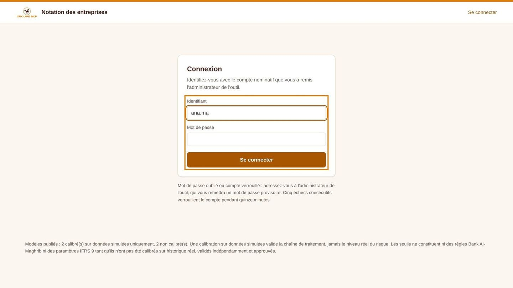

**EF-AUTH-01 — Connexion.** Identifiant et mot de passe. Comptes nominatifs uniquement ; les clés API sont réservées aux échanges entre systèmes.

| Élément | Règle |
|---|---|
| Identifiant | 3 à 64 caractères (minuscules, chiffres, point, tiret, tiret bas) |
| Mot de passe | 12 caractères au moins ; stocké haché (scrypt), jamais en clair |
| Verrouillage | 5 échecs consécutifs : compte verrouillé 15 minutes ; message identique que l'identifiant existe ou non |
| Mot de passe provisoire | Imposé à la création et à la réinitialisation ; changement obligatoire à la première connexion |
| Session | Jeton aléatoire en cookie sécurisé (HttpOnly, Secure, SameSite) ; expiration ; fermeture de toutes les sessions au changement de mot de passe, de rôle ou de rattachement |

**EF-AUTH-02 — Changer son mot de passe.** Ancien mot de passe, nouveau mot de passe et confirmation ; le nouveau diffère de l'ancien.

**CA :** connexion, déconnexion, verrouillage après cinq échecs, changement imposé du mot de passe provisoire, journalisation de chaque événement (LOGIN_SUCCEEDED, LOGIN_FAILED, LOGOUT, PASSWORD_CHANGED).

### 4.2 Tableau de bord et navigation

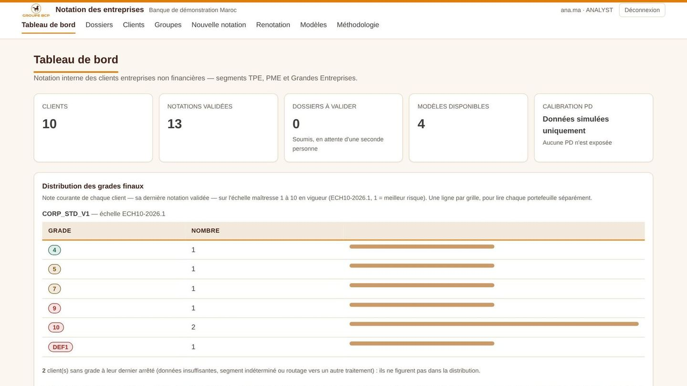

**EF-DASH-01 — Tableau de bord.** Compteurs du périmètre : clients, notations validées, dossiers en validation, modèles disponibles, statut de calibration des probabilités de défaut. Distribution des notes finales (dernière note validée de chaque client), une ligne par grille. Dernières notations, avec client, date d'arrêté, segment, score, note et résultat.

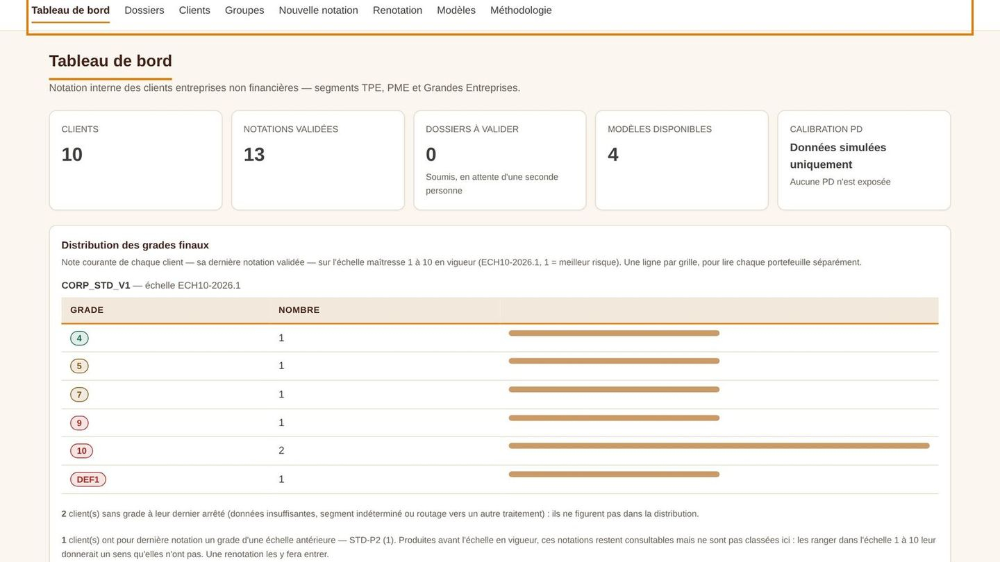

**EF-NAV-01 — Menu.** Tableau de bord, Dossiers, Clients, Groupes, Nouvelle notation, Renotation, Modèles, Méthodologie ; Administration pour les administrateurs. Le nom de l'entité et le rôle de l'utilisateur sont affichés. Le logo et le nom de l'outil suivent l'habillage de l'entité (EF-ADM-03).

### 4.3 Clients

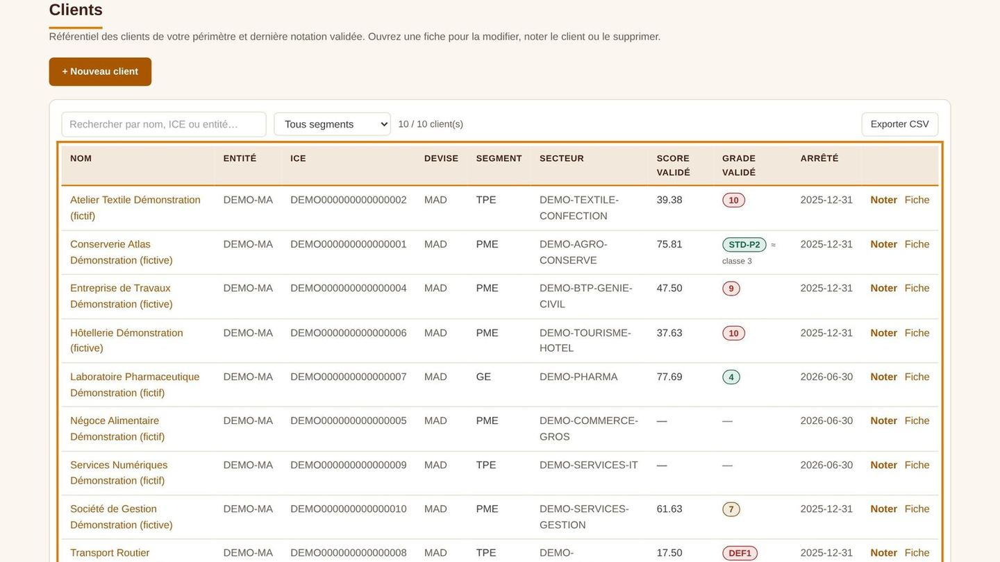

**EF-CLI-01 — Liste des clients.** Recherche par nom, ICE ou entité ; filtre par segment ; filtre « afficher les désactivés » ; export CSV.

| Colonne | Contenu |
|---|---|
| Nom | Lien vers la fiche |
| Entité | Code de la banque ou filiale |
| ICE, devise, segment, secteur | Référentiel client |
| Score validé, grade validé | Dernière notation officielle ; une note antérieure à l'échelle 1 à 10 est suivie de sa classe équivalente |
| Arrêté | Date d'arrêté de la note officielle |
| Actions | « Noter » (ouvre la fiche sur le formulaire de notation), « Fiche » |

La mention « dossier en cours » ou « dossier en validation » signale une notation en préparation.

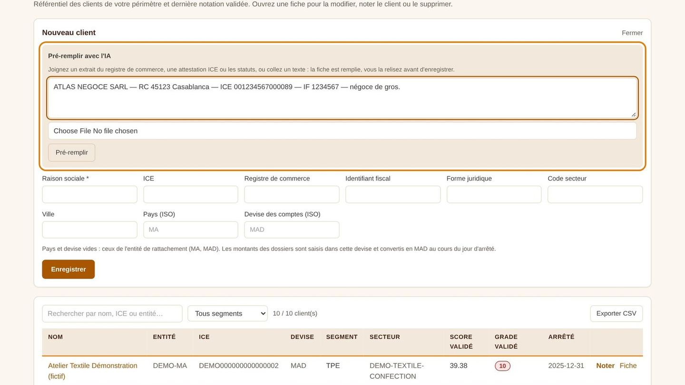

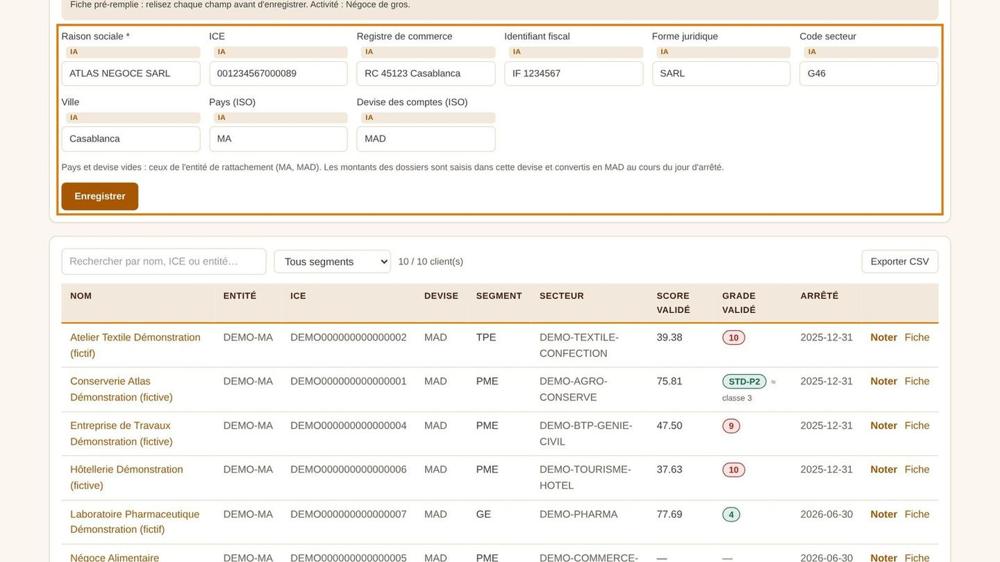

**EF-CLI-02 — Création d'un client.** Par saisie, ou à partir de documents (Kbis, statuts, attestation ICE, liasse) lus par l'OCR intelligent, qui pré-remplit la fiche ; l'analyste relit et enregistre.

| Champ | Type | Obligatoire | Règle |
|---|---|---|---|
| Raison sociale | Texte | Oui | 2 à 200 caractères |
| Entité de rattachement | Liste | Oui | Entités de la portée d'écriture de l'utilisateur |
| ICE | Texte | Recommandé | 15 chiffres ; unique par entité |
| Registre de commerce, identifiant fiscal | Texte | Non | |
| Forme juridique | Liste | Non | SA, SARL, SARL AU, SNC, entreprise individuelle… |
| Code secteur | Liste | Oui | Référentiel sectoriel interne |
| Ville, pays | Texte, ISO 3166 | Non | Pays par défaut : pays de l'entité |
| Devise des comptes | Liste ISO 4217 | Oui | Par défaut : devise de l'entité |
| Date de création | Date | Recommandé | Nécessaire au critère d'ancienneté et aux règles BAM (lot A) |
| Groupe d'affaires | Liste | Non | EF-GRP-01 |

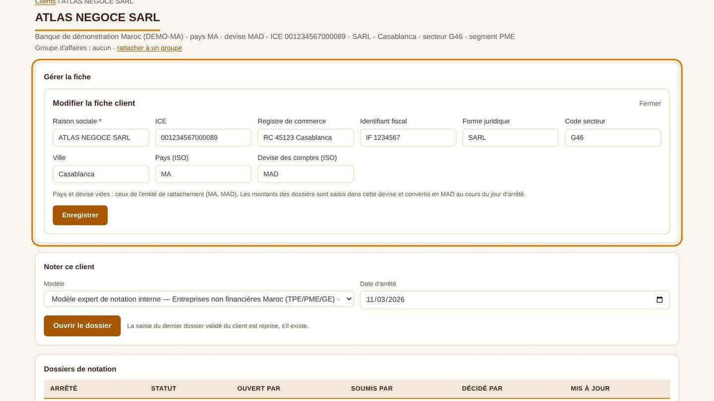

**EF-CLI-03 — Fiche client.** Identité, groupe d'affaires, historique des notations (date d'arrêté, segment, score, grade moteur, grade final, résultat, demandeur), formulaire « Noter ce client ».

**EF-CLI-04 — Modifier, supprimer, désactiver.** Modification de l'identité (journalisée avec l'avant et l'après). Suppression réservée au gestionnaire des risques : définitive pour un client sans notation ; un client noté est désactivé, son historique conservé. Un client désactivé n'apparaît plus dans les listes de notation ni dans les lots ; il se réactive depuis sa fiche.

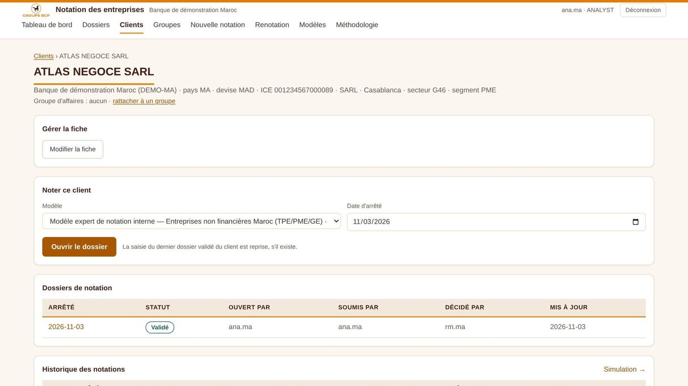

**CA :** unicité de l'ICE par entité ; refus de créer un client dans une entité hors portée ; un client noté ne se supprime pas, il se désactive ; journalisation COUNTERPARTY_CREATED / UPDATED.

### 4.4 Groupes d'affaires

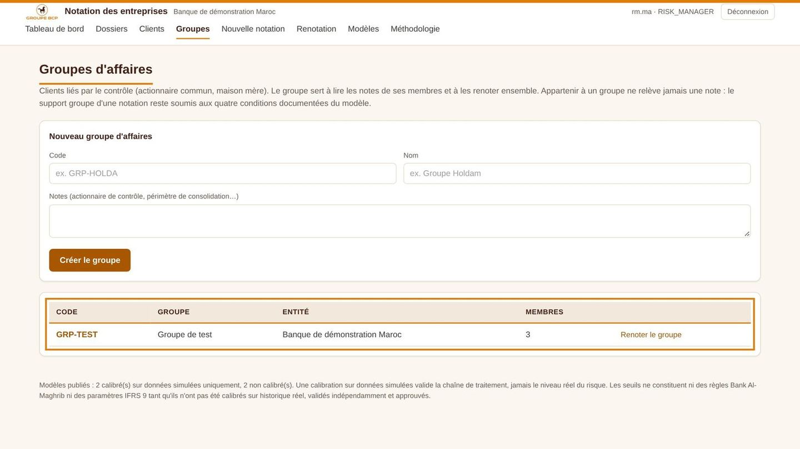

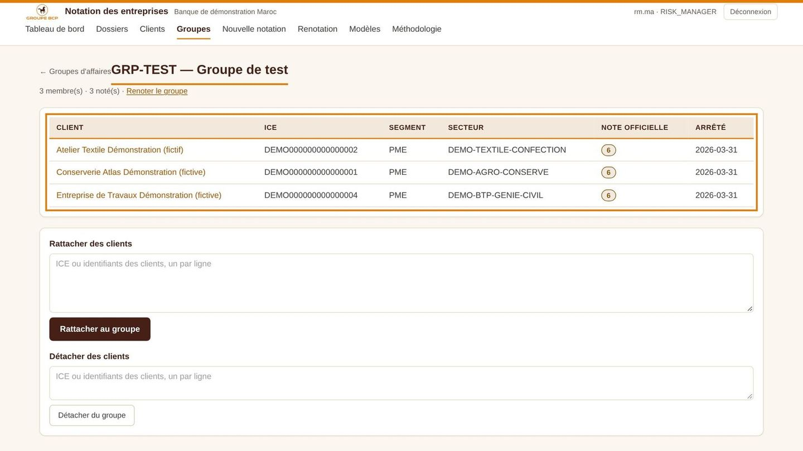

**EF-GRP-01 — Groupes d'affaires.** Code, libellé, entité porteuse. Rattachement et détachement de clients par liste d'ICE (un par ligne). Seuls les clients de l'entité du groupe et de sa descendance peuvent y être rattachés. La fiche liste les membres, leur note et les engagements ; elle sert à sélectionner une renotation par lot.

### 4.5 Ouvrir un dossier de notation

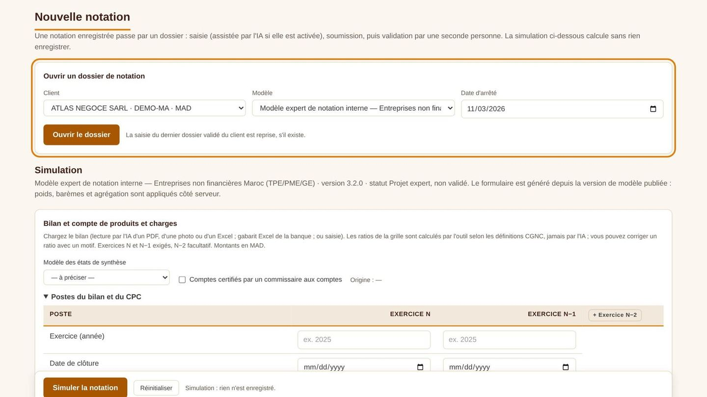

**EF-DOS-01 — Ouverture.** Choix du client, du modèle et de la date d'arrêté (par défaut : aujourd'hui).

| Règle | Détail |
|---|---|
| Un dossier en cours par client | Refus si un brouillon ou un dossier en validation existe déjà (message : « Un dossier est déjà en cours pour ce client ») |
| Reprise | La saisie du dernier dossier validé ou rejeté du client sur ce modèle est reprise, à mettre à jour |
| Client désactivé | Refus, avec invitation à le réactiver |
| Modèle | Grille standard (TPE, PME, GE avec comptes) ou TPE comportementale (sans comptes exploitables) ; les grilles challenger sont réservées au pilote |

**EF-DOS-02 — Espace de travail du dossier.** En-tête (client, entité, modèle et version, date d'arrêté, devise, auteur) ; sections : cadrage et montants, pièces, bilan, OCR intelligent, grille par domaine, barre d'actions collante (Enregistrer le brouillon, Aperçu du calcul, Soumettre à validation, Abandonner).

**EF-DOS-03 — Cadrage.** Segment (imposé ou calculé, RG-01), chiffre d'affaires HT et engagements bancaires globaux dans la devise du client, chiffre d'affaires du groupe le cas échéant, défaut avéré (case, avec motif). Les montants sont convertis en MAD au dernier cours publié à la date d'arrêté (RG-15) ; la conversion est affichée et consignée.

### 4.6 Pièces et OCR intelligent

**EF-OCR-01 — Pièces du dossier.** Formats PDF, PNG, JPEG, XLSX, CSV, TXT ; taille maximale paramétrable (4 Mo par défaut) ; plusieurs fichiers à la fois. Chaque pièce est conservée avec son empreinte SHA-256, son auteur et sa date ; elle ne se modifie pas.

**EF-OCR-02 — Section Bilan.** Bilan (actif, passif) et compte de produits et charges au format du plan comptable marocain (CGNC, modèle normal ou simplifié), exercices N et N−1 obligatoires, N−2 facultatif. Pour chaque exercice : année, date de clôture, modèle comptable, certification par un commissaire aux comptes, pièce source.

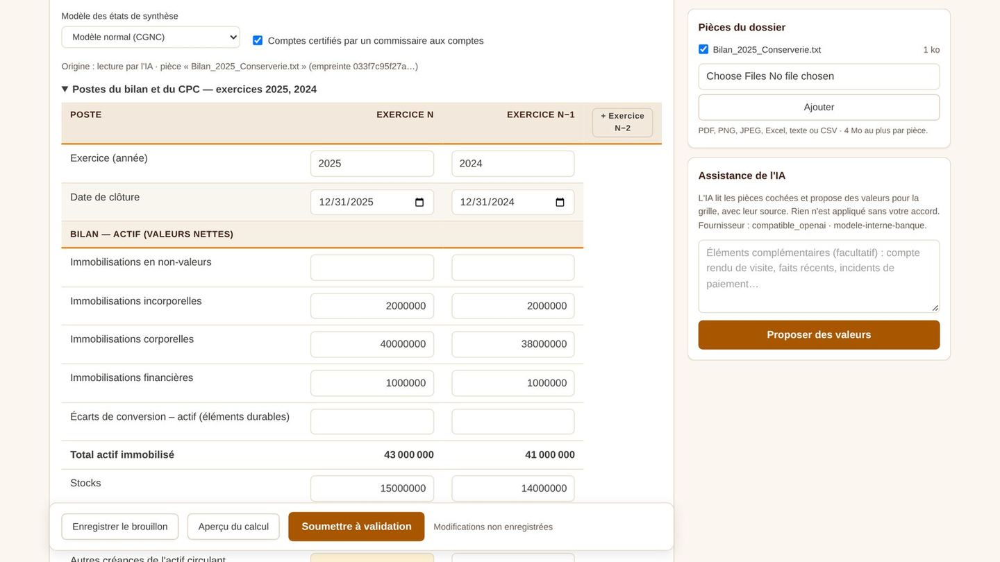

**EF-OCR-03 — Lecture par OCR intelligent.** L'analyste coche une ou plusieurs pièces et lance « Lire le bilan ». L'OCR intelligent reconnaît les postes (y compris sur une photo ou un scan), les associe aux rubriques CGNC et remplit les montants des exercices trouvés. Il indique les montants lus, les postes non trouvés et l'origine de chaque valeur (document, page). L'analyste relit et corrige chaque montant avant d'enregistrer.

**EF-OCR-04 — Gabarit Excel.** Alternative sans OCR : la banque fournit un gabarit Excel CGNC (téléchargeable depuis l'écran) ; une fois rempli, il est importé et reconnu par un marqueur ; un fichier quelconque est refusé.

**EF-OCR-05 — Contrôles du bilan.**

| Contrôle | Effet |
|---|---|
| Actif = passif (à l'unité près) | Bloquant à la soumission |
| Résultat net du bilan = résultat du CPC | Bloquant |
| Total de l'actif = total du document source | Bloquant |
| Exercices N et N−1 présents, dates de clôture ordonnées | Bloquant (grille standard, paramétrable) |
| Fraîcheur : clôture N de moins de 18 mois à la date d'arrêté | Alerte |
| Rubriques non trouvées par l'OCR intelligent | Alerte, à compléter |

**EF-OCR-06 — Ratios.** L'outil calcule les indicateurs (EBE, EBE retraité du crédit-bail, CAF, fonds de roulement, BFR, trésorerie nette, dette brute et nette économiques, fonds propres tangibles) et les ratios de la grille (RG-19). Pour chaque ratio : valeur calculée, valeur retenue, correction éventuelle et motif. Les ratios non notés (gearing, ROE, délais clients et fournisseurs, rotation des stocks…) sont calculés et affichés.

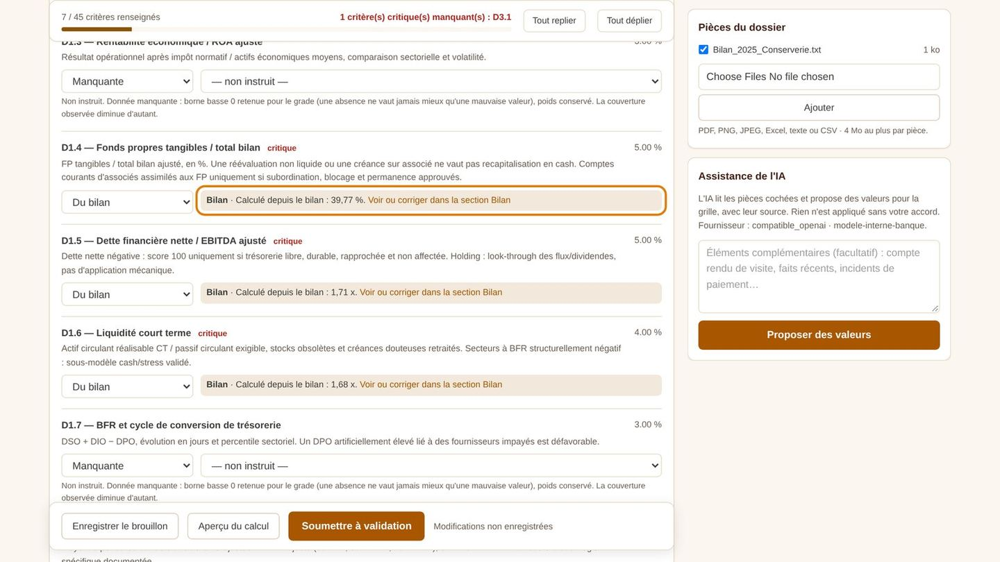

**EF-OCR-07 — Correction motivée.** L'analyste peut corriger un ratio de la grille, et lui seul, avec un motif obligatoire (10 caractères au moins). La valeur calculée et la valeur retenue restent visibles côte à côte, en particulier pour le valideur.

**EF-OCR-08 — Propositions pour la grille.** À partir des pièces et d'éléments complémentaires saisis par l'analyste (visite, carnet de commandes…), l'OCR intelligent propose des valeurs pour les critères de la grille : valeur, source (pièce, page), justification, degré de confiance. Chaque proposition s'accepte ou se refuse ; « Accepter celles ≥ 80 % » accepte en une fois les propositions les plus sûres. Une proposition hors grille ou invalide est écartée et comptée.

**EF-OCR-09 — Règles de l'OCR intelligent.**

| Règle | Détail |
|---|---|
| Libellé | L'interface emploie « OCR intelligent » (lecture des documents, propositions) ; les maquettes montrent encore « IA » |
| Désactivé par défaut | Activation par l'administrateur du groupe ; fournisseur, modèle et adresse paramétrables ; possibilité d'un moteur hébergé par la banque |
| Secret | La clé d'accès au service reste dans la configuration du serveur, jamais en base ni à l'écran |
| Décision humaine | Rien n'est appliqué sans décision de l'analyste ; chaque décision est journalisée (AI_PROPOSAL_DECIDED) |
| Séparation des fonctions | Accepter ou refuser une proposition fait de l'utilisateur un contributeur du dossier (RG-13) |
| Sécurité du contenu | Le contenu des pièces est traité comme une donnée : aucune instruction qu'il contiendrait n'est exécutée |
| Données personnelles | Envoi des pièces au service conforme à la loi 09-08 et à la politique d'externalisation ; journal des envois |

**CA :** lecture d'un bilan de démonstration (PDF et photo) avec 95 % des postes reconnus ; import du gabarit ; refus d'un fichier quelconque ; contrôles bloquants ; correction motivée visible du valideur ; aucune proposition appliquée sans décision.

### 4.7 La grille

**EF-GRI-01 — Critères.** La grille est présentée par domaine (D1 à D7 pour la grille standard, B1 à B7 pour la grille TPE comportementale), avec le poids de chaque critère pour le segment. Un critère chiffré prend la valeur calculée ou saisie et se note par barème ; un critère qualitatif se note en choisissant l'un des cinq repères écrits (100, 75, 50, 25, 0). Le libellé complet du repère est affiché.

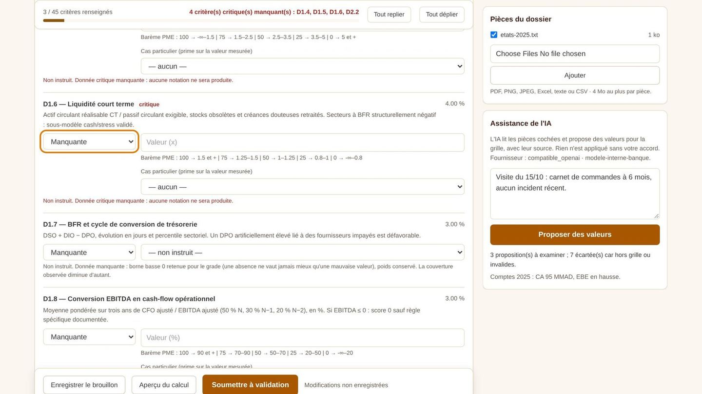

**EF-GRI-02 — Statut d'une donnée.** Disponible, estimée, manquante, invalide, périmée, non applicable (RG-02). Le statut s'affiche avec son effet sur le score et la couverture.

**EF-GRI-03 — Enregistrement.** Enregistrement à tout moment, sans contrôle bloquant ; un message confirme l'enregistrement ; une modification non enregistrée est signalée avant de quitter la page. Saisie limitée à 400 Ko.

### 4.8 Aperçu du calcul

**EF-APE-01 — Aperçu.** Même calcul que la soumission, sans enregistrement : score brut, classe de 1 à 10, grade moteur et grade final, classe et score de confiance, couverture observée, contributions par domaine et par critère, plafonds appliqués, signaux d'alerte, données manquantes. Probabilité de défaut affichée seulement si une calibration validée sur défauts observés existe ; sinon « non exposée ». Impression ou export PDF.

**EF-APE-02 — Dossier sans grade.** Si le calcul ne produit pas de grade (donnée critique manquante, couverture insuffisante, routage), la soumission est refusée avec la liste exacte des éléments à compléter.

### 4.9 Soumission et circuit de validation

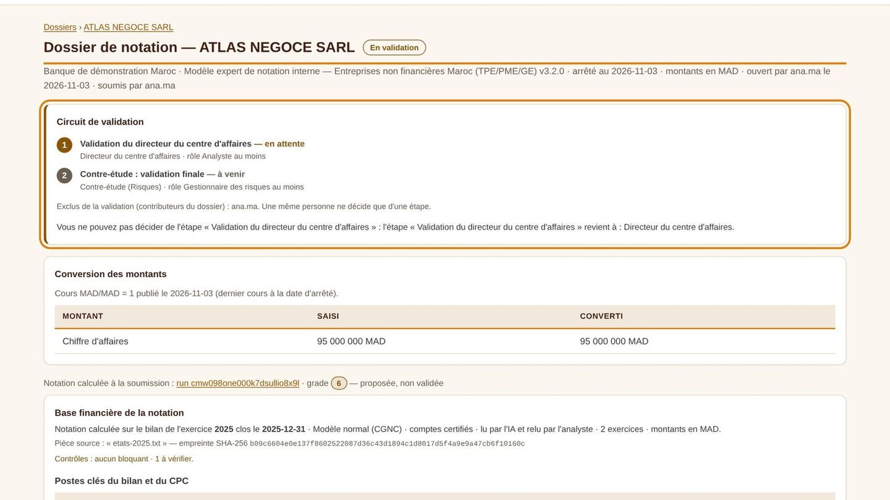

**EF-VAL-01 — Soumission.** Contrôles : statut brouillon ; fonction autorisée à soumettre (si paramétrée) ; bilan conforme (grille standard) ; grade produit. Le serveur recalcule la notation à partir du brouillon enregistré, l'enregistre de façon immuable (entrées, résultat, versions du modèle, du moteur, des paramètres et de l'échelle) et fige le circuit applicable au dossier (étapes, fonctions, rôles, en fonction de l'exposition).

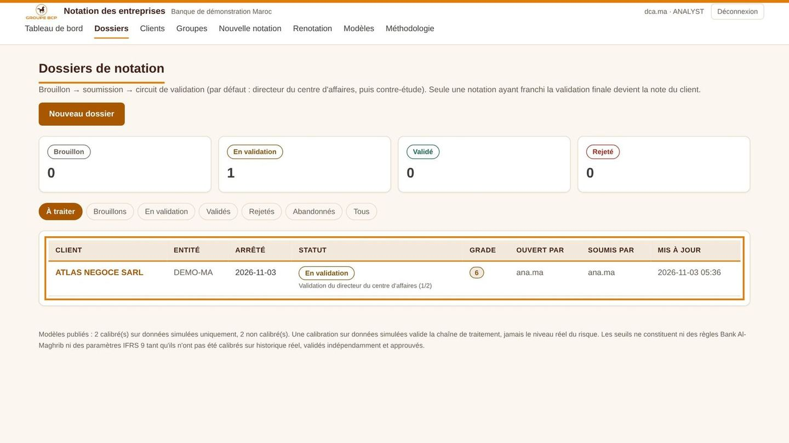

**EF-VAL-02 — File « À traiter ».** Chacun y trouve ses brouillons et dossiers rejetés à reprendre, et les dossiers dont l'étape en attente lui revient (fonction et rôle). Sous le statut, l'étape en attente et son rang (« Validation du directeur du centre d'affaires (1/2) »). La file liste aussi les notes à renouveler (dernière note validée plus ancienne que la durée de validité).

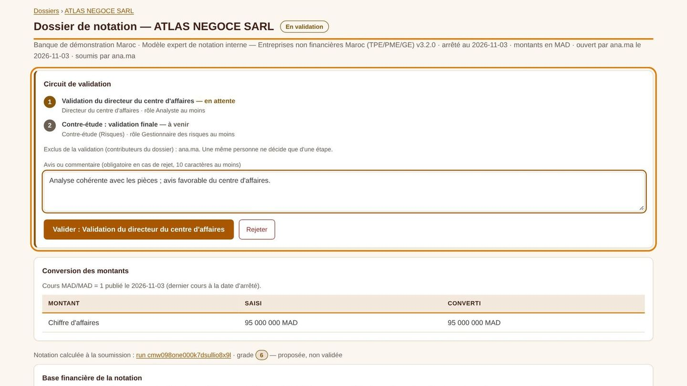

**EF-VAL-03 — Décision sur une étape.** Le panneau « Circuit de validation » affiche chaque étape (libellé, fonction, rôle minimal, état : validée, en attente, à venir, rejet), les décisions prises (par qui, quand, avis) et les contributeurs exclus. Le décideur saisit un avis (obligatoire pour un rejet, 10 caractères au moins) et clique sur « Valider : [étape] » ou « Rejeter ».

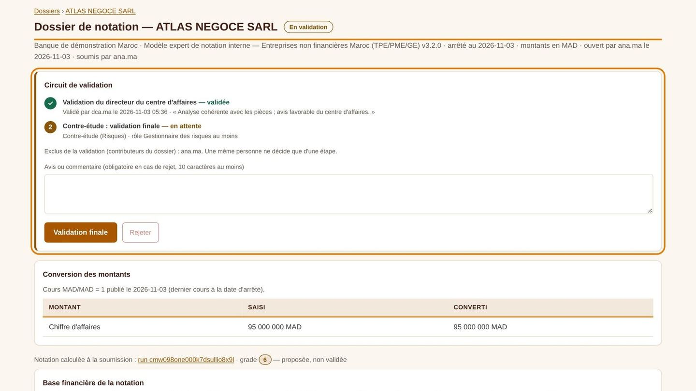

**EF-VAL-04 — Validation finale.** À la dernière étape, le bouton devient « Validation finale » : la notation devient la note officielle du client.

**Règles du circuit.**

| Règle | Détail |
|---|---|
| RG-13 Séparation des fonctions | Un contributeur du dossier (création, enregistrements, pièces, décisions sur les propositions de l'OCR intelligent, soumission) ne décide d'aucune étape ; un dossier repris hérite des contributeurs du dossier rejeté |
| Une personne, une étape | Une même personne ne décide que d'une étape d'un dossier |
| Fonction et rôle | Le décideur détient une fonction habilitée de l'étape (si l'étape en désigne) et au moins son rôle minimal |
| Seuil d'exposition | Une étape conditionnée par un seuil s'ajoute si l'exposition le dépasse ; une exposition inconnue applique toutes les étapes |
| RG-14 Délégation | Au-delà du seuil de délégation, la dernière étape exige au moins le rôle paramétré |
| Circuit figé | Un dossier garde le circuit de sa soumission ; une modification du paramétrage s'applique aux dossiers soumis ensuite |
| Rejet | À n'importe quelle étape ; motif obligatoire ; dossier clos, repris en un nouveau brouillon |
| Concurrence | Deux décideurs simultanés d'une même étape : le second reçoit « Dossier déjà décidé à cette étape » |
| Canaux | Mêmes règles à l'écran et par l'API ; une clé API ne porte pas de fonction et ne décide que des étapes ouvertes à toute fonction |

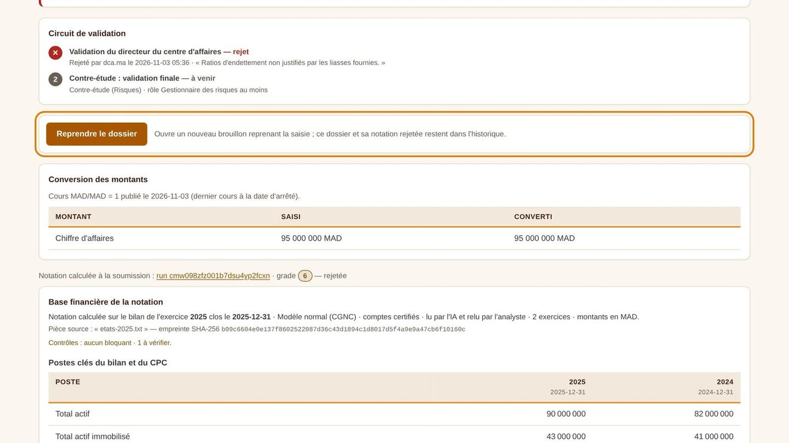

**EF-VAL-05 — Reprise.** « Reprendre le dossier » ouvre un nouveau brouillon reprenant la saisie ; le dossier rejeté et sa notation restent dans l'historique et ne deviennent jamais la note officielle.

**CA :** directeur puis contre-étude ; contre-étude refusée avant le directeur ; contributeur refusé ; même personne refusée à l'étape 2 ; rejet à l'étape 1 ; seuil d'exposition ; délégation ; circuit modifié sans effet sur un dossier en cours ; décisions simultanées ; mêmes résultats écran et API.

### 4.10 Résultat et fiche de notation

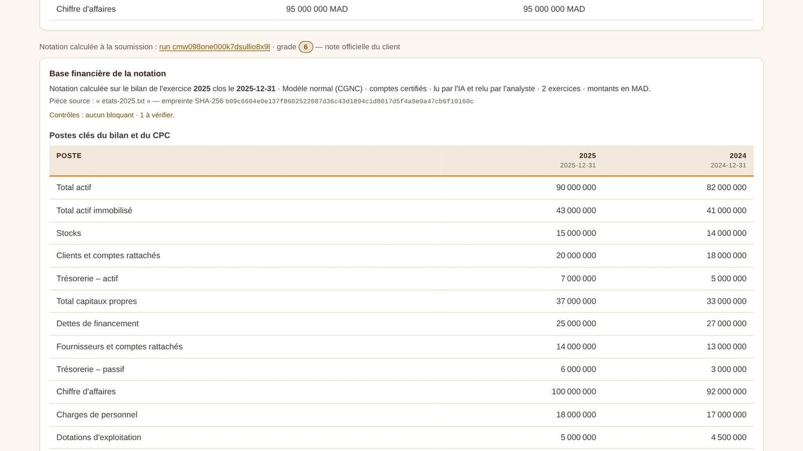

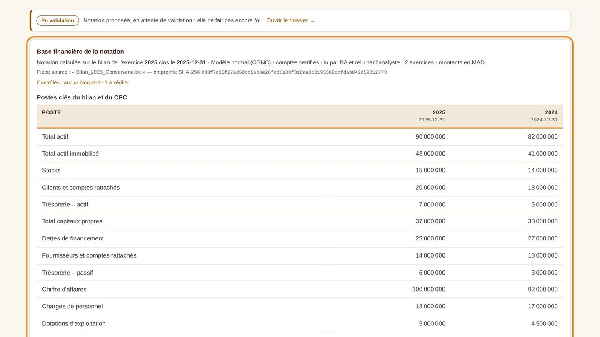

**EF-RES-01 — Fiche de notation.** Client, date d'arrêté, modèle et versions ; statut (validée, en validation, rejetée) ; score brut, grade moteur, grade après plafonds, grade final ; confiance et couverture ; contributions ; plafonds et signaux ; base financière (exercice, clôture, modèle comptable, certification, pièce source et empreinte, contrôles, postes clés du bilan et du CPC, tous les ratios, corrections et motifs) ; circuit de validation ; dérogations. Export PDF.

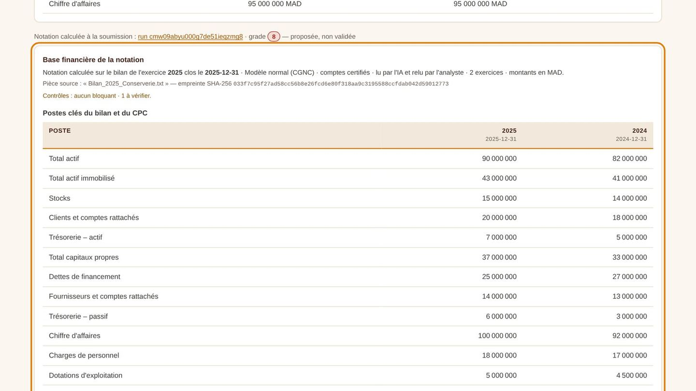

**EF-RES-02 — Note officielle.** Seule une notation validée est la note du client (RG-16) ; elle remplace la précédente dans la liste, la fiche client et le tableau de bord.

### 4.11 Dérogations

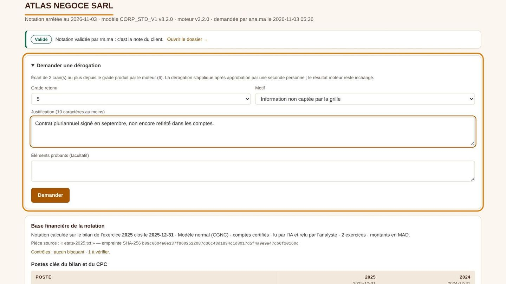

**EF-DER-01 — Demande.** Sur une notation validée, un gestionnaire des risques demande une dérogation : grade retenu, motif codifié, commentaire (10 caractères au moins), pièce justificative, date d'expiration facultative.

| Motifs codifiés | |
|---|---|
| Donnée non captée par le modèle | Limite du modèle |
| Événement récent défavorable | Spécificité sectorielle |
| Événement récent favorable | Changement de management |
| Soutien du groupe | Choc temporaire |
| Exception de politique | |

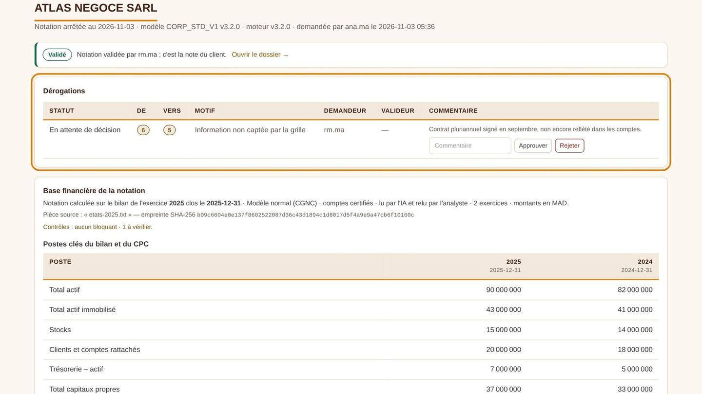

**EF-DER-02 — Décision.** Une seconde personne (gestionnaire des risques, distincte du demandeur) approuve ou rejette. Règles : écart de 2 crans au plus (paramétrable), mesuré sur l'échelle de la notation ; ni vers ni depuis un grade de défaut ; une seule dérogation en attente par notation ; le résultat du moteur n'est jamais réécrit ; une dérogation expirée cesse de s'appliquer ; une dérogation ne s'applique qu'à partir de sa date de décision.

### 4.12 Liste des dossiers

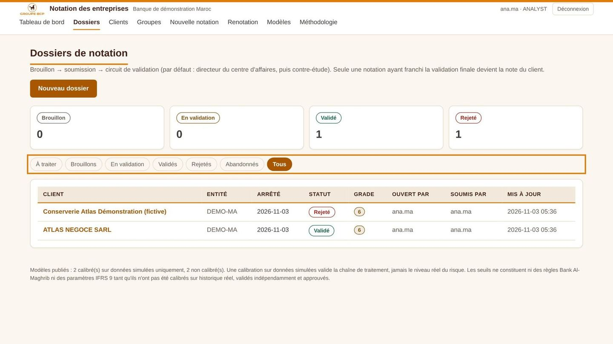

**EF-DOS-04 — Liste.** Onglets : À traiter, Brouillons, En validation, Validés, Rejetés, Abandonnés, Tous ; compteurs par statut. Colonnes : client, entité, arrêté, statut et étape en attente, grade, ouvert par, soumis par, mise à jour.

### 4.13 Renotation par lot

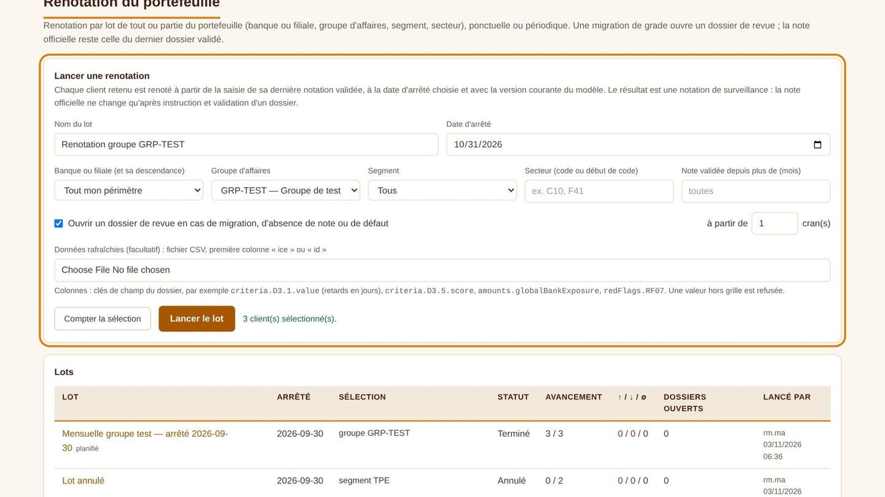

**EF-REN-01 — Lancer un lot.** Sélection : banque ou filiale (et sa descendance), groupe d'affaires, segment, secteur (préfixe de code), note validée depuis plus de N mois. Paramètres : nom du lot, date d'arrêté, ouverture d'un dossier de revue à partir de N crans de migration, en cas d'absence de note ou de défaut. Données rafraîchies facultatives : fichier CSV (première colonne ICE ou identifiant ; colonnes = clés de champs du dossier). « Compter la sélection » donne le nombre de clients avant lancement.

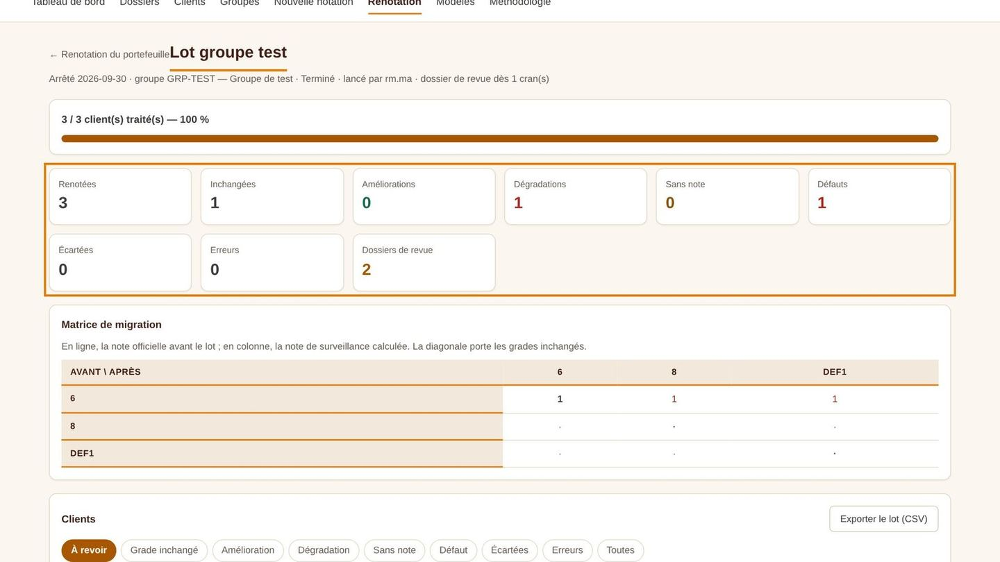

**EF-REN-02 — Suivi.** Avancement (traités / total), compteurs (inchangés, améliorations, dégradations, sans note, défauts, écartés, erreurs, dossiers de revue), matrice de migration (note officielle en ligne, note de surveillance en colonne), détail par client, export CSV. Le traitement se fait par tranches et reprend après interruption.

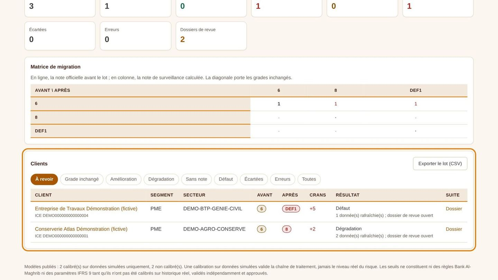

**EF-REN-03 — Planification.** Nom, fréquence (mensuelle, trimestrielle, semestrielle, annuelle), jour d'exécution, mêmes critères de sélection ; activation et désactivation. Le lot est créé automatiquement à l'échéance (date d'arrêté : fin du mois précédent) et traité par la tâche planifiée du serveur.

**EF-REN-04 — Règles.** Chaque client est renoté à partir de son dernier dossier validé, avec les données rafraîchies et la nouvelle date d'arrêté. La notation de lot est une surveillance : elle ne devient jamais la note officielle. Un dossier de revue pré-rempli s'ouvre pour chaque migration significative, absence de note ou défaut, et suit le circuit normal. Un client sans dossier validé réutilisable est écarté avec son motif ; une valeur du fichier hors grille est refusée.

### 4.14 Simulation et modèles

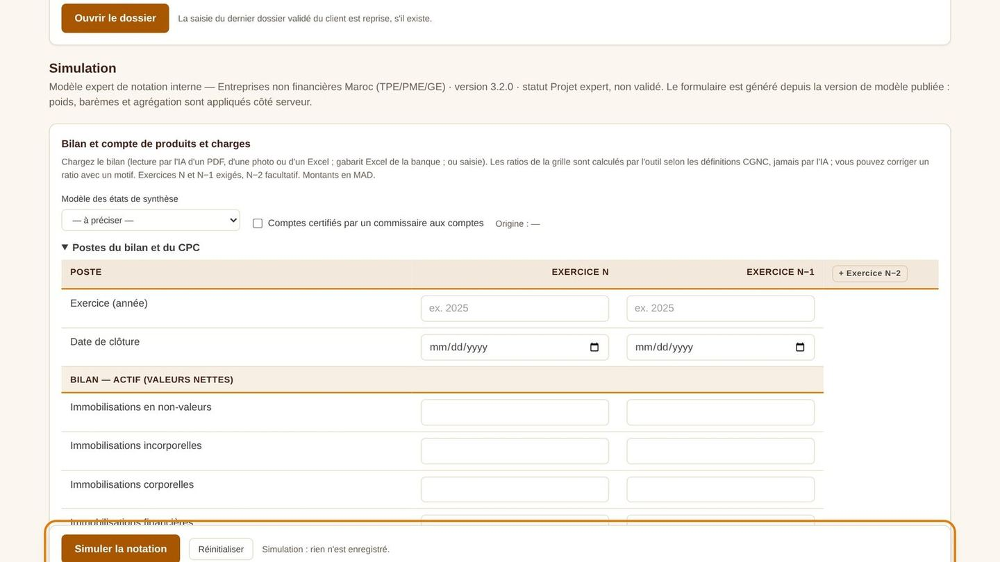

**EF-SIM-01 — Simulation.** Calcul d'une notation sans client ni enregistrement, avec saisie du bilan et de la grille ; même moteur que les dossiers.

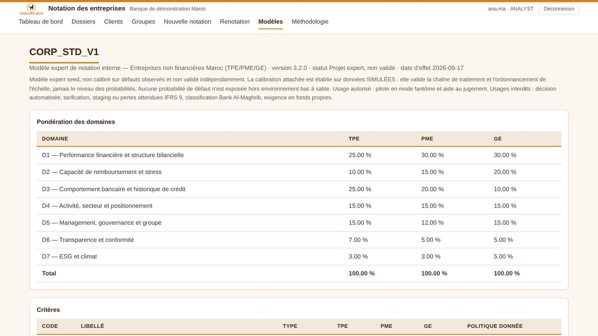

**EF-MOD-01 — Modèles.** Pour chaque grille : version effective (avec les paramètres en vigueur), statut, domaines et poids par segment, critères, barèmes et repères, données critiques, plafonds, signaux d'alerte, échelle, statut de calibration. Lecture seule.

### 4.15 Administration

**EF-ADM-01 — Vue d'ensemble.** Accès aux utilisateurs, banques et filiales, devises, paramétrage des grilles, échelle de notation, paramétrage (circuit, workflow, dérogations, pièces, OCR intelligent).

**EF-ADM-02 — Utilisateurs.** Création (identifiant, nom, rôle, entité, portée d'écriture, fonction) ; mot de passe provisoire affiché une seule fois ; modification du rôle, du rattachement et de la fonction ; réinitialisation du mot de passe ; désactivation et réactivation. Un administrateur ne modifie ni son propre rôle, ni son rattachement, ni sa fonction. Un administrateur d'entité ne gère que les comptes de sa branche et n'attribue pas le rôle Administrateur du groupe.

**EF-ADM-03 — Banques et filiales.** Arbre des entités : code, nom, entité parente, pays, devise ; habillage (nom de l'outil, logo, couleur, appliquée seulement si son contraste est suffisant) ; désactivation.

**EF-ADM-04 — Devises.** Cours datés vers le MAD (devise, date, cours, source) ; un cours publié ne se modifie pas, il se remplace par un cours plus récent ; une conversion sans cours à la date d'arrêté ou avant est refusée, jamais devinée.

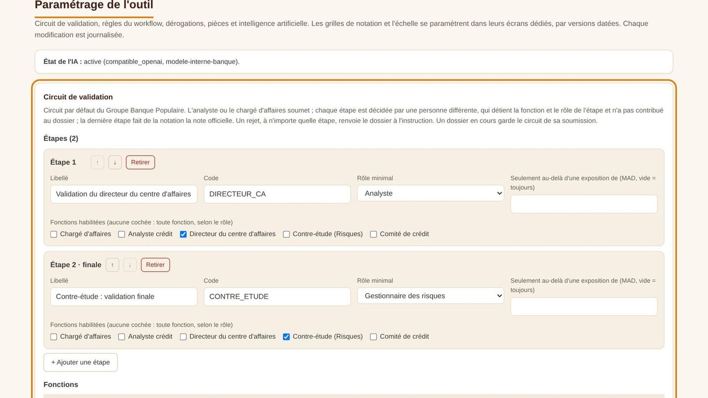

**EF-ADM-05 — Circuit de validation.** Étapes ordonnées (6 au plus) : libellé, code, fonctions habilitées, rôle minimal, seuil d'exposition facultatif ; ajout, retrait, réordonnancement. Fonctions : code, libellé, droit de soumettre, nombre de comptes actifs ; une fonction attribuée ne se supprime pas. Contrôles à l'enregistrement : au moins une étape, codes uniques, fonctions connues, pas de circuit dont toutes les étapes seraient conditionnées par un seuil. Réservé à l'administrateur du groupe ; journalisé avec l'ancien et le nouveau circuit.

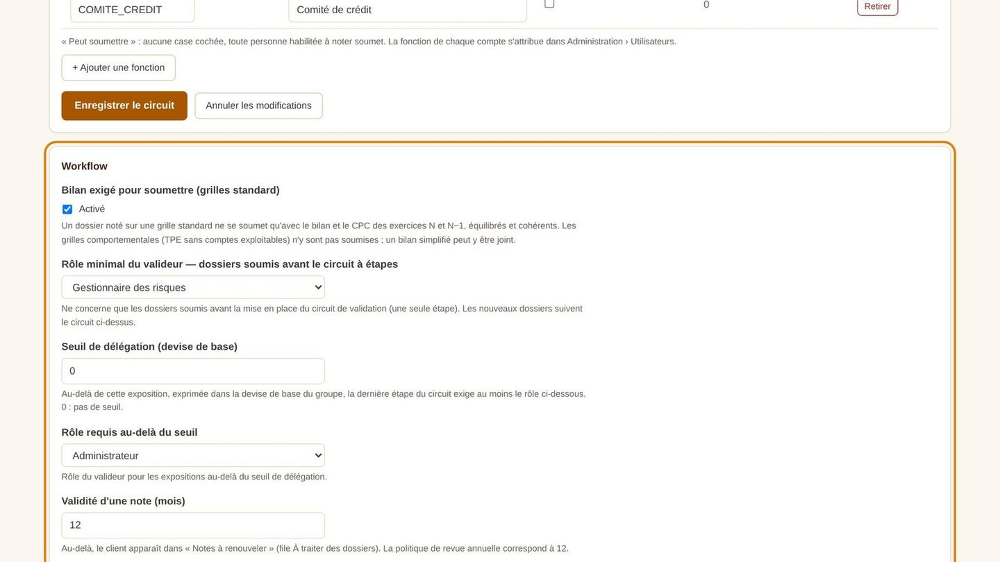

**EF-ADM-06 — Paramètres.** Voir le chapitre 8.

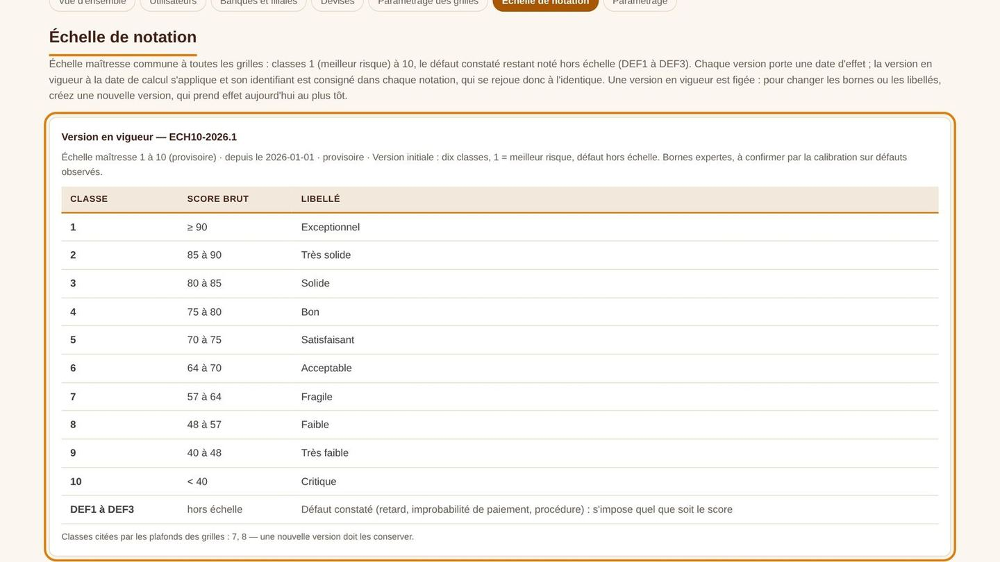

**EF-ADM-07 — Échelle de notation.** Versions datées (RG-20) : identifiant, date d'effet, bornes et libellés des classes, motif. Une version en vigueur est figée ; une version future se modifie ou se retire.

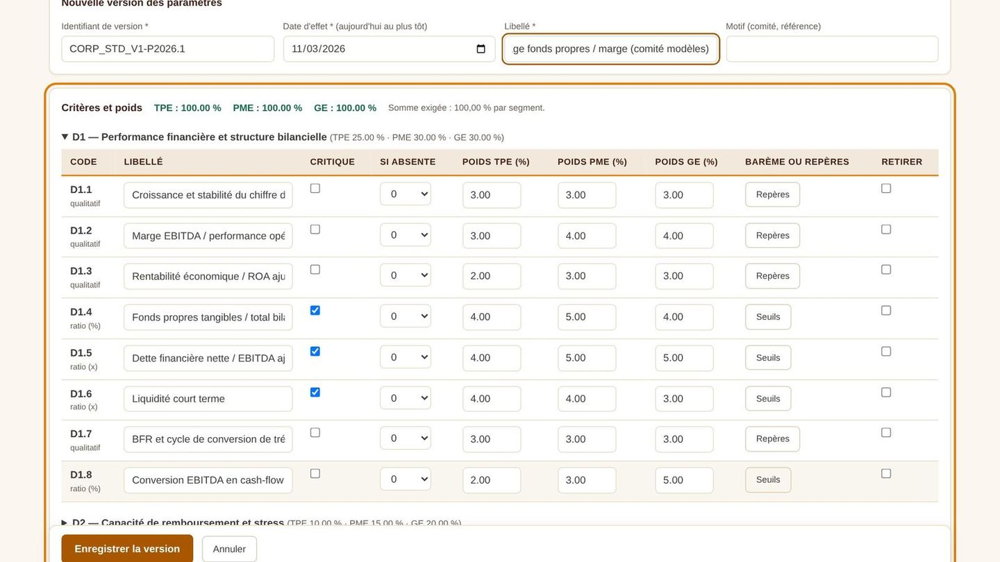

**EF-ADM-08 — Paramétrage des grilles.** Versions datées des paramètres de chaque grille : poids par segment (total affiché, 100 % exigé), seuils des barèmes à cinq paliers, repères qualitatifs, libellé, caractère critique, score d'une donnée absente, ajout et retrait de critères, classe plafond et seuil des exceptions, seuils des revues obligatoires, couverture minimale, poids et classes de confiance, crans maximaux de soutien. Contrôles du démarrage à l'enregistrement (concentration d'un critère, barèmes exhaustifs, plafonds présents dans l'échelle, critère référencé par une exception non retirable). La version appliquée est consignée dans chaque notation.

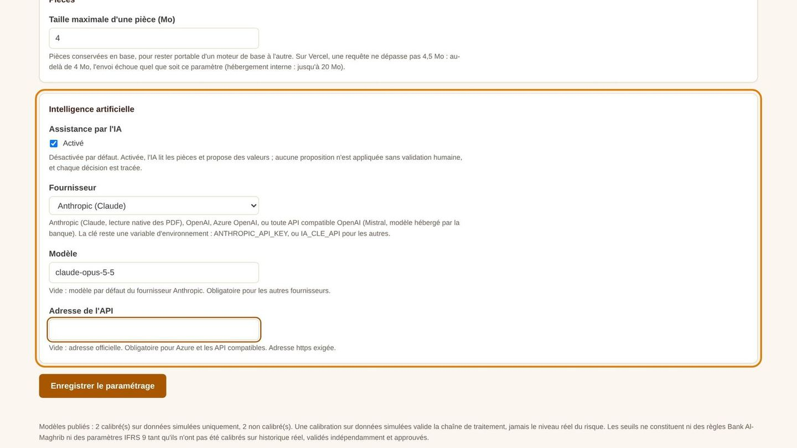

**EF-ADM-09 — OCR intelligent.** Activation, fournisseur, modèle, adresse du service (https obligatoire) ; état affiché (actif, désactivé, configuration incomplète).

### 4.16 Usage sur téléphone

**ENF-MOB-01.** Tous les écrans s'utilisent sur téléphone et tablette (largeur 390 pixels) sans défilement horizontal de la page ; les tableaux larges défilent dans leur cadre.

## 5. Moteur de notation

### 5.1 Règles de gestion

| Règle | Détail |
|---|---|
| RG-01 Segmentation | Le segment (TPE, PME, GE) est imposé par l'analyste ou calculé à partir du chiffre d'affaires et de l'exposition, convertis en MAD. Seuils provisoires : TPE jusqu'à 10 M MAD, GE au-delà de 175 M MAD ; à confirmer. |
| RG-02 Statut d'une donnée | Disponible (observée) ; estimée (comptée dans le score, pas dans la couverture) ; manquante, invalide ou périmée (score 0, poids conservé ; le score haut possible est affiché à côté) ; non applicable (seulement si le modèle le prévoit, poids transféré au critère receveur). |
| RG-03 Données critiques | Grille standard : fonds propres tangibles / bilan, dette nette / EBE, liquidité court terme, DSCR, retards de paiement. Si l'une manque, aucune note (sauf défaut constaté). |
| RG-04 Score d'un critère | Chiffré : barème à cinq paliers (100, 75, 50, 25, 0) propre au segment, bornes sans chevauchement. Qualitatif : repère écrit choisi. Cas particulier déclaré : score imposé. |
| RG-05 Matérialité ESG | Un critère ESG non matériel est écarté ; son poids est transféré au critère receveur. |
| RG-06 Score brut | Moyenne pondérée des scores des critères, poids du segment, sur 100. |
| RG-07 Défaut | Un défaut constaté impose DEF1 (retard), DEF2 (improbabilité de paiement, restructuration en difficulté) ou DEF3 (procédure collective, contentieux), quel que soit le score. |
| RG-08 Porte de qualité | Au moins 60 % du poids sur des données observées, 30 % dans chaque domaine, confiance au moins C ; sinon aucun grade (le score est conservé pour la surveillance). |
| RG-09 Confiance | 35 % complétude + 20 % fraîcheur + 30 % fiabilité + 15 % provenance ; classes A (85+), B (70+), C (55+), U. Informative : ne modifie jamais le grade. |
| RG-10 Grade | Le score donne la classe selon l'échelle en vigueur (5.2) ; défaut hors échelle. |
| RG-11 Exceptions | Après le grade, sans modifier le score : DSCR < 1, incertitude sur la continuité, EBE négatif deux années sur trois → au mieux classe 8 ; dossier groupe incomplet → au mieux classe 7. La plus contraignante s'applique. |
| RG-12 Soutien du groupe | Note autonome conservée ; relèvement de 2 crans au plus, seulement si capacité, volonté, engagement juridique et transférabilité sont documentés. |
| RG-15 Devises | Montants convertis en MAD au dernier cours publié à la date d'arrêté ou avant ; conversion consignée. |
| RG-16 Note officielle | Seule une notation validée est la note du client. |
| RG-17 Signaux d'alerte | 18 signaux. Bloquants (identité, sanction, fraude, activité interdite) : statut conformité bloqué. Contrôle de défaut et alertes : revue de l'analyste. Jamais dilués dans la moyenne. |
| RG-18 Reproductibilité | Chaque notation enregistre entrées, résultat, versions du modèle, du moteur, des paramètres et de l'échelle ; elle se rejoue à l'identique. |
| RG-19 Ratios du bilan | Formules uniques : EBE retraité du crédit-bail, fonds propres tangibles, dette nette économique, flux d'exploitation, DSCR sur le principal à 12 mois. EBE retraité nul ou négatif, ou fonds propres tangibles négatifs : cas particulier défavorable imposé. |
| RG-20 Échelle paramétrable | Versions datées ; version en vigueur à la date de calcul ; version en vigueur figée ; bornes strictement décroissantes couvrant [0, 100] ; classes citées par les plafonds conservées. |
| RG-21 Paramètres des grilles | Versions datées, mêmes règles que l'échelle ; contrôles du démarrage à l'enregistrement. |

### 5.2 Échelle maîtresse (version ECH10-2026.1)

| Classe | Score minimal | Libellé |
|---|---|---|
| 1 | 90 | Exceptionnel |
| 2 | 85 | Très solide |
| 3 | 80 | Solide |
| 4 | 75 | Bon |
| 5 | 70 | Satisfaisant |
| 6 | 64 | Acceptable |
| 7 | 57 | Fragile |
| 8 | 48 | Faible |
| 9 | 40 | Très faible |
| 10 | 0 | Critique |
| DEF1 à DEF3 | — | Défaut constaté, hors échelle |

### 5.3 Grilles

| Grille | Usage | Domaines (poids PME) |
|---|---|---|
| CORP_STD_V1 | TPE avec comptes, PME, GE | D1 Performance financière et bilan (30 %), D2 Capacité de remboursement (15 %), D3 Comportement bancaire (20 %), D4 Activité et secteur (15 %), D5 Management et groupe (12 %), D6 Transparence et conformité (5 %), D7 ESG et climat (3 %) |
| CORP_TPE_BEHAV_V1 | TPE sans comptes exploitables | B1 Comportement du compte, B2 Capacité observée sur les flux, B3 Activité, B4 Dirigeant, B5 Documents et conformité, B6 Groupe, B7 ESG |
| Challengers | Pilote en double notation | Grilles resserrées (16 et 12 critères), sans effet sur la note officielle |

Le détail des critères, barèmes et repères figure dans la note méthodologique ; il est livré sous forme de configuration versionnée et validée au démarrage.

### 5.4 Cas de calcul de référence

Le moteur livré doit reproduire exactement les cas de référence du simulateur Excel (onglet « Cas exemples ») et des tests automatisés : mêmes scores bruts, mêmes classes, mêmes plafonds, pour chaque grille et chaque segment. Un écart, même d'un point de score, est une anomalie bloquante.

## 6. Données

### 6.1 Tables

| Table | Contenu | Clés et contraintes |
|---|---|---|
| entities | Banques et filiales, arbre, devise, pays, habillage | Code unique ; parent |
| users, user_sessions | Comptes, rôle, entité, portée, fonction, verrouillage ; sessions | Identifiant unique |
| counterparties | Clients : identité, entité, devise, secteur, segment, groupe, actif | ICE unique par entité |
| economic_groups | Groupes d'affaires | Code unique par entité |
| exchange_rates | Cours datés vers le MAD | (devise, date) unique |
| rating_cases | Dossiers : statut, saisie (JSON), conversion, circuit figé et décisions, auteurs | Un dossier en cours par client |
| case_documents | Pièces : nom, type, taille, empreinte, contenu | Lien dossier |
| ai_proposals | Propositions de l'OCR intelligent : champ, valeur, source, justification, confiance, décision | Lien dossier |
| rating_runs | Notations immuables : entrées, résultat, versions, origine (écran, API, lot) | Clé d'idempotence |
| overrides | Dérogations : grades, motif, preuve, demandeur, décideur, expiration | Une en attente par notation |
| renotation_batches, renotation_items, renotation_schedules | Lots, résultats par client, planifications | |
| app_settings | Paramétrage, versions de l'échelle et des grilles, circuit | Clé unique |
| audit_events | Journal : acteur, rôle, action, ressource, entité, détail, horodatage, corrélation | Ajout seul (pas de modification ni de suppression) |
| outbox_events, webhook_subscriptions, webhook_deliveries | Événements sortants et abonnements | |

### 6.2 Historisation et conservation

- Notations, dossiers, pièces, décisions et journal sont conservés au moins 10 ans (un cycle économique complet).
- Une notation ne se modifie jamais : une correction passe par un nouveau dossier.
- Une version d'échelle, de grille ou de circuit en vigueur n'est jamais modifiée ; les anciennes versions restent lisibles.

## 7. Interfaces

### 7.1 API REST (contrat OpenAPI fourni)

| Ressource | Méthodes | Usage |
|---|---|---|
| /health | GET | Supervision |
| /models, /models/{id} | GET | Grilles et versions |
| /counterparties, /counterparties/{id} | GET, POST, PATCH, DELETE | Référentiel clients |
| /counterparties/{id}/rating-runs | GET | Historique des notations |
| /rating-runs | GET, POST | Notation persistée ; crée un dossier en validation avec son circuit |
| /rating-runs/simulate, /rating-runs/compare | POST | Simulation, comparaison de grilles |
| /rating-runs/{id} | GET | Détail |
| /rating-cases, /rating-cases/{id}/decision | GET, POST | Dossiers, décision sur l'étape en attente |
| /overrides, /overrides/{id}/decision | POST | Dérogations |
| /renotation-batches, /{id}, /{id}/process | GET, POST | Lots |
| /renotation/cron | POST | Tâche planifiée (secret dédié) |
| /webhook-subscriptions, /{id} | GET, POST, DELETE | Abonnements |

Authentification par clé API (en-tête), rattachée à une entité et à un rôle ; clés stockées hachées ; idempotence par en-tête Idempotency-Key ; corrélation par X-Correlation-ID ; erreurs au format problem+json ; mêmes droits qu'à l'écran.

### 7.2 Événements sortants

rating.calculated, case.validated, case.rejected, override.decided, renotation.completed ; signés (HMAC), rejoués en cas d'échec, écrits dans la même transaction que l'opération métier (outbox). Les systèmes aval consomment exclusivement case.validated comme note officielle.

### 7.3 Intégrations cibles avec le SI de la banque

| Système | Flux | Usage |
|---|---|---|
| Référentiel clients (NACOM ou équivalent) | Lecture | Identité, secteur, forme juridique, date de création, date d'entrée en relation |
| Comptes courants | Lecture mensuelle | Mouvements créditeurs et débiteurs, soldes, utilisation des autorisations (comportement bancaire) |
| Créances en souffrance, impayés, échéanciers | Lecture quotidienne | Retards, défaut, déclenchement de renotation |
| SCIP, crédit bureau | Lecture | Incidents de paiement |
| Centrale des bilans | Lecture | Alimentation des états financiers |
| Annuaire d'entreprise (SSO) | Authentification | Connexion unique, si retenue |

## 8. Paramètres

| Paramètre | Défaut | Effet |
|---|---|---|
| Circuit de validation | Directeur du centre d'affaires, puis contre-étude | EF-ADM-05 |
| Bilan exigé pour soumettre (grilles standard) | Oui | EF-OCR-05 |
| Seuil de délégation (MAD) et rôle au-delà | 0 (aucun) ; Administrateur | RG-14 |
| Durée de validité d'une note (mois) | 12 | Notes à renouveler |
| Écart maximal d'une dérogation (crans) | 2 | EF-DER-02 |
| Taille maximale d'une pièce (Mo) | 4 | EF-OCR-01 |
| OCR intelligent : activation, fournisseur, modèle, adresse | Désactivé | EF-ADM-09 |
| Échelle de notation | ECH10-2026.1 | RG-20 |
| Paramètres des grilles | Grilles embarquées | RG-21 |

Tout changement est réservé à l'administrateur du groupe et journalisé avec la valeur précédente.

## 9. Journal d'audit

Chaque opération produit un événement : acteur, rôle, action, ressource, entité, détail, horodatage, identifiant de corrélation. Actions minimales :

| Domaine | Actions |
|---|---|
| Connexion | LOGIN_SUCCEEDED, LOGIN_FAILED, LOGOUT, PASSWORD_CHANGED |
| Comptes | USER_CREATED, USER_ROLE_CHANGED, USER_ENTITY_CHANGED, USER_FUNCTION_CHANGED, USER_PASSWORD_RESET |
| Référentiels | ENTITY_CREATED, ENTITY_UPDATED, COUNTERPARTY_CREATED, COUNTERPARTY_UPDATED, ECONOMIC_GROUP_CREATED, FX_RATE_CREATED |
| Dossier | CASE_CREATED, CASE_DRAFT_SAVED, CASE_DOCUMENT_ADDED, CASE_SUBMITTED, CASE_STEP_APPROVED, CASE_VALIDATED, CASE_REJECTED, CASE_REOPENED, CASE_CANCELLED |
| OCR intelligent | AI_FINANCIALS_EXTRACTED, AI_PROPOSALS_GENERATED, AI_PROPOSAL_DECIDED |
| Notation, dérogation | RATING_RUN_CREATED, OVERRIDE_REQUESTED, OVERRIDE_APPROVED, OVERRIDE_REJECTED, OVERRIDE_EXPIRED |
| Renotation | RENOTATION_BATCH_CREATED, RENOTATION_BATCH_DONE, RENOTATION_BATCH_CANCELLED, RENOTATION_SCHEDULE_CREATED |
| Paramétrage | SETTINGS_UPDATED, WORKFLOW_CIRCUIT_UPDATED, MODEL_PARAMS_CREATED, MODEL_PARAMS_UPDATED, MODEL_PARAMS_DELETED, échelle |

L'historique d'un dossier est affiché sur sa page. Le journal est en ajout seul et exporté vers un stockage indépendant.

## 10. Exigences non fonctionnelles

| Code | Exigence |
|---|---|
| ENF-01 Sécurité applicative | Contrôle des droits côté serveur sur chaque action et chaque route ; protection CSRF ; en-têtes de sécurité ; aucune donnée sensible dans les journaux applicatifs ; dépendances maintenues à jour et auditées |
| ENF-02 Cloisonnement | Filtrage par entité au niveau de l'accès aux données, pour l'écran, l'API et les traitements de lot ; tests d'accès croisés entre entités |
| ENF-03 Base de données | PostgreSQL (configuration livrée) ; Oracle possible avec adaptation de la couche d'accès ; comptes propriétaire, migration et applicatif séparés ; pas de DDL ni de TRUNCATE pour le compte applicatif |
| ENF-04 Transactions | Calcul, enregistrement, dossier, journal et événement sortant dans une même transaction ; idempotence ; gestion des décisions concurrentes |
| ENF-05 Performance | Écran affiché en moins de 2 secondes ; aperçu du calcul en moins de 1 seconde ; lecture d'un bilan par OCR intelligent en moins de 60 secondes ; lot de 1 000 clients en moins de 30 minutes |
| ENF-06 Disponibilité | Heures ouvrées ; sauvegarde quotidienne, restauration testée ; objectifs RPO et RTO à fixer par la banque |
| ENF-07 Accessibilité | WCAG 2.1 niveau AA (contrastes, clavier, libellés des champs, lecteurs d'écran) |
| ENF-08 Navigateurs | Versions récentes de Chrome, Edge, Firefox et Safari ; téléphone et tablette (ENF-MOB-01) |
| ENF-09 Langue | Interface en français ; montants et dates au format marocain |
| ENF-10 Charte | Charte du Groupe Banque Populaire ; habillage par entité |
| ENF-11 Exploitabilité | Journaux applicatifs structurés ; supervision (/health) ; migrations versionnées et réversibles ; environnements de développement, recette et production |
| ENF-12 Données personnelles | Conformité à la loi 09-08 ; minimisation des données envoyées à l'OCR intelligent ; hébergement conforme à la politique d'externalisation |

## 11. Recette

### 11.1 Scénarios de bout en bout

1. Création d'un client à partir de ses documents (OCR intelligent), relecture, enregistrement.
2. Ouverture d'un dossier ; ajout des pièces ; lecture du bilan par OCR intelligent ; contrôles ; correction motivée d'un ratio.
3. Propositions de l'OCR intelligent pour la grille ; acceptation et refus ; saisie des critères qualitatifs.
4. Aperçu ; tentative de soumission sans grade (refus motivé) ; complément ; soumission.
5. File « À traiter » du directeur du centre d'affaires ; validation de l'étape ; file de la contre-étude ; validation finale ; note officielle.
6. Rejet à l'étape 1, reprise du dossier, nouvelle soumission ; contributeurs hérités.
7. Contre-étude tentant de décider avant le directeur : refus ; contributeur tentant de valider : refus.
8. Dérogation demandée, approuvée par une seconde personne, expirée.
9. Dossier en devise étrangère : conversion au cours publié ; refus si aucun cours.
10. Renotation par lot d'un groupe d'affaires avec fichier rafraîchi ; matrice de migration ; dossiers de revue.
11. Modification du circuit, de l'échelle et d'une grille par versions datées ; absence d'effet sur les dossiers en cours et sur les notations antérieures.
12. Accès croisés entre deux filiales : données introuvables.
13. Mêmes opérations par l'API : mêmes résultats, mêmes refus.

### 11.2 Critères de réception

- Tous les scénarios passent sur l'environnement de recette, avec des données représentatives.
- Les cas de calcul de référence sont reproduits à l'identique (5.4).
- Aucune anomalie bloquante ou majeure ouverte ; tests automatisés fournis et exécutés en intégration continue.
- Audit d'accessibilité (AA) et test d'intrusion sans vulnérabilité élevée ouverte.

## 12. Lotissement proposé

| Lot | Contenu |
|---|---|
| Lot 1 — Socle | Comptes, entités, devises, clients, dossiers, bilan (saisie et gabarit Excel), grilles, moteur, aperçu, circuit de validation, fiche de notation, journal |
| Lot 2 — OCR intelligent et pilotage | Lecture des documents et propositions, dérogations, tableau de bord, groupes d'affaires, renotation par lot et planification, API et webhooks |
| Lot 3 — Paramétrage et intégrations | Paramétrage des grilles, de l'échelle et du circuit à l'écran ; intégrations au SI (référentiel clients, comptes, impayés, SCIP) ; règles Bank Al-Maghrib du lot A |

## 13. Points à arrêter par la banque

1. Seuils de segmentation TPE, PME, GE.
2. Définition du défaut, de la guérison et de la rechute (DEF1 à DEF3), alignée sur Bank Al-Maghrib.
3. Fonctions et attribution des étapes du circuit ; seuils d'un éventuel comité de crédit.
4. Fournisseur et hébergement de l'OCR intelligent ; types de pièces admis.
5. Flux du SI disponibles et leur fréquence.
6. Base de données cible (PostgreSQL ou Oracle) et environnement d'hébergement.
7. Objectifs de disponibilité, RPO et RTO.
