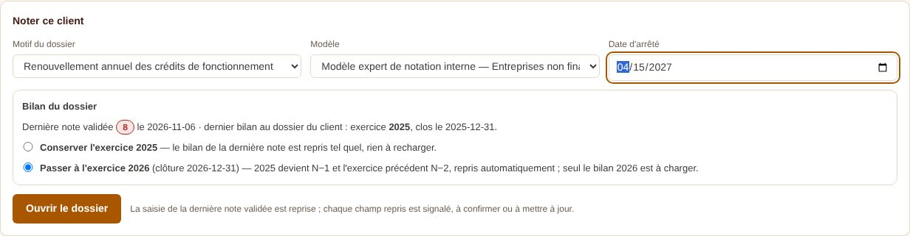
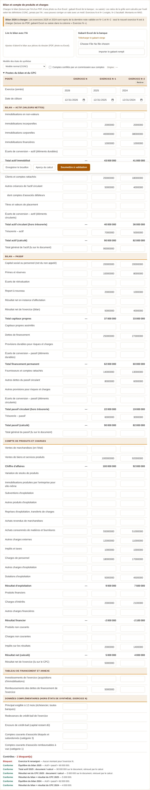
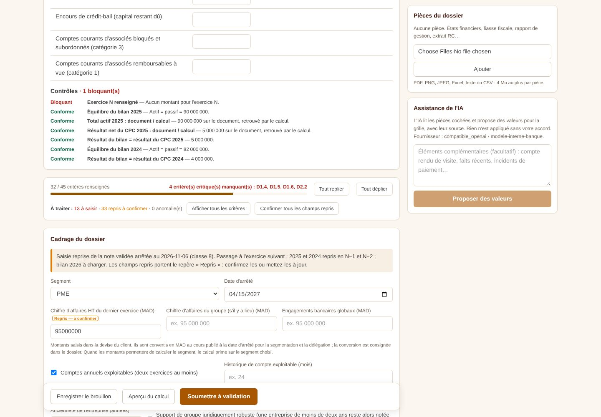
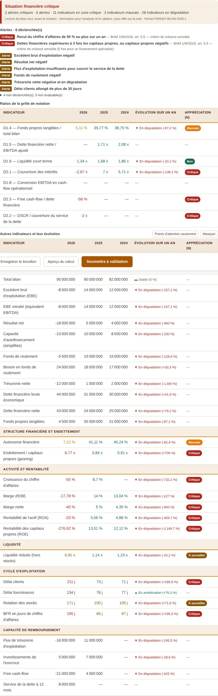
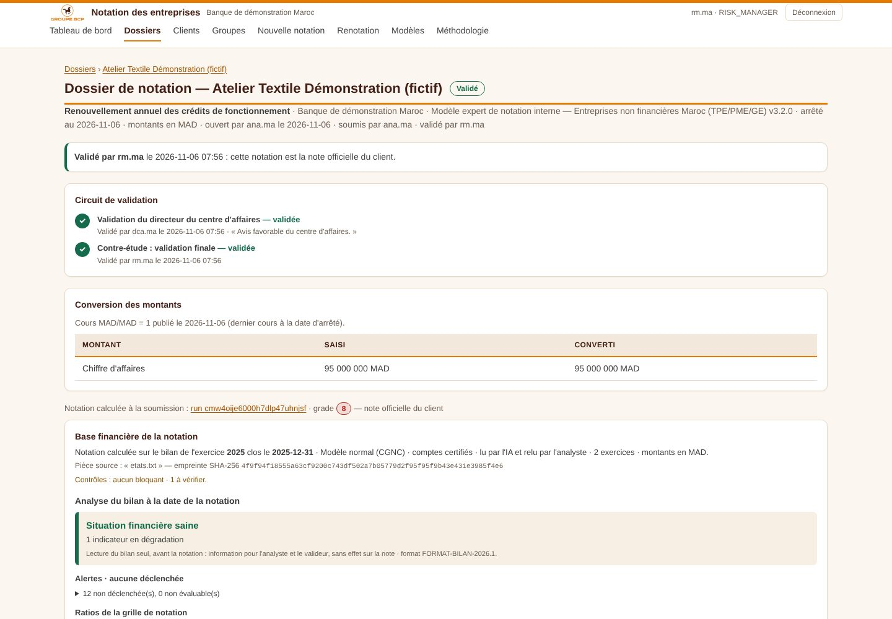

# Format du bilan, analyse au chargement et ouverture du dossier

*Point 1 de la demande du 6 novembre 2026. Décision D-56 (journal des décisions).*

## 1. Le parcours du chargé d'affaires

1. **Ouvrir le dossier** (Nouvelle notation, ou « Noter ce client » depuis la fiche) : client, **motif** (renouvellement annuel des crédits de fonctionnement, demande de crédit d'investissement, entrée en relation, révision, autre), modèle, date d'arrêté.
2. **Choisir l'exercice.** L'outil affiche la dernière note validée et le dernier bilan connu du client, puis propose :
   - *Conserver l'exercice* (ex. 2025) : le bilan de la dernière note est repris tel quel, rien à recharger ;
   - *Passer à l'exercice suivant* (ex. 2026) : 2025 devient N−1, 2024 devient N−2, repris automatiquement ; **seul le bilan 2026 est à charger**. S'il figure déjà au référentiel du client (reprise du stock), il est pré-rempli.

   L'exercice suivant est proposé par défaut dès que sa clôture est passée à la date d'arrêté (paramétrable par motif).
3. **Charger le nouveau bilan** : lecture du PDF par l'OCR intelligent, gabarit Excel de la banque, ou saisie.
4. **Lire l'analyse du bilan**, affichée dès le chargement, avant la notation (§ 3).
5. **Compléter la saisie** guidée par les repères (§ 4), puis soumettre au circuit de validation.

À la validation de la note, les bilans qui l'ont fondée entrent au **référentiel des bilans du client** : le prochain dossier en reprendra N−1 et N−2.

## 2. Le format du bilan (Administration › Format du bilan)

Le plan de postes CGNC de la banque reste la référence commune : les ratios de la grille s'y rattachent, selon les définitions du dictionnaire comptable. Le format décide de ce que l'on charge et de la façon dont on l'analyse.

| Élément | Paramétrage |
|---|---|
| Poste saisi | Chargé ou non chargé (n'est plus demandé : saisie, gabarit Excel, lecture du bilan) |
| Total | Calculé à partir du détail ; saisi directement tel qu'au bilan (détail facultatif, contrôlé s'il est renseigné) ; ou retiré |
| Postes propres à la banque | Code, libellé, section, exercice N seulement ou non |
| Indicateurs complémentaires | Définis par formule (ex. `STOCKS / TOTAL_ACTIF * 100`) |
| Appréciation de chaque indicateur | Sens (hausse ou baisse = mieux), seuils bon / mauvais / critique, variation significative sur un an ; indicateur affiché ou masqué |
| Alertes | Condition par formule, gravité (critique, alerte), référence |
| Synthèse | Seuils qui font passer la situation à « critique », « dégradée », « à surveiller » |

**Préréglages.** *Bilan complet* (format embarqué) ; *bilan agrégé* (grandes masses saisies directement) ; *notation seulement* (les postes lus par les ratios de la grille et par les alertes actives). Les deux derniers ne laissent jamais un total partiel : un total incomplet est saisi directement s'il est utile, retiré sinon.

**Garde-fous.** Les postes lus par chaque ratio sont relevés automatiquement. Si un poste n'est plus chargé, le ratio devient « non calculable » — jamais calculé sur des zéros — et l'écran le signale ; l'administrateur est averti avant d'enregistrer. Le gabarit Excel et la lecture par l'IA suivent le format en vigueur.

**Versions.** Chaque format est une version datée ; une version en vigueur est figée, une version future se modifie ou se retire. La version appliquée est consignée dans chaque notation.

**Langage des formules.** Codes des postes et des indicateurs ; `+ − * /`, parenthèses ; `< <= > >= = <>` ; `ET`, `OU`, `NON` ; `PREC(x)` (exercice précédent), `PREC(x; 2)`, `EVOL(x)` (variation sur un an, en %) ; `ABS`, `MIN`, `MAX` ; variables `MOIS_DEPUIS_CLOTURE`, `EXERCICES`. Une donnée manquante rend le résultat « non évaluable ».

## 3. L'analyse du bilan au chargement

Affichée dans le dossier dès que l'exercice N est chargé, et figée sur la fiche de notation :

- **situation d'ensemble** : saine, à surveiller, dégradée ou critique, avec ses motifs ;
- **alertes déclenchées**, les critiques d'abord, avec leur référence ;
- **ratios de la grille de notation**, puis **les autres indicateurs** par famille : valeurs N, N−1, N−2, évolution sur un an (amélioration, stable, dégradation), appréciation de l'exercice N ; filtre « points d'attention seulement ».

Alertes embarquées : recul du chiffre d'affaires de 50 % ou plus ; dettes financières supérieures à 3 fois les capitaux propres ou capitaux propres négatifs ; trois exercices déficitaires sans augmentation de capital ; capitaux propres inférieurs au quart du capital ; comptes de l'exercice suivant non reçus 7 mois après sa clôture (critères chiffrés de la circulaire 1/W/2025) ; EBE négatif ; résultat négatif ; recul du CA de plus de 20 % ; DSCR inférieur à 1 ; fonds de roulement négatif ; trésorerie négative en dégradation ; délai clients allongé de plus de 30 jours.

**L'analyse n'entre pas dans la note.** Elle informe l'analyste et le valideur. La prise en compte des critères de créance sensible ou en souffrance dans la note — et leur levée par un comité — est le point 2, à arbitrer.

Les seuils embarqués sont une proposition, à valider par les Risques.

## 4. Les repères de saisie

| Repère | Sens |
|---|---|
| Calculé du bilan | Ratio de la grille calculé à partir du bilan chargé |
| Repris — à confirmer | Valeur reprise de la dernière note validée : à confirmer ou à mettre à jour |
| À saisir | Ni récupéré du bilan, ni repris |
| Anomalie | Donnée déclarée invalide ou périmée |

Un compteur « À traiter » résume le reste à faire ; le filtre « Champs à traiter seulement » n'affiche que ces critères ; « Confirmer » valide un champ repris sans le modifier, « Confirmer tous les champs repris » les valide tous. Tant que des champs repris ne sont ni confirmés ni modifiés, le dossier ne se soumet pas (paramètre « Confirmer les champs repris de la note précédente », activé par défaut).

## 5. Paramétrage et données

| Élément | Où |
|---|---|
| Format du bilan | Administration › Format du bilan (`app_settings`, clé `FINANCIAL_FORMAT_VERSIONS`) |
| Motifs des dossiers | Administration › Paramétrage › Motifs des dossiers (clé `CASE_PURPOSES`) |
| Confirmation des champs repris | Administration › Paramétrage › Workflow |
| Référentiel des bilans | Table `financial_statements` (migration `prisma/sql/09-referentiel-bilans-motifs.sql`), cloisonnée par entité comme les clients |
| Motif d'un dossier | Colonne `rating_cases.purpose`, journal d'audit `CASE_CREATED` (motif, exercice, exercices repris) |

## 6. Captures (données fictives)

| Écran | Capture |
|---|---|
| Ouverture : dernière note, choix de l'exercice |  |
| Bilan 2026 à charger, 2025 et 2024 repris |  |
| Repères et champs à traiter |  |
| Analyse d'un bilan dégradé |  |
| Analyse figée sur la note validée |  |
| Administration : préréglage « notation seulement » |  |
| Administration : appréciation des indicateurs |  |
| Administration : alertes |  |
