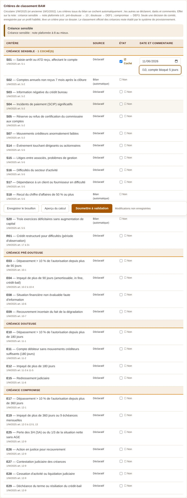
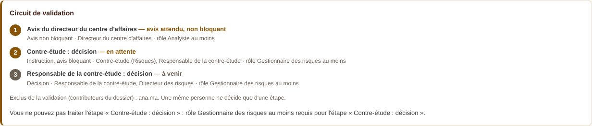
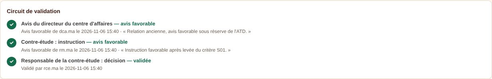
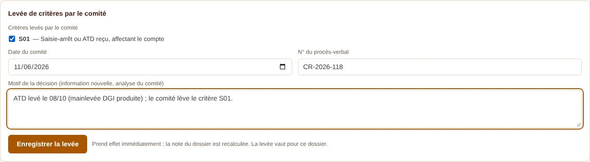
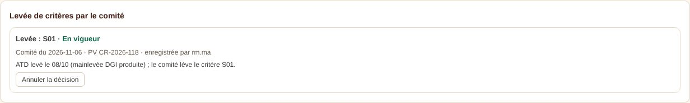
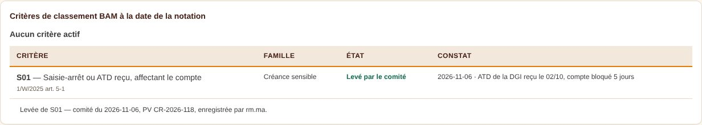
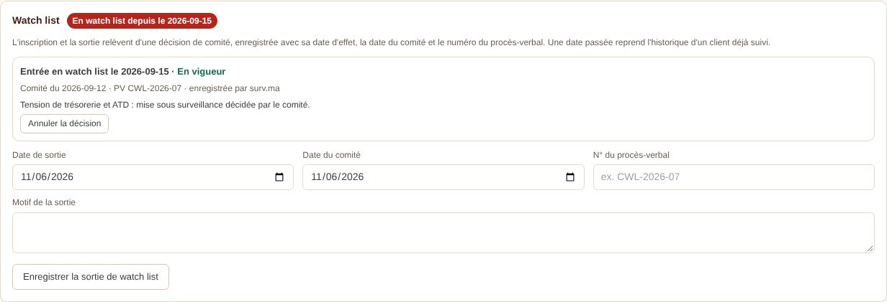
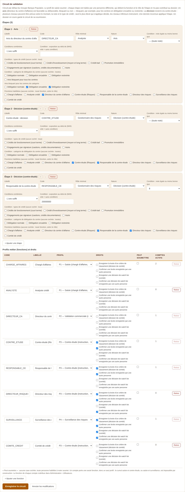
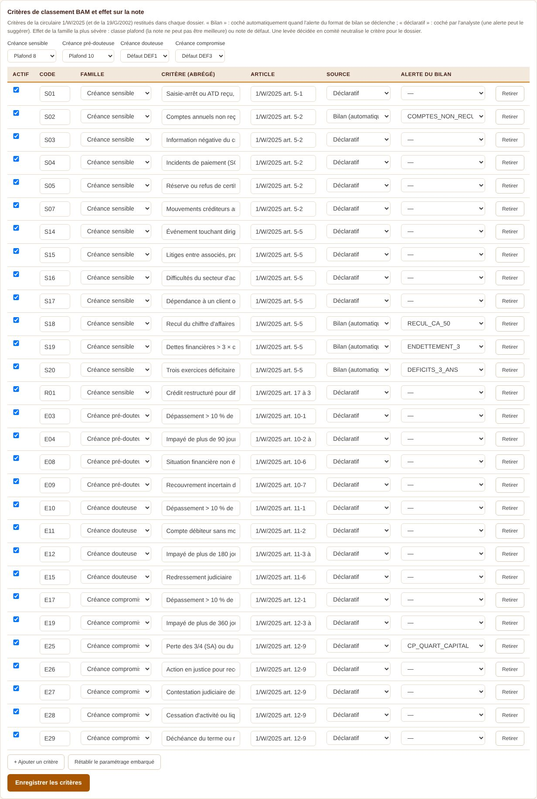

# Profils, circuit de validation, critères de classement BAM et watch list

*Décision D-57 (journal des décisions). Demande de la banque des 6 et 7 novembre 2026.*

## 1. Bonnes pratiques retenues

| Principe | Mise en œuvre dans l'outil |
|---|---|
| La note est arrêtée par une fonction indépendante de l'octroi (Bâle, CRR art. 173) | La décision revient à la contre-étude (profil P3). Le directeur du centre d'affaires donne un avis. |
| Quatre yeux, séparation des fonctions | Celui qui saisit ne décide pas. Une même personne ne traite qu'une étape d'un dossier. Un compte porte une seule fonction, donc un seul profil. La levée et la watch list peuvent exiger une seconde personne. |
| Délégation proportionnée au risque du centre (taille, sinistralité, dérogations et rejets, constats d'audit) | Catégorie de délégation par centre (normale, encadrée, restreinte). Elle rend l'avis du directeur bloquant ou ajoute un niveau de décision. |
| Droits par action, regroupés en profils | Droits paramétrables par fonction : lever un critère, confirmer une levée, décider de la watch list, confirmer une décision de watch list. |
| Note, classement et surveillance sont trois décisions distinctes | Plafond ou défaut issus des critères BAM dans la note ; levée par un comité ; watch list décidée par un comité. Chacune est tracée. |
| Signaux d'alerte et watch list gouvernés (EBA/GL/2020/06) | Alertes du bilan et critères BAM. Entrée et sortie de watch list sur décision de comité, avec procès-verbal et historique. |

## 2. Profils

| Profil | Fonctions par défaut | Ce qu'il fait |
|---|---|---|
| P1 — Saisie | Chargé d'affaires, analyste crédit | Ouvre et saisit le dossier, déclare les critères BAM, soumet |
| P2 — Validation commerciale | Directeur du centre d'affaires | Avis favorable ou défavorable ; non bloquant, ou bloquant selon la catégorie du centre |
| P3 — Contre-étude | Contre-étude, responsable de la contre-étude, directeur des risques | Instruit ; un seul niveau décide ; lève un critère (décision de comité) |
| P4 — Surveillance des risques | Surveillance | Watch list (entrée et sortie), levée de critère ; ne saisit ni ne valide une note |
| P5 — Consultation, audit | — | Lecture |
| P6 — Administration | — | Paramétrage |

Les fonctions, leur profil et leurs droits se paramètrent dans Administration › Paramétrage › Circuit de validation. La fonction de chaque compte se définit dans Administration › Utilisateurs.

## 3. Circuit de validation

- **Avis** : favorable ou défavorable. Un avis ne rejette pas le dossier. Il est non bloquant, ou bloquant pour tous les centres, ou bloquant pour les centres des catégories cochées.
- **Décision** : la contre-étude arrête la note.
  - Plusieurs niveaux de décision peuvent être prévus, chacun avec ses conditions : exposition au-delà d'un seuil, note égale ou moins bonne qu'une classe, types de crédit, catégories de centre. Les conditions se combinent (l'une suffit, ou toutes).
  - Seul le niveau le plus élevé qui s'applique décide ; les niveaux inférieurs instruisent (avis bloquant).
  - Il y a toujours au moins un niveau de décision sans condition.
- Les conditions se lisent à la soumission : exposition, note calculée, type de crédit du dossier, catégorie du centre. Une donnée inconnue applique l'étape. Un centre sans catégorie prend la première catégorie active (« délégation normale »).
- Le circuit est figé sur le dossier à la soumission.

**Circuit par défaut (seuils à paramétrer) :**
1. Avis du directeur du centre d'affaires, non bloquant, bloquant en délégation encadrée ou restreinte.
2. Décision de la contre-étude.
3. Au-delà de 20 MDH, ou pour une note de 8 ou moins bonne, la décision remonte au responsable de la contre-étude.

## 4. Critères de classement BAM

- **Le bloc « Critères de classement BAM »** apparaît en bas du dossier :
  - chaque critère abrégé, par famille (sensible, pré-douteux, douteux, compromis) ;
  - sa source : le bilan, coché automatiquement, ou une déclaration de l'analyste, datée et commentée ;
  - son état : coché, non coché, levé, à vérifier.
- **Effet sur la note** (paramétrable) :

  | Famille | Effet |
  |---|---|
  | Sensible | Note plafonnée à 8 |
  | Pré-douteux | Note plafonnée à 10 (le client reste noté) |
  | Douteux | Défaut DEF1 |
  | Compromis | Défaut DEF3 |

  La famille la plus sévère l'emporte. Le plafond s'applique après le grade du moteur, comme une exception non compensatoire (moteur 3.3.0).
- **Levée par le comité** : enregistrée sur le dossier par un profil habilité (contre-étude ou surveillance par défaut), avec la date du comité, le numéro du procès-verbal et le motif. Une personne qui a contribué au dossier ne peut pas l'enregistrer.
  - Selon le paramétrage, la levée prend effet immédiatement ou après confirmation par une seconde personne habilitée (cible).
  - La note du dossier est alors recalculée ; l'ancienne notation reste dans l'historique.
  - La levée vaut pour ce dossier. Au renouvellement, elle est **rappelée** : si le critère est toujours rempli, il s'applique de nouveau et doit être réexaminé.
- Les critères, la levée et l'effet sont figés sur la fiche de notation.
- Le classement officiel des créances reste établi par le système de provisionnement.

## 5. Watch list

- **Niveaux et effet sur la note (D-58, à arrêter en COPIL)** :

  | Niveau | Note plafonnée à | Renotation | Revue |
  |---|---|---|---|
  | WL1 — sous surveillance | 8 | 60 jours | 90 jours |
  | WL2 — surveillance renforcée | 9 | 30 jours | 30 jours |
  | WL3 — pré-recouvrement | 10 | 15 jours | 30 jours |

  Face aux critères BAM, le plafond le plus sévère s'applique. Un cran supplémentaire en cas de cumul est paramétrable ; il est désactivé par défaut. Les niveaux se paramètrent dans Administration › Paramétrage › Niveaux de watch list. La proposition complète de paramétrage figure dans docs/19.
- **Décision de comité**, enregistrée par un profil habilité (surveillance par défaut) : entrée (avec son niveau), changement de niveau ou sortie, date d'effet, date du comité, numéro du procès-verbal, motif.
- **Reprise de l'historique** : une date passée permet de reprendre l'historique d'un client déjà suivi.
- **Règles** :
  - une entrée suit une sortie (ou rien) ;
  - une sortie suit une entrée ;
  - les dates se suivent dans l'ordre ;
  - confirmation par une seconde personne si le paramétrage l'exige.
- **Affichage** : un badge « Watch list » sur la liste des clients, un bandeau sur les dossiers, l'historique complet sur la fiche du client.
- **Annulation** : une décision erronée s'annule avec un motif ; elle n'est jamais supprimée.

## 6. Paramétrage et données

| Élément | Où |
|---|---|
| Profils, droits, circuit | Administration › Paramétrage › Circuit de validation (clé `WORKFLOW_CIRCUIT`) |
| Types de crédit | Administration › Paramétrage › Types de crédit (`CREDIT_TYPES`) ; le type par défaut se règle sur chaque motif |
| Catégories de délégation | Administration › Paramétrage (`ENTITY_TIERS`) ; attribution dans Banques et filiales (colonne `entities.riskTier`) |
| Critères BAM et effet par famille | Administration › Paramétrage › Critères de classement (`CLASSIFICATION_CRITERIA`) |
| Seconde validation (levée, watch list) | Administration › Paramétrage › Comités |
| Décisions de comité | Table `committee_decisions` (migration 09), cloisonnée par entité |

## 7. Captures (données fictives)

| Écran | Capture |
|---|---|
| Critères BAM du dossier |  |
| Circuit figé : avis non bloquant, instruction, décision remontée |  |
| Circuit validé |  |
| Levée par le comité : formulaire |  |
| Levée enregistrée |  |
| Fiche : critères figés |  |
| Watch list du client |  |
| Administration : circuit, profils et droits |  |
| Administration : critères et effets |  |
