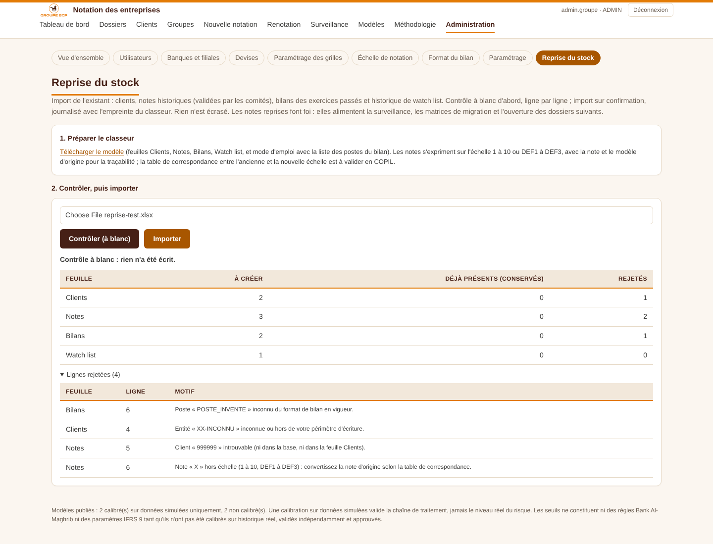

# 25 — Reprise du stock

> Décision D-65. Format du classeur et règles de reprise : **à valider avec la DSI et la Direction des risques avant la bascule**.

## Objet

Charger dans l'outil, en une fois et avant la mise en service, le stock existant de la banque :

- les **clients** ;
- les **notes historiques validées**, avec la note d'origine et le modèle d'origine ;
- les **bilans** historiques ;
- l'**historique de watch list**.

L'écran se trouve dans Administration › **Reprise du stock**. Il est réservé aux administrateurs.

## Le classeur

Le modèle se télécharge depuis l'écran. Il contient :

- une feuille **Lisez-moi**, avec un exemple par colonne et la liste des codes postes du format de bilan ;
- quatre feuilles de données.

| Feuille | Une ligne = | Colonnes obligatoires | Rapprochement |
|---|---|---|---|
| Clients | un client | Raison sociale, Entité (code) | Code client T24, sinon ICE ; un client déjà présent est ignoré |
| Notes | une note validée | Client, Date d'arrêté, Date de validation, Note (1 à 10 ou DEF1 à DEF3) | Une note existante au même client et à la même date d'arrêté est ignorée |
| Bilans | un poste d'un exercice | Client, Exercice, Date de clôture, Poste (code), Montant | Un exercice déjà présent à la même date de clôture est ignoré |
| Watch list | un passage en watch list | Client, Date d'entrée | Ignoré si le client a déjà un historique de watch list |

Les dates sont acceptées au format ISO (2024-12-31), jj/mm/aaaa ou date Excel. Les montants acceptent les espaces et la virgule décimale.

## Déroulement

1. **Contrôle (à blanc).** L'outil lit le classeur et calcule, feuille par feuille, ce qui serait créé, ignoré ou rejeté, avec le numéro de ligne et le motif de chaque rejet. Rien n'est écrit.
2. **Import.** Après confirmation, tout est écrit dans **une seule transaction** : soit tout passe, soit rien. Le journal d'audit trace l'import avec le nom du fichier et son empreinte (SHA-256).
3. **Rejouer le même classeur** est sans effet : tout est ignoré comme « déjà présent ». On peut donc corriger les lignes rejetées et réimporter.

## Ce que devient chaque donnée

- **Clients.** Ils sont créés avec la source « saisie ». L'entité doit exister et être dans le périmètre d'écriture de l'administrateur. La fiche T24 pourra ensuite être rapprochée (docs/21).
- **Notes.** Chaque note devient une notation **officielle** :
  - origine « reprise », modèle « REPRISE_STOCK » ;
  - datée de sa date de validation ;
  - rattachée à sa date d'arrêté.

  Elle alimente la « dernière note validée » à l'ouverture d'un dossier, les matrices de migration et la surveillance du portefeuille (docs/20). Sa fiche affiche un bandeau « Note reprise du stock » avec la note d'origine, le modèle d'origine, le commentaire et le classeur. **Elle n'est pas recalculée** : l'outil ne dispose ni des données ni de la grille qui l'ont produite.
- **Bilans.** Ils sont stockés au format de bilan de l'outil, avec la source « REPRISE_STOCK ». Tous les postes du format sont admis, totaux compris. Un poste inconnu fait rejeter la ligne.
- **Watch list.** Chaque passage crée une décision d'entrée et, le cas échéant, de sortie, à l'état « effective ». Les périodes qui se chevauchent pour un même client sont rejetées.

## Ce qui n'est pas repris

- Les dossiers de crédit en cours : ils sont rouverts dans l'outil.
- Les pièces jointes.
- Les engagements : ils sont rapatriés de T24 (docs/23).

## Points à valider

- L'extraction du stock depuis l'outil actuel, et sa profondeur historique : nombre d'exercices et de notes par client.
- La table de correspondance entre les anciennes notes et l'échelle 1 à 10. Elle est à établir avant l'import : l'outil reprend la note convertie et conserve la note d'origine pour mémoire.
- Le sort des clients sans code T24 ni ICE. Ils sont rejetés tant que l'un des deux manque.
