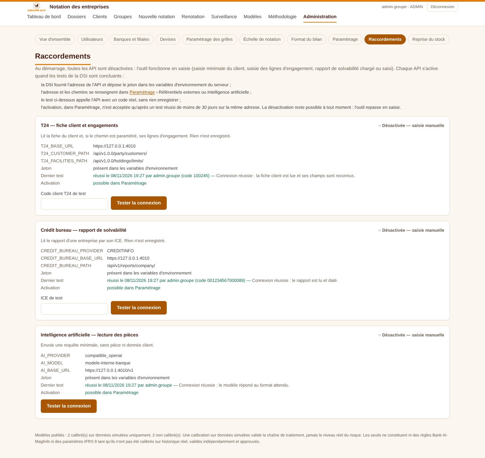

# 26 — Mise en service des API (T24, crédit bureau, OCR intelligent)

> Décision D-67. **Démarrage sans API** ; chaque raccordement s'active après les tests de la DSI.

## Au démarrage : tout en saisie

Toutes les API sont **désactivées par défaut** (`T24_ENABLED`, `CREDIT_BUREAU_API_ENABLED`, `AI_ENABLED` valent `false` tant que rien n'est enregistré). L'outil fonctionne entièrement sans elles :

| Besoin | Sans API |
|---|---|
| Fiche client | Saisie minimale (raison sociale, ICE ou RC, forme juridique, secteur, segment commercial), à rattacher à T24 plus tard |
| Engagements | Saisie des lignes sur la fiche client |
| Rapport de solvabilité | Saisie manuelle du rapport (ou lecture d'un PDF par l'OCR intelligent une fois celle-ci activée) |
| Bilan | Saisie ou import du modèle Excel |
| Ouverture de dossier | Aucune actualisation T24 : le dossier part des données saisies |

## Mise en service d'une API

Écran **Administration › Raccordements** (administrateur du groupe).

1. La DSI fournit l'adresse de l'API et dépose le jeton dans les variables d'environnement du serveur. Ce sont `T24_API_TOKEN`, `CREDIT_BUREAU_API_TOKEN`, et `ANTHROPIC_API_KEY` ou `IA_CLE_API`. L'écran indique seulement si le jeton est présent, jamais sa valeur.
2. L'adresse et les chemins se renseignent dans Paramétrage › Référentiels externes (ou OCR intelligent).
3. **Tester la connexion** avec un code réel :
   - un code client T24, avec lecture de la fiche et des lignes d'engagement ;
   - un ICE pour le crédit bureau ;
   - une requête minimale, sans donnée client, pour l'OCR intelligent.

   Le test appelle l'API **même désactivée** et n'enregistre aucune donnée client. Il affiche ce qui a été lu (champs reconnus, nombre de lignes, date du rapport) pour vérifier la correspondance des champs. Chaque test est journalisé (`INTEGRATION_TESTED`).
4. **Activer** dans Paramétrage. L'activation est **refusée** dans trois cas :
   - aucun test réussi ;
   - le dernier test réussi a plus de 30 jours ;
   - l'adresse, un chemin, le fournisseur ou le modèle a changé depuis ce test.
5. La **désactivation** reste possible à tout moment, sans condition : l'outil repasse en saisie.

## Remarque sur l'existant

Une API déjà activée avant cette version le reste : la condition ne porte que sur une nouvelle activation. En production, l'OCR intelligent a été activée le 2 novembre 2026, alors que T24 et le crédit bureau sont désactivés. Pour démarrer sans aucune API, il faut aussi désactiver l'OCR intelligent dans Paramétrage.
