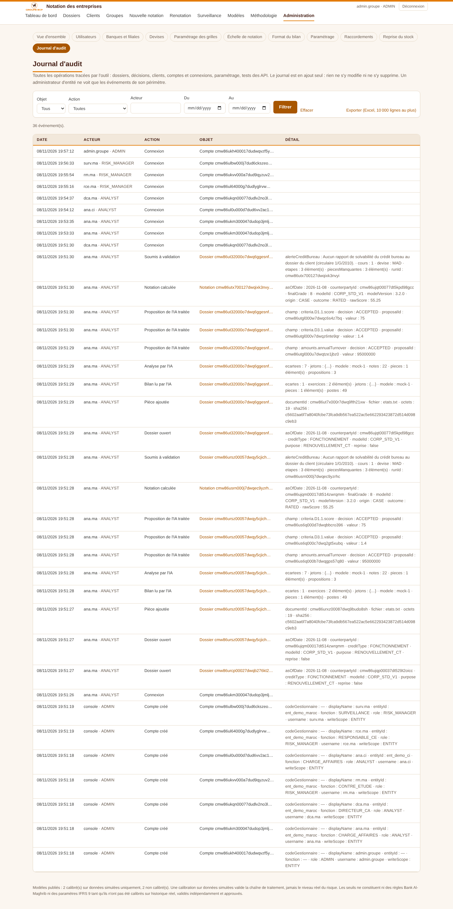

# 27 — Diagnostic complet : écrans, front-end, back-end, base de données

> Réalisé le 8 novembre 2026, sur la branche `claude/scoring-tool-morocco-sme-iwwqje` et sur la base de production Supabase (schéma `corp_scoring`).

## 1. Synthèse

| Volet | Résultat | Correction |
|---|---|---|
| Base de production ↔ schéma Prisma | Colonnes, types, nullabilité et valeurs par défaut identiques sur les 23 tables ; 65 index identiques ; trigger identique | — |
| Contraintes | 44 contraintes de même définition ; 3 clés étrangères nommées en minuscules (héritage des premiers scripts) | Migration 14 appliquée : noms alignés, empreinte identique |
| Valeurs stockées ↔ valeurs attendues par le code | Rôles, statuts, issues de notation, notes, types d'entité, segments : toutes reconnues | — |
| Paramétrage | 33 paramètres au registre, tous utilisés ; aucun paramètre lu hors registre | — |
| Journal d'audit | 70 actions tracées, mais aucun écran pour les consulter hors du dossier ; 3 actions du dossier affichées sous leur code brut | Écran **Journal d'audit** (lecture seule, filtres, export) ; libellés communs pour toutes les actions |
| Écrans (7 profils, bureau et mobile, API désactivées) | 224 écrans conformes : pas d'erreur serveur ni console, pas de débordement horizontal, WCAG 2.1 AA sans violation grave | Graphiques de surveillance : rôles ARIA corrigés (15 éléments signalés) |
| Habilitations | Les 12 écrans d'administration et l'export du journal sont refusés à un analyste ; un analyste de Côte d'Ivoire ne voit aucun dossier, client ni notation du Maroc (404) | — |
| Alertes Supabase (schéma de l'outil) | Seule information : RLS activé sans politique. C'est voulu : l'API publique de Supabase est fermée et l'outil se connecte en propriétaire | — |

## 2. Méthode

1. **Base.** La prod et une base créée depuis le schéma de la branche sont comparées par empreinte (colonnes par table, index, contraintes, triggers). Les valeurs distinctes des colonnes à liste fermée sont ensuite confrontées aux listes du code.
2. **Code.** Une analyse statique vérifie :
   - les paramètres du registre (src/lib/settings.ts), comparés aux lectures dans le code ;
   - les actions écrites au journal, comparées aux libellés affichés.
3. **Écrans.** Un parcours automatisé couvre les 7 comptes de démonstration (chargé d'affaires Maroc et Côte d'Ivoire, directeur de centre, responsable de la contre-étude, contre-étude, surveillance, administrateur du groupe), en 1440 px et en 390 px. Il est fait **avec T24, le crédit bureau et l'IA désactivés** (scénario de démarrage). Pour chaque écran, il relève :
   - le statut HTTP et les erreurs de console ;
   - le débordement horizontal ;
   - l'audit axe-core (WCAG 2.1 A et AA) ;
   - le titre principal, les polices et une capture.
4. **Contrôle d'accès.** Accès direct d'un analyste aux 12 écrans d'administration et à l'export du journal.
5. **Non-régression.** Ont été relancés :
   - les 466 tests automatisés ;
   - la vérification des types (tsc) et le lint (eslint) ;
   - le parcours de bout en bout des lots précédents.

## 3. Écrans couverts

Tableau de bord ; dossiers (à traiter, tous) ; dossier aux états brouillon, soumis et rejeté ; clients et fiche client ; nouvelle notation ; fiche de notation ; surveillance ; modèles (liste, standard, TPE) ; groupes et fiche groupe ; renotation et lot ; méthodologie ; mot de passe.

Administration :
- vue d'ensemble ;
- grilles, échelle, format du bilan ;
- utilisateurs, banques et filiales, devises ;
- paramétrage ;
- raccordements ;
- reprise du stock ;
- journal d'audit, avec ou sans filtre.

## 4. Journal d'audit (D-68)

Administration › **Journal d'audit** :

- **Contenu.** Toutes les opérations tracées : dossiers, décisions de comité, clients, connexions et comptes, paramétrage, tests des API, reprise du stock.
- **Lecture seule.** Le journal est en ajout seul.
- **Filtres** par objet, action, acteur et période, avec 100 événements par page.
- **Lien** vers le dossier, le client, la notation ou le lot concerné.
- **Export Excel** filtré, de 10 000 lignes au plus, avec le détail JSON complet.
- **Cloisonnement.** Un administrateur d'entité ne voit que les événements de son périmètre. Les événements globaux (paramétrage, tests des API) sont réservés à l'administrateur du groupe.

## 5. Points d'attention, sans correction de code

- **IA activée en production depuis le 2 novembre 2026.** T24 et le crédit bureau sont désactivés. Pour démarrer sans aucune API (docs/26), il faut aussi désactiver l'IA dans Paramétrage. Elle se réactivera après un test réussi dans Raccordements.
- **Alertes Supabase des autres schémas** (`public`, `sges`, `suivi_reco`) : vues en « security definer », RLS désactivé dans `public`, fonctions sans `search_path`, protection contre les mots de passe divulgués désactivée. Elles ne concernent pas l'outil de notation, mais le même projet Supabase. Elles sont à traiter par les responsables de ces applications.
- **Données de production.** Elles se limitent à la démonstration : 10 clients, 13 notations, aucun dossier. La reprise du stock (docs/25) est à faire avant la mise en service.
