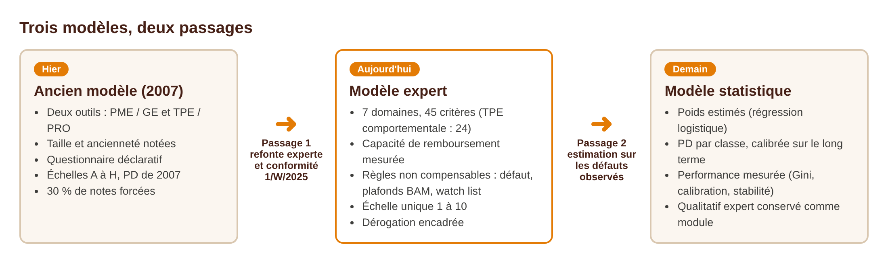
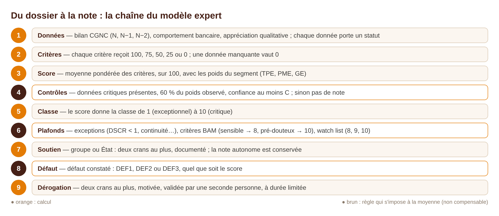
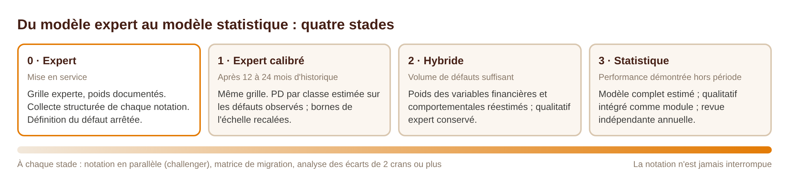
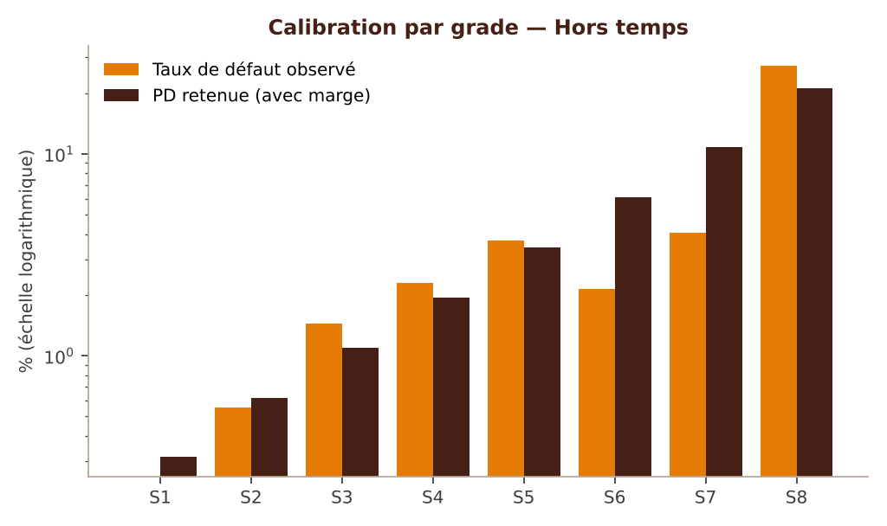
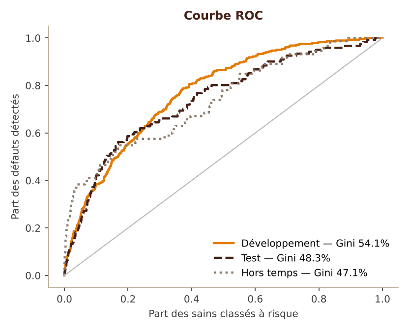

# Guide méthodologique complet de la notation des entreprises

**Objet :** expliquer, de façon complète et pratique, les deux passages du dispositif de notation des entreprises :
- de l'ancien modèle (cahier des charges de 2007) au nouveau modèle expert ;
- du modèle expert à un modèle statistique estimé sur les défauts de la banque.

**Périmètre :** les entreprises non financières (TPE, PME et grandes entreprises) du Groupe Banque Populaire au Maroc, avec un chapitre sur les filiales africaines. Les financements de projets relèvent d'un dispositif distinct.
**Destinataires :** Direction des Risques, contre-étude, Engagements, réseau (chargés d'affaires et directeurs de centre), Conformité, Audit interne, fonction de validation, comité modèles.
**Version :** 1.0 — novembre 2026 — moteur de notation 3.3.0, échelle ECH10-2026.1.

> Les poids, barèmes et seuils du modèle expert sont fixés à dire d'expert et documentés. Ils n'ont pas encore été estimés sur les défauts observés de la banque. Aucune probabilité de défaut n'est publiée tant qu'une calibration sur données réelles n'a pas été validée de façon indépendante. Les exemples chiffrés de ce guide sont fictifs ; ils servent à expliquer les calculs.

## Sommaire

1. Synthèse
2. Le point de départ : l'ancien modèle
3. Pourquoi changer
4. Le nouveau modèle expert
5. Conduire le passage de l'ancien modèle au modèle expert
6. Pourquoi et quand passer au statistique
7. Les données : ce que l'outil collecte déjà
8. La définition du défaut et la cible
9. La trajectoire en quatre stades
10. La démarche d'estimation, étape par étape
11. Calibration et échelle maîtresse
12. Validation et décision de bascule
13. Gouvernance et suivi
14. Filiales africaines
15. Décisions attendues
16. Annexes : formules, glossaire, références

## 1. Synthèse

**Le point de départ.** Le modèle en production date de 2007. Il a structuré la notation de la banque, mais :
- il ne mesure pas la capacité de remboursement des PME et des grandes entreprises ;
- il note la taille et l'ancienneté comme des qualités en soi ;
- une note sur trois est forcée manuellement, sans motif codifié ;
- il ne reprend pas les critères chiffrés de la circulaire 1/W/2025 de Bank Al-Maghrib, applicable au 1er janvier 2027.

**Le premier passage : vers un modèle expert.** Le nouveau modèle est une grille experte :
- **sept domaines** : performance financière, capacité de remboursement, comportement bancaire, activité, management, transparence, ESG ;
- des **poids** qui dépendent de la taille de l'entreprise ;
- une **grille dédiée aux TPE** sans comptes exploitables ;
- une **échelle unique de 1 à 10**, avec le défaut hors échelle ;
- des **règles non compensables** (défaut, plafonds liés aux critères Bank Al-Maghrib, watch list), qui empêchent une moyenne favorable de masquer une situation dégradée.

Le passage se conduit en six étapes : validation, paramétrage, reprise de l'existant, double notation, bascule, rodage.

**Le second passage : vers un modèle statistique.** Il ne se fait pas d'un coup. Il franchit quatre stades, du modèle expert au modèle estimé :
- calibrer d'abord les classes du modèle expert sur les défauts observés ;
- puis réestimer les poids des variables financières et comportementales ;
- enfin estimer un modèle complet.

La notation n'est jamais interrompue. À chaque stade, l'ancien et le nouveau modèle notent en parallèle, et la bascule se décide sur des preuves : pouvoir discriminant, justesse des probabilités, stabilité.

**Ce qui rend ce second passage possible.** L'outil archive dès aujourd'hui, pour chaque notation :
- les postes du bilan et les ratios, calculés avec des formules uniques ;
- les réponses qualitatives ;
- les engagements et le rapport du crédit bureau ;
- la note et la version du modèle.

L'historique nécessaire à l'estimation se constitue ainsi notation après notation.

| | Ancien modèle (2007) | Modèle expert (2026) | Modèle statistique (cible) |
|---|---|---|---|
| Fondement des poids | Jugement de 2007 | Jugement d'experts documenté, principes de place | Estimation sur les défauts de la banque |
| Capacité de remboursement | Non mesurée (PME / GE) | Domaine D2 : DSCR, couverture des intérêts, stress | Variables retenues si elles discriminent |
| Règles réglementaires | Défaut si créance déjà en souffrance | Critères 1/W/2025 : défaut, plafonds, revues | Conservées comme règles au-dessus du score |
| Échelle | Deux échelles A à H | Une échelle 1 à 10, défaut hors échelle | Même échelle, une PD par classe |
| Performance | Non mesurée | Suivie (distribution, migrations, dérogations) | Mesurée (Gini, calibration, stabilité) |
| Ajustements manuels | Forçage libre (30 %) | Dérogation de 2 crans, motivée, double validation | Idem, cible < 10 % |

## 2. Le point de départ : l'ancien modèle

### 2.1 Architecture

Le modèle en production est décrit par le cahier des charges « Outil de notation Pro / TPE / PME / GE », version 2.1 du 11 mai 2007. Il comporte deux outils, choisis selon le chiffre d'affaires.

| Élément | PME / GE | TPE / PRO |
|---|---|---|
| Population | CA d'au moins 3 MDH ; GE au-delà de 50 MDH | CA inférieur à 3 MDH |
| Score | Quantitatif (10 facteurs) + qualitatif (6 thèmes) | Quantitatif (6 facteurs) + comportemental (5 facteurs du compte) |
| Combinaison | Poids du quantitatif de 50 % (CA < 10 MDH) à 75 % (CA > 150 MDH) | Poids selon l'ancienneté de la relation et des comptes (100 %, 25 % ou 0 %) |
| Ajustements | Forçage : créance en souffrance (Déf), garantie de l'État (A), appartenance à un groupe (± crans) | Malus de −10, −20 points ou défaut selon les signaux d'alerte |
| Échelle | A à H et Déf ; PD de 0,03 % (A) à 54,45 % (H) | A à H et Déf ; PD de 0,30 % (A) à 27,44 % (H) |

### 2.2 Les facteurs

**PME / GE — quantitatif.**

| Facteur | Poids |
|---|---|
| Rotation du capital | 20 % |
| Liquidité réduite | 20 % |
| Chiffre d'affaires | 10 % |
| Effectif | 10 % |
| Âge de l'entreprise | 10 % |
| Rentabilité des fonds propres | 10 % |
| Frais financiers / CA | 5 % |
| Dette nette / fonds propres | 5 % |
| Fonds de roulement / actif circulant | 5 % |
| Croissance du résultat net | 5 % |

**PME / GE — qualitatif.**

| Thème | Poids |
|---|---|
| Qualité du management | 35 % |
| Situation du secteur | 20 % |
| Concurrence | 15 % |
| Historique bancaire | 15 % |
| Pouvoir de marché | 10 % |
| Exposition aux crédits | 5 % |

**TPE / PRO — quantitatif.**

| Facteur | Poids |
|---|---|
| Secteur | 25 % |
| Chiffre d'affaires | 20 % |
| Frais financiers / CA | 20 % |
| Forme juridique | 20 % |
| Expérience du dirigeant | 10 % |
| Résultat net / CA | 5 % |

Malus de 20 points si le fonds de roulement est négatif (hors pharmacies).

**TPE / PRO — comportemental.**

| Facteur du compte courant | Poids |
|---|---|
| Utilisation du découvert | 35 % |
| Nombre de mouvements | 30 % |
| Variation du nombre de flux créditeurs sur 3 mois | 15 % |
| Variation du montant des flux créditeurs sur 6 mois | 10 % |
| Solde / flux créditeurs | 10 % |

**Signaux d'alerte TPE / PRO.** Seul le malus le plus fort s'applique.

| Effet | Signaux |
|---|---|
| Défaut | Créance en souffrance ; liquidation ou règlement judiciaire ; consolidation de crédit dans les 6 mois |
| −20 points | Impayé de plus de 60 jours ; plus de 3 rejets SCIP dans le mois ; rééchelonnement dans les 6 mois |
| −10 points | Impayé régularisé dans les 3 mois ; impayé de plus de 30 jours ; 1 ou 2 incidents SCIP |

### 2.3 Ce qui fonctionnait

1. **Deux outils adaptés à la taille.** La TPE est notée d'abord sur le fonctionnement de son compte, ce qui reste le bon choix pour des entreprises aux comptes peu fiables. Le nouveau modèle garde ce principe.
2. **Le comportement bancaire et les incidents sont pris en compte**, et la créance en souffrance impose le défaut.
3. **Un référentiel sectoriel central**, que le chargé de notation ne peut pas modifier.
4. **Des réponses qualitatives fermées et codifiées**, qui limitent l'arbitraire.
5. **Une logique de groupe** et une hiérarchie des forçages.
6. **Une exigence de paramétrage et d'historisation.**

### 2.4 Ce qui ne fonctionne plus

| Constat | Conséquence |
|---|---|
| Aucun ratio de capacité de remboursement (EBE, service de la dette) dans la note PME / GE | La question centrale du crédit — l'entreprise peut-elle rembourser ? — n'est pas mesurée |
| La taille et l'ancienneté pèsent 30 % ; un CA au-delà de 50 MDH rapporte le maximum de points | Une grande entreprise ancienne est mécaniquement mieux notée, quel que soit son endettement |
| Barèmes non monotones (liquidité réduite, fonds de roulement) | Une liquidité très faible peut être mieux notée qu'une liquidité confortable |
| Ratios rapportés aux fonds propres | Instables ou trompeurs quand les fonds propres sont faibles ou négatifs |
| Donnée absente notée de 0 à 20 points | Une information manquante peut valoir mieux qu'une information défavorable |
| Questionnaire déclaratif pesant jusqu'à 50 % pour les petites PME | Note sensible à l'appréciation, peu vérifiable |
| Garantie de l'État : note A automatique | La note ne mesure plus le risque propre de l'entreprise |
| Forçage manuel sans motif codifié ni plafond | 30 % de notes forcées (3 881 sur 12 909, extraction 2008-2019) |
| Deux échelles A à H aux PD de 2007, jamais recalibrées | Une même lettre ne signifie pas le même risque dans les deux outils |
| Notes non rapprochées des défauts constatés | La performance du modèle n'est pas mesurée |

L'extraction de production montre aussi une forte concentration : 80 % des notes sont en C, D ou E, et la dette bancaire n'est renseignée que dans 51 % des notations.

### 2.5 L'écart avec la circulaire 1/W/2025

La circulaire 1/W/2025 du 15 décembre 2025 abroge la 19/G/2002. Elle s'applique à partir du 1er janvier 2027, avec une mise en œuvre progressive (article 53). Son article 48 demande que les systèmes d'évaluation du risque de crédit prennent en compte ses règles. L'ancien modèle ne le fait pas :

| Exigence de la 1/W/2025 | Ancien modèle |
|---|---|
| Créances sensibles (art. 5) : recul du CA de 50 % en un an, dettes financières / capitaux propres > 3, trois exercices déficitaires, comptes non reçus 7 mois après la clôture, saisie ou ATD, information négative, mouvements créditeurs anormalement faibles | Aucun critère mesuré à son seuil ; la notion de créance sensible n'existe pas |
| Souffrance (art. 8, 10 à 13) : impayé de plus de 90 jours, dépassements, absence de flux réels, neuf échéances impayées, procédures | Défaut seulement si la créance est déjà classée ; pour les TPE, un impayé de plus de 60 jours ne retire que 20 points |
| Restructurations (art. 17 à 30) : définition, viabilité, rang, observation, retour en sain | Seuls la consolidation (défaut) et le rééchelonnement (−20 points) des TPE sont traités |
| Classement indépendant des garanties (art. 16) | La garantie de l'État force la note A |
| Classement plus sévère si d'autres informations le justifient (art. 49) | Forçage possible dans les deux sens, sans motif |

## 3. Pourquoi changer

Le changement de modèle répond à cinq objectifs :

1. **Mesurer le risque de défaut**, c'est-à-dire la capacité de l'entreprise à honorer ses engagements, et non sa taille ou son ancienneté.
2. **Être conforme** à la circulaire 1/W/2025 : ses critères doivent dégrader la note, et une note ne doit jamais masquer un critère de classement.
3. **Rendre la note traçable et explicable** : chaque note doit pouvoir être reconstituée à l'identique, critère par critère, avec la version du modèle qui l'a produite.
4. **Encadrer le jugement** : remplacer le forçage libre par une dérogation motivée, limitée et validée par une seconde personne.
5. **Préparer le statistique** : produire dès maintenant des données propres, homogènes et datées, rapprochables des défauts.

Le choix d'un modèle **expert** pour ce premier passage n'est pas un renoncement au statistique : c'est la condition pour y arriver. Sans historique de défauts propre et rapproché des notations, aucune estimation fiable n'est possible. Le modèle expert sert à la fois à noter correctement dès 2027 et à constituer cet historique.

## 4. Le nouveau modèle expert

### 4.1 Sept principes de conception

1. **Mesurer les mécanismes de défaut** : la structure financière, la capacité de remboursement, le comportement du compte, puis l'activité, le management et la transparence. La taille oriente vers la bonne grille ; elle ne rapporte pas de points.
2. **Des variables monotones et robustes** : le risque varie toujours dans le même sens. Les ratios restent définis quand les fonds propres ou l'EBE sont faibles.
3. **Pas de compensation des situations graves** : les données critiques, plafonds, défauts et signaux d'alerte s'imposent à la moyenne.
4. **Une donnée absente ne rapporte jamais de points.**
5. **Une note intrinsèque** : le soutien d'un groupe ou de l'État s'ajoute ensuite, en crans plafonnés, et reste visible.
6. **Tout est documenté et versionné** : chaque notation garde la version du modèle, des paramètres et de l'échelle qui l'ont produite.
7. **Un modèle conçu pour devenir statistique** : les variables, les données et l'historique sont structurés pour l'estimation.

### 4.2 Segmentation et grilles

| Grille | Population | Base de la note |
|---|---|---|
| Standard (CORP_STD_V1) | TPE avec comptes, PME, grandes entreprises | Bilan et CPC CGNC sur deux exercices au moins, comportement bancaire, appréciation qualitative |
| TPE comportementale (CORP_TPE_BEHAV_V1) | TPE sans comptes exploitables | Fonctionnement du compte et flux observés, appréciation simplifiée |
| Challengers (pilote) | Mêmes populations | Grilles resserrées (16 et 12 critères), notées en parallèle pour comparaison, sans effet sur la note officielle |

Le segment (TPE, PME, GE) se détermine sur le chiffre d'affaires et l'exposition, convertis en dirhams. Seuils provisoires, à confirmer en COPIL : TPE jusqu'à 10 MDH, GE au-delà de 175 MDH. Le segment fixe les poids et les barèmes.

### 4.3 Les sept domaines de la grille standard

| Domaine | Ce qui est mesuré | TPE | PME | GE |
|---|---|---|---|---|
| D1 · Performance financière et structure bilancielle | Croissance et stabilité du CA, marge d'EBE, rentabilité économique, fonds propres tangibles / total bilan, dette nette / EBE, liquidité, BFR, conversion de l'EBE en trésorerie | 25 % | 30 % | 30 % |
| D2 · Capacité de remboursement et stress | Couverture des intérêts, DSCR, free cash-flow / dette, liquidité et mur de dette, résistance à un scénario de stress, covenants | 10 % | 15 % | 20 % |
| D3 · Comportement bancaire et historique de crédit | Retards de paiement, dépassements, utilisation des lignes, mouvements créditeurs, incidents, restructuration, endettement auprès du système bancaire | 25 % | 20 % | 10 % |
| D4 · Activité, secteur et positionnement | Risque sectoriel, position concurrentielle, concentration clients et fournisseurs, visibilité des revenus, exposition pays et change, risque opérationnel | 15 % | 15 % | 15 % |
| D5 · Management, gouvernance et groupe | Expérience, homme-clé et succession, gouvernance, actionnariat et groupe, stratégie, parties liées, pilotage financier | 15 % | 12 % | 15 % |
| D6 · Transparence et conformité | Qualité des états financiers, délai de production, cohérence, situation juridique, fiscale et sociale | 7 % | 5 % | 5 % |
| D7 · ESG et climat | Risque physique, risque de transition, conformité environnementale et sociale, gouvernance ESG | 3 % | 3 % | 5 % |

**Pourquoi ces poids.**
- **Le comportement bancaire (D3) pèse plus pour une TPE (25 %) que pour une GE (10 %).** Les comptes d'une TPE sont moins fiables, alors que son compte courant dit beaucoup de sa santé.
- **La capacité de remboursement (D2) pèse le plus pour une GE (20 %).** Ses comptes, audités, permettent une analyse fine du service de la dette.

**Garde-fous de la grille.**
- La grille standard compte **45 critères**, et aucun ne dépasse **6 % du poids total** : la note ne repose jamais sur un seul fait.
- La grille TPE comportementale compte **24 critères** :

  | Domaine | Poids |
  |---|---|
  | Comportement de crédit | 30 % |
  | Capacité observée sur les flux | 20 % |
  | Activité | 18 % |
  | Management | 12 % |
  | Transparence et conformité | 12 % |
  | Groupe | 5 % |
  | ESG | 3 % |

### 4.4 Comment un critère est noté

**Critère chiffré.**
- **Barème à cinq paliers** (100, 75, 50, 25, 0) propre au segment, monotone, sans chevauchement de bornes.
- **Ratios calculés sur le bilan CGNC avec des définitions uniques** :
  - EBE retraité du crédit-bail ;
  - fonds propres tangibles : capitaux propres et comptes courants bloqués, hors non-valeurs, incorporels, écarts de réévaluation et comptes d'associés débiteurs ;
  - dette nette économique : dettes de financement, trésorerie passif, crédit-bail et comptes courants d'associés à vue, moins la trésorerie et les titres de placement ;
  - DSCR sur le service de la dette à douze mois.
- Un EBE nul ou négatif, ou des fonds propres tangibles négatifs, imposent le score le plus défavorable.

**Exemple — critère D1.5, dette nette / EBE, pour une PME (poids 5 %).** Plus le ratio est élevé, plus le risque l'est ; le barème est donc décroissant.

| Dette nette / EBE | Score |
|---|---|
| 1,5 ou moins | 100 |
| De 1,5 à 2,5 | 75 |
| De 2,5 à 3,5 | 50 |
| De 3,5 à 5 | 25 |
| Plus de 5, ou EBE nul ou négatif | 0 |

Le barème est plus strict pour une TPE (1 / 2 / 3,5 / 5) et pour une grande entreprise au-delà de 3,5 (dernier palier à 4,5). Les barèmes de tous les critères figurent dans la note méthodologique, générée depuis le moteur, et dans l'écran Paramétrage des grilles.

**Critère qualitatif.** Cinq repères écrits (100, 75, 50, 25, 0) décrivent chaque niveau. L'analyste choisit le repère qui correspond aux faits, pièces à l'appui. Il ne choisit pas un chiffre : il choisit une description.

**Statut de la donnée.** Chaque donnée est disponible, estimée, manquante, invalide, périmée ou non applicable. Une donnée manquante, invalide ou périmée vaut 0, et son poids reste dans la moyenne. C'est la règle qui garantit qu'**une absence d'information ne peut jamais améliorer une note**.

### 4.5 Du score à la note

1. **Score brut** : moyenne pondérée des scores des critères, sur 100.
2. **Données critiques** : sans les fonds propres tangibles, la dette nette / EBE, la liquidité, le DSCR et les retards de paiement, aucune note n'est produite.
3. **Porte de qualité** : il faut au moins 60 % du poids sur des données observées, 30 % au moins dans chaque domaine, et une classe de confiance au moins égale à C. Sinon, pas de note.
4. **Classe** : le score donne la classe de l'échelle de 1 à 10.
5. **Plafonds (exceptions non compensables).**

   | Situation | Note au mieux |
   |---|---|
   | DSCR inférieur à 1, incertitude sur la continuité d'exploitation, EBE négatif deux années sur trois | 8 |
   | Dossier groupe incomplet alors que le groupe est matériel | 7 |
   | Critère de créance sensible (1/W/2025) | 8 |
   | Critère de créance pré-douteuse | 10 |
   | Watch list WL1 · WL2 · WL3 | 8 · 9 · 10 |

   Quand plusieurs plafonds s'appliquent, **le plus sévère l'emporte**.
6. **Soutien** : la note autonome est conservée. Le soutien d'un groupe ou de l'État ajoute au plus deux crans, s'il est documenté : capacité, volonté, engagement juridique, transférabilité des fonds.
7. **Défaut** : un défaut constaté impose une classe de défaut, quel que soit le score.
   - **DEF1** : retard de paiement ;
   - **DEF2** : improbabilité de paiement, ou restructuration en difficulté ;
   - **DEF3** : procédure collective ou contentieux.

   Un critère de créance douteuse impose DEF1 ; un critère de créance compromise impose DEF3.
8. **Dérogation** : un écart de deux crans au plus, motivé, documenté, validé par une seconde personne et à durée limitée. Jamais vers ou depuis un défaut.

### 4.6 L'échelle de notation

| Classe | Score minimal | Libellé |
|---|---|---|
| 1 | 90 | Exceptionnel |
| 2 | 85 | Très solide |
| 3 | 80 | Solide |
| 4 | 75 | Bon |
| 5 | 70 | Satisfaisant |
| 6 | 64 | Acceptable |
| 7 | 57 | Fragile |
| 8 | 48 | Faible |
| 9 | 40 | Très faible |
| 10 | 0 | Critique |
| DEF1 · DEF2 · DEF3 | — | Défaut constaté, hors échelle |

L'échelle est commune à toutes les grilles et se gère par versions datées (ici ECH10-2026.1). Ses bornes sont expertes : les bornes définitives résulteront de la calibration sur les défauts observés (chapitre 11).

### 4.7 Le niveau de confiance

Chaque note porte une **classe de confiance** (A, B, C ou U), calculée sur quatre dimensions :

| Dimension | Poids |
|---|---|
| Complétude | 35 % |
| Fiabilité (pièces, certification) | 30 % |
| Fraîcheur | 20 % |
| Provenance | 15 % |

La confiance ne modifie pas la note. Elle dit au décideur sur quoi la note repose : une classe 4 en confiance A et une classe 4 en confiance C n'appellent pas la même vigilance.

### 4.8 L'intégration des règles de Bank Al-Maghrib

La classification réglementaire porte sur chaque **créance** (saine, sensible, pré-douteuse, douteuse, compromise) ; la note porte sur la **contrepartie**. Les deux ne se confondent pas, mais elles ne doivent jamais se contredire. Le modèle intègre les règles des circulaires à trois niveaux :

| Niveau | Mécanisme | Effet |
|---|---|---|
| 1. Critère de la grille | Le fait mesuré par la circulaire est un critère pondéré (retards, dépassements, flux, incidents, restructuration…) | Il dégrade la note de façon graduée |
| 2. Règle imposée | Défaut, plafond ou revue obligatoire déclenchés par le seuil de la circulaire | Il ne se compense pas |
| 3. Indicateur de classification | Le fait daté (seuil, date, pièce) est restitué avec la note | Il alimente la classification des créances |

**Les critères de classement dans le dossier.**
- Les critères calculables sur le bilan se cochent automatiquement : recul du CA de 50 %, dettes financières supérieures à trois fois les capitaux propres, trois exercices déficitaires…
- Les autres sont déclarés par le chargé d'affaires, datés et commentés : saisie ou ATD, impayé de plus de 90 jours, procédure…
- Un critère ne peut être **levé** que par une décision de comité, enregistrée par un profil habilité qui n'a pas contribué au dossier. L'enregistrement indique la date du comité, le numéro du procès-verbal et le motif.

**La watch list.**
- L'inscription, le changement de niveau et la sortie sont décidés en comité de surveillance.
- Chaque niveau plafonne la note : WL1 à 8, WL2 à 9, WL3 à 10. Il impose aussi un délai de renotation.

Sur les 108 critères et dispositions recensés dans les deux circulaires, tous les thèmes sont couverts par la grille. Le détail critère par critère figure dans le document « Couverture des critères Bank Al-Maghrib ».

### 4.9 Exemple complet (fictif)

Une PME industrielle, chiffre d'affaires 95 MDH. Les scores moyens obtenus par domaine sont les suivants.

| Domaine | Poids PME | Score du domaine | Contribution |
|---|---|---|---|
| D1 · Performance et structure | 30 % | 62 | 18,60 |
| D2 · Capacité de remboursement | 15 % | 55 | 8,25 |
| D3 · Comportement bancaire | 20 % | 80 | 16,00 |
| D4 · Activité et secteur | 15 % | 70 | 10,50 |
| D5 · Management et groupe | 12 % | 75 | 9,00 |
| D6 · Transparence | 5 % | 50 | 2,50 |
| D7 · ESG | 3 % | 50 | 1,50 |
| **Score** | **100 %** | | **66,35** |

1. **Classe.** 66,35 est compris entre 64 et 70 : la classe issue du score est **6 — Acceptable**.
2. **Critère de classement.** Le bilan montre des dettes financières égales à 3,4 fois les capitaux propres. Le critère de créance sensible « dettes financières / capitaux propres > 3 » se coche automatiquement : la note est plafonnée à 8. La classe 6 étant meilleure que 8, **la note devient 8 — Faible**.
3. **Ce qui est conservé.** Le score de 66,35 et la classe 6 restent visibles sur la fiche, avec le motif du plafond. La surveillance du modèle s'appuie sur le score ; la décision de crédit, sur la note.
4. **Levée possible.** Si le comité constate que l'endettement finance un investissement déjà productif, couvert par un DSCR solide, il peut lever le critère. La note revient alors à 6, avec la référence du procès-verbal.
5. **Au renouvellement**, la levée est rappelée : si le critère est toujours rempli, il s'applique de nouveau et doit être réexaminé.

**Avec l'ancien modèle.** La même entreprise aurait été bien notée sur sa taille, son effectif et son ancienneté. Son endettement n'aurait pesé qu'à travers « dette nette / fonds propres », pour 5 % du quantitatif. C'est exactement l'écart que le nouveau modèle corrige.

## 5. Conduire le passage de l'ancien modèle au modèle expert

### 5.1 Ce qui change, élément par élément

| Ancien modèle | Nouveau modèle |
|---|---|
| Rotation du capital, croissance du résultat net | Rentabilité économique ; croissance et stabilité du CA |
| Liquidité réduite, fonds de roulement / actif circulant | Liquidité court terme (barème monotone) ; BFR et cycle de trésorerie |
| Rentabilité des fonds propres, dette nette / fonds propres | Marge d'EBE ; fonds propres tangibles / total bilan ; dette nette / EBE |
| Frais financiers / CA | Couverture des intérêts par l'EBE ; DSCR ; free cash-flow / dette |
| CA, effectif, âge | Servent à la segmentation, plus à la note ; ancienneté dans la grille TPE |
| Questionnaire (secteur, concurrence, pouvoir de marché, management) | Domaines D4 et D5, avec repères écrits ; concentrations mesurées en pourcentage |
| Historique bancaire, nombre de banques | Domaine D3 (10 à 25 % de la note) |
| Comportement du compte TPE | Grille TPE comportementale |
| Malus et signaux d'alerte | Critères pondérés, plafonds BAM, watch list, défaut au-delà de 90 jours |
| Garantie de l'État, groupe | Note intrinsèque et soutien plafonné à deux crans |
| Forçage | Dérogation encadrée |
| Échelles A à H | Échelle unique de 1 à 10, défaut hors échelle |

### 5.2 Les six étapes du passage

| Étape | Contenu | Responsable | Livrable |
|---|---|---|---|
| 1. Validation | COPIL : méthodologie, seuils de segmentation, définition du défaut, effets des critères BAM, watch list, circuit de validation | Direction des Risques, COPIL | Procès-verbal ; paramètres arrêtés |
| 2. Paramétrage | Grilles, échelle, circuit et critères saisis dans l'outil en versions datées ; API mises en service après tests de la DSI | Administrateur du groupe, DSI | Versions publiées ; tests de connexion réussis |
| 3. Reprise de l'existant | Clients, dernières notes validées, bilans historiques, historique de watch list, par classeur Excel contrôlé à blanc | Direction des Risques, DSI | Journal de reprise ; table de correspondance validée |
| 4. Double notation | Sur un échantillon représentatif, chaque dossier est noté par l'ancien et par le nouveau modèle | Contre-étude, réseau pilote | Matrice de migration, analyse des écarts |
| 5. Bascule | Le nouveau modèle devient la note officielle pour tout nouveau dossier ; l'ancien reste consultable | COPIL | Décision de bascule |
| 6. Rodage (6 mois) | Suivi mensuel des notes, plafonds, levées, watch list, dérogations et délais ; recalage des seuils | Direction des Risques | Revue à six mois |

### 5.3 La table de correspondance des anciennes notes

Les notes A à H ne se traduisent pas mécaniquement en classes 1 à 10.
- **Les deux anciennes échelles ne signifiaient pas le même risque** : la lettre H valait 54,45 % de PD en PME et 27,44 % en TPE.
- **Le nouveau modèle classe autrement** : il ne valorise plus la taille, il mesure la capacité de remboursement.

La correspondance s'établit donc **sur les faits** :
1. **Double notation** d'un échantillon de dossiers récents (quelques centaines, toutes lettres et tous segments représentés).
2. **Tableau croisé** ancienne lettre × nouvelle classe, séparément pour PME / GE et pour TPE / PRO.
3. **Correspondance de reprise** : pour chaque lettre, la classe médiane observée. Elle sert seulement à reprendre l'historique (surveillance, matrices de migration), jamais à noter un client.
4. **Validation en COPIL**. La note d'origine et le modèle d'origine restent conservés à côté de la note reprise, pour la traçabilité.

### 5.4 Lire la double notation

La **matrice de migration** croise, dossier par dossier, l'ancienne note et la nouvelle.

| Écart entre les deux notes | Lecture | Action |
|---|---|---|
| Même rang relatif, à un cran près | Les deux modèles s'accordent | Aucune |
| Nouveau modèle plus sévère de 2 crans ou plus | Souvent : endettement ou capacité de remboursement mal mesurés auparavant, ou critère BAM | Vérifier le dossier ; c'est le plus souvent la correction attendue |
| Nouveau modèle plus favorable de 2 crans ou plus | Souvent : petite entreprise saine pénalisée par sa taille, ou forçage défavorable ancien | Vérifier les données saisies et la confiance |
| Note impossible (données critiques) | Le dossier manque d'éléments indispensables | Compléter le dossier avant la bascule |

L'objectif n'est pas que les deux modèles s'accordent : le nouveau modèle est conçu pour corriger les défauts de l'ancien. L'objectif est que **chaque écart important s'explique** par un mécanisme identifié.

### 5.5 Points de vigilance

- **Notes plus sévères.** Les plafonds BAM, la mesure de l'endettement et la règle « donnée absente = 0 » dégradent une partie du portefeuille. Il faut l'anticiper dans la délégation, la tarification et le dialogue avec les clients.
- **Rupture de série.** Les anciennes et les nouvelles notes ne sont pas comparables sans la table de correspondance. Les indicateurs de portefeuille sont donc publiés en distinguant les deux séries pendant la transition.
- **Qualité de la saisie.** Le bilan doit être saisi complètement et équilibré, et chaque appréciation qualitative appuyée sur un repère et une pièce. La formation du réseau en est la condition.
- **Dérogations.** Le taux de dérogation est le premier indicateur d'adhésion. Un taux élevé signale un barème à revoir ou un besoin de formation, pas un modèle à contourner.
- **Calendrier.** La circulaire s'applique le 1er janvier 2027 : la bascule doit précéder la première campagne de classement sous le nouveau texte.

## 6. Pourquoi et quand passer au statistique

### 6.1 Ce que le statistique apporte

Le modèle expert est transparent, robuste et immédiatement utilisable. Sa limite est connue : **ses poids ne sont pas estimés sur les défauts de la banque**, et la probabilité de défaut associée à chaque classe reste une hypothèse. Un modèle statistique :

- **estime** le lien entre les caractéristiques d'une entreprise et sa probabilité de faire défaut dans les douze mois ;
- **mesure** sa propre qualité : pouvoir de discrimination, justesse des probabilités, stabilité ;
- **fournit une PD par classe**, utilisable pour l'appétit pour le risque, la tarification ajustée au risque, le provisionnement (IFRS 9) et le capital.

### 6.2 Ce qu'il exige

| Exigence | Niveau requis | Pourquoi |
|---|---|---|
| Une définition du défaut unique et datée | Alignée sur la 1/W/2025, approuvée par Risques, Finance et Conformité | La cible du modèle doit avoir le même sens sur toute la période |
| Un historique profond | 5 ans au moins, idéalement un cycle économique complet | Pour estimer une tendance centrale de long terme, pas celle d'une bonne ou d'une mauvaise année |
| Un volume de défauts suffisant | Plusieurs centaines au total, une vingtaine au moins par classe ou par segment | En deçà, les intervalles de confiance sont trop larges pour conclure |
| Des données homogènes | Mêmes postes, mêmes formules, mêmes réponses codifiées | Une variable dont la définition change en cours de route n'est pas estimable |
| Des notations rapprochées des défauts | Pour chaque notation : défaut ou non dans les 12 mois suivants | C'est la variable à expliquer |

### 6.3 Pourquoi pas tout de suite

Ces conditions ne sont pas réunies aujourd'hui :
- l'ancien modèle n'a pas archivé ses données de manière homogène (dette bancaire renseignée à 51 %, ratios aux définitions instables) ;
- les défauts n'ont pas été rapprochés des notations ;
- la définition du défaut doit être arrêtée selon la 1/W/2025.

Estimer un modèle sur ces données produirait des poids fragiles, avec une précision trompeuse.

**Un accélérateur possible.** Les bilans historiques repris dans l'outil, saisis au format CGNC, peuvent être rapprochés des défauts constatés depuis 2008. On recalcule alors, rétroactivement, les ratios du nouveau modèle pour constituer un premier historique. Cet historique reconstitué peut avancer le stade 1. Il exige une marge de prudence au titre des déficiences de données (chapitre 11).

## 7. Les données : ce que l'outil collecte déjà

Le modèle expert et l'outil ont été conçus pour que **chaque notation produise une ligne d'historique exploitable**, sans saisie supplémentaire.

| Donnée archivée | Où | Usage statistique |
|---|---|---|
| Postes du bilan et du CPC (N, N−1, N−2), format et version | Référentiel des bilans du client, fiche de notation | Variables financières, recalculables à l'identique |
| Ratios calculés (formules uniques) | Instantané de la notation | Variables candidates |
| Réponses qualitatives (repère choisi, pièce) | Instantané de la notation | Module qualitatif |
| Statut de chaque donnée et classe de confiance | Instantané de la notation | Traitement des valeurs manquantes ; contrôle de qualité |
| Lignes d'engagement : autorisé, encours, impayés, ancienneté | Fiche client, position datée | Variables comportementales |
| Rapport du crédit bureau : encours système, impayés, incidents | Fiche client, daté | Endettement système, incidents |
| Critères BAM cochés, levées, watch list | Dossier, décisions de comité | Signaux précoces ; contrôle de la cohérence |
| Note, score, classe, plafond, dérogation, versions | Notation | Comparaison expert / statistique ; mesure des dérogations |
| Défaut (DEF1, DEF2, DEF3) et date | Notation, décisions | Cible (sous réserve de la définition arrêtée) |
| Notes et bilans repris de l'ancien outil | Reprise du stock | Historique antérieur, avec marge de prudence |

Toutes ces données sont **datées**, **versionnées** et **cloisonnées par entité**. L'extraction pour la modélisation est un export, pas une reconstitution.

## 8. La définition du défaut et la cible

### 8.1 La définition

La cible est le **défaut à 12 mois** : l'entreprise fait défaut dans les douze mois qui suivent la date d'arrêté de la notation. Est en défaut une contrepartie qui présente :
- un **impayé de plus de 90 jours** sur une obligation significative ;
- ou une **improbabilité de paiement avérée** : restructuration en difficulté, procédure collective, passage en créance en souffrance, abandon de créance.

C'est la même définition que celle qui déclenche les classes DEF1 à DEF3 dans l'outil.

### 8.2 La construction de la cible

Pour chaque notation, la cible vaut 1 si un défaut survient dans les 12 mois qui suivent la date d'arrêté, 0 sinon. Sont exclues, en les comptant :
- les entreprises **déjà en défaut** à la date d'arrêté : elles ne sont pas notées, elles sont en défaut ;
- les doublons (même contrepartie, même année : on garde une notation) ;
- les notations dont la **fenêtre d'observation est incomplète** : moins de 12 mois entre l'arrêté et l'extraction, ce qui sous-estimerait les défauts.

Si la définition du défaut a changé au cours de l'historique (seuil de matérialité, contagion au groupe), on reconstitue l'historique selon la définition actuelle. À défaut, on quantifie l'écart et on l'intègre à la marge de prudence.

## 9. La trajectoire en quatre stades

| Stade | Le modèle | Ce qui est estimé | Conditions de passage au stade suivant |
|---|---|---|---|
| 0 · Expert (mise en service) | Grille experte, poids et barèmes documentés | Rien ; calibration synthétique pour vérifier la chaîne de calcul | Définition du défaut arrêtée ; collecte structurée en place |
| 1 · Expert calibré | Même grille | PD par classe sur les défauts observés ; bornes de l'échelle | 12 à 24 mois d'historique ; défauts rapprochés |
| 2 · Hybride | Poids et barèmes quantitatifs réestimés ; qualitatif expert | Coefficients des variables financières et comportementales | Volume suffisant par segment ; validation indépendante |
| 3 · Statistique | Modèle estimé ; qualitatif intégré comme module | Ensemble du modèle | Performance supérieure au stade 2 sur l'échantillon hors période |

**Le stade 1 change peu de choses pour le réseau, mais beaucoup pour la Direction des Risques.** La grille reste la même et les notes ne bougent pas. En revanche, chaque classe reçoit une probabilité de défaut mesurée, et l'on sait si les classes sont bien ordonnées. C'est le premier moment où la performance du modèle se démontre.

**Le stade 2 est le cœur du passage.**
- Les variables financières et comportementales (domaines D1 à D3) sont réestimées par régression logistique.
- Le qualitatif (D4 à D7), plus difficile à estimer sur de petits volumes, reste expert.
- La note combine les deux modules.

**Le stade 3** n'est atteint que si le modèle complet fait mieux que le stade 2 sur des données qu'il n'a jamais vues.

**Les grandes entreprises** font trop rarement défaut pour une estimation classique. Elles restent sur un modèle expert calibré, avec des méthodes adaptées aux portefeuilles à faibles défauts et, le cas échéant, des références externes (notations d'agences, données de marché).

**Calendrier indicatif**, qui dépend du volume de défauts observé :

| Échéance | Étape |
|---|---|
| Janvier 2027 | Mise en service du modèle expert (stade 0) |
| 2028 | Stade 1 : premières PD par classe |
| 2029-2030 | Stade 2 : modèle hybride PME et TPE |
| Au-delà de 2031 | Stade 3, si les données le justifient |

## 10. La démarche d'estimation, étape par étape

La démarche est outillée par un script Python livré avec l'outil (guide de modélisation statistique). Chaque étape est déterministe et traçable : on peut toujours expliquer en comité pourquoi une variable est, ou n'est pas, dans le modèle.

### 10.1 Les échantillons

L'historique est découpé en trois échantillons :
- **développement** : 70 % des contreparties des années anciennes ; le modèle y est estimé ;
- **test** : 30 % des contreparties des mêmes années, tirées par contrepartie, jamais par notation, pour qu'une entreprise ne soit pas des deux côtés ;
- **hors période** : la ou les années les plus récentes, jamais utilisées pour estimer. C'est le juge de paix : un modèle qui ne tient pas sur l'avenir proche ne sert à rien.

### 10.2 L'analyse de chaque variable

Pour chaque variable candidate, on vérifie :
- son **taux de valeurs manquantes** : au-delà de 30 %, la variable est fragile ;
- ses **valeurs extrêmes** : un 99e centile très éloigné du maximum trahit une erreur d'unité ;
- son **sens économique attendu**. Par exemple, plus la dette nette / EBE est élevée, plus le risque l'est. Une variable dont le lien observé contredit l'intuition économique est écartée, même si elle améliore la performance : c'est le premier rempart contre le sur-apprentissage.

### 10.3 La discrétisation, le poids de l'évidence et la valeur d'information

Chaque variable est découpée en classes de risque **homogènes et monotones**. Chaque classe reçoit un **poids de l'évidence (WoE)** :

WoE = ln( part des défauts dans la classe ÷ part des sains dans la classe )

Avec cette convention, un WoE positif signale une classe plus risquée que la moyenne. La **valeur d'information (IV)** mesure le pouvoir de séparation de la variable :

IV = Σ ( part des défauts − part des sains ) × WoE

**Exemple chiffré — le DSCR.** Un portefeuille de 10 000 sains et 400 défauts.

| Classe de DSCR | Sains | Défauts | Taux de défaut | Part des sains | Part des défauts | WoE | Contribution à l'IV |
|---|---:|---:|---:|---:|---:|---:|---:|
| Moins de 1 | 1 000 | 120 | 10,7 % | 10 % | 30 % | +1,10 | 0,220 |
| De 1 à 1,5 | 3 000 | 140 | 4,5 % | 30 % | 35 % | +0,15 | 0,008 |
| 1,5 et plus | 6 000 | 140 | 2,3 % | 60 % | 35 % | −0,54 | 0,135 |
| **Total** | **10 000** | **400** | **3,8 %** | | | | **IV = 0,36** |

**Lecture.**
- Le taux de défaut décroît régulièrement avec le DSCR : la variable est monotone et a du sens économique.
- Son IV de 0,36 indique un **fort** pouvoir de séparation.

**Barème de lecture de l'IV :**

| IV | Pouvoir de séparation |
|---|---|
| Moins de 0,02 | Aucun |
| 0,02 à 0,1 | Faible |
| 0,1 à 0,3 | Moyen |
| Plus de 0,3 | Fort |
| Plus de 0,5 | Suspect : vérifier qu'il ne s'agit pas d'une information postérieure au défaut |

**Valeurs manquantes.** Elles forment leur propre classe et reçoivent leur WoE observé. Le modèle statistique reste ainsi fidèle au principe du modèle expert : on mesure ce que vaut l'absence d'information, on ne lui donne pas une valeur favorable par défaut.

### 10.4 La sélection des variables

Une variable est retenue si elle remplit toutes ces conditions :
- son **IV** est d'au moins 0,02 ;
- son **sens économique** est respecté ;
- sa **corrélation** avec une variable déjà retenue reste inférieure à 0,6 (entre les WoE) ;
- son **facteur d'inflation de la variance (VIF)** reste inférieur à 5 dans le modèle final.

On cherche **une variable par mécanisme de défaut** (structure, endettement, liquidité, service de la dette, comportement), plutôt que plusieurs variables qui disent la même chose.

### 10.5 La régression logistique

La probabilité de défaut à 12 mois est modélisée par une régression logistique sur les WoE :

ln( PD / (1 − PD) ) = b0 + b1 × WoE1 + b2 × WoE2 + … + bk × WoEk

et donc PD = 1 / (1 + e^−(b0 + b1 × WoE1 + … + bk × WoEk)).

**Comment les variables entrent dans le modèle, pas à pas.**
- **Entrée** : à chaque étape, entre la variable qui améliore le plus le modèle, à condition d'être significative (p-valeur inférieure à 5 %) et d'avoir un coefficient positif.
- **Sortie** : toute variable devenue non significative ou de signe inversé est retirée.
- **Taille** : un modèle de crédit lisible compte rarement plus de 8 à 12 variables.

**Exemple.** Une entreprise dont la combinaison logit vaut −3 a une PD de 1 / (1 + e³) = **4,7 %**.

**Lecture des coefficients.** La contribution de chaque variable (coefficient × dispersion de son WoE) est l'équivalent statistique du poids d'un critère dans la grille experte. On peut donc comparer, domaine par domaine, les poids d'experts et les poids estimés. Ce rapprochement est l'un des résultats les plus utiles pour le comité.

### 10.6 Le retour au format de la grille

Le modèle estimé est traduit dans le format même de l'outil : critères notés 100, 75, 50, 25 ou 0, poids en points de base.
- **Score d'une classe** : 100 pour la classe la moins risquée de la variable, 0 pour la plus risquée, linéairement entre les deux, arrondi au palier de 25.
- **Poids d'une variable** : proportionnel à l'amplitude de sa contribution.
- **Coût de l'arrondi** : il est mesuré, en points de Gini. Sur la démonstration, la perte est de quelques dixièmes de point : le format de l'outil n'est pas un obstacle au statistique.

**Conséquence pratique.** Le modèle statistique s'exécute dans l'outil comme une grille, en parallèle de la grille experte (mode challenger). Il ne demande ni nouvel écran ni nouvelle saisie pour le réseau.

## 11. Calibration et échelle maîtresse

### 11.1 La tendance centrale de long terme

Le taux de défaut varie avec la conjoncture. Une PD utilisée pour l'appétit pour le risque, la tarification ou le capital doit refléter la **moyenne de long terme**, pas la dernière année. La tendance centrale est la moyenne des taux de défaut annuels, chaque année pesant autant.

**Exemple.** Taux annuels de 3,1 %, 4,8 %, 3,6 %, 2,9 % et 4,1 % : tendance centrale = 18,5 % ÷ 5 = **3,7 %**.

On décale ensuite la constante du modèle jusqu'à ce que la PD moyenne prédite égale cette tendance centrale. Ce décalage ne change pas le classement des entreprises.

### 11.2 La marge de prudence

La PD retenue ajoute à la PD centrale une marge de prudence pour trois sources d'incertitude :

| Catégorie | Origine | Exemple |
|---|---|---|
| A — données | Historique reconstitué, définition du défaut modifiée, valeurs manquantes | Bilans repris de l'ancien outil, rapprochés après coup des défauts |
| B — méthode | Changement de processus non encore visible dans les données | Nouvelle définition du défaut, nouveaux critères BAM |
| C — estimation | Incertitude sur la tendance centrale elle-même | Calculée : borne supérieure à 90 % de la moyenne des taux annuels |

### 11.3 L'échelle maîtresse

Les dix classes de l'échelle reçoivent chacune une PD :
- **les bornes sont géométriques** : chaque classe correspond à un risque environ 1,6 fois supérieur à la précédente ;
- **une monotonie stricte** est exigée d'une classe à la suivante ;
- **un plancher de 0,03 %** s'applique.

Deux voies existent pour relier l'échelle actuelle, fondée sur le score, aux PD :
1. **publier une nouvelle version datée de l'échelle**, dont les bornes de score reproduisent les bornes de PD ;
2. **conserver les bornes de score** et attacher à chaque classe la PD observée.

Dans les deux cas, chaque notation conserve la version d'échelle qui l'a produite : l'historique reste lisible.

## 12. Validation et décision de bascule

### 12.1 Les quatre questions de la validation

| Question | Mesure | Seuil de lecture |
|---|---|---|
| Le modèle classe-t-il bien ? | Gini (= 2 × AUC − 1) et KS, avec intervalles de confiance | Gini de 50 à 60 % visé pour PME et TPE hors échantillon |
| Les PD sont-elles justes ? | Test binomial (ou de Jeffreys) par classe ; Hosmer-Lemeshow | Aucune classe significativement sous-estimée |
| Le modèle est-il stable ? | Indice de stabilité de la population (PSI) par classe et par variable | Moins de 0,10 : stable ; 0,10 à 0,25 : à surveiller ; plus de 0,25 : à revoir |
| L'échelle est-elle utile ? | Concentration par classe (Herfindahl), migrations | Pas de classe qui concentre l'essentiel du portefeuille |

**Exemple de test binomial.** La classe 7 a une PD retenue de 5 %. Sur 400 entreprises, on attend 20 défauts. On en observe 31.
- Écart-type attendu : √(400 × 0,05 × 0,95) = 4,36 défauts.
- Écart : (31 − 20) ÷ 4,36 = 2,52 écarts-types. C'est au-delà de 1,645, le seuil unilatéral à 95 %.
- Conclusion : la PD de la classe 7 est **sous-estimée**. Elle doit être revue, ou la marge de prudence augmentée.

### 12.2 La comparaison avec le modèle en place

À chaque stade, le modèle candidat et le modèle en place notent **en parallèle** les mêmes dossiers. La décision de bascule s'appuie sur :
1. le **Gini** de chacun sur l'échantillon hors période, et l'écart avec son intervalle de confiance ;
2. la **matrice de migration** entre les deux notes, et l'analyse de chaque écart de deux crans ou plus ;
3. la **corrélation des rangs** : les deux modèles doivent s'accorder sur l'essentiel, le statistique apportant de l'information en plus ;
4. l'**avis de la fonction de validation indépendante** ;
5. l'**approbation du comité modèles**.

### 12.3 Les critères de réussite

| Indicateur | Cible |
|---|---|
| Gini hors échantillon | 50 à 60 % pour les PME et les TPE |
| Taux de dérogation | Moins de 10 % (30 % de forçage avec l'ancien modèle) |
| Stabilité de la population | PSI inférieur à 0,10 ; recalibrage au-delà de 0,25 |
| Calibration | Aucune classe significativement sous-estimée au test binomial |
| Revue | Annuelle, par une fonction indépendante |

### 12.4 Ce qui ne change pas avec le statistique

Le statistique remplace les **poids**, pas les **règles**. Restent au-dessus du score, quel que soit le stade :
- le défaut et ses classes DEF1 à DEF3 ;
- les critères de classement de Bank Al-Maghrib et leurs plafonds ;
- la watch list ;
- les données critiques et la porte de qualité ;
- le soutien plafonné ;
- la dérogation encadrée.

C'est ce qui garantit la conformité réglementaire pendant tout le passage.

## 13. Gouvernance et suivi

| Instance | Rôle |
|---|---|
| Direction des Risques | Propriétaire du modèle ; propose les évolutions ; suit la performance |
| Comité modèles | Approuve les versions du modèle, des paramètres et de l'échelle |
| Fonction de validation indépendante | Revue annuelle ; valide toute estimation statistique avant usage |
| Conformité | Alignement avec Bank Al-Maghrib et les régulateurs locaux |
| Audit interne | Contrôle de l'application et de la traçabilité, notamment via le journal d'audit de l'outil |

**Règles de version.**
- Toute modification fait l'objet d'une version datée, motivée et approuvée.
- Une notation conserve toujours la version qui l'a produite.
- Aucune modification n'efface l'historique.

**Suivi au moins annuel, dans le module de surveillance de l'outil :**
- distribution des notes par classe et par segment ;
- matrices de migration ;
- taux de défaut par classe, dès le stade 1 ;
- dérogations : volume, sens, motifs ;
- plafonds BAM appliqués et levées ;
- watch list : entrées, sorties, durées ;
- stabilité des populations (PSI) ;
- complétude et confiance des données.

## 14. Filiales africaines

Le cadre est commun au groupe : sept domaines, règles imposées, échelle de 1 à 10, confiance, gouvernance. Chaque filiale le complète par des paramètres locaux, validés localement puis par le groupe.

| Composant | Socle groupe | Paramètre local |
|---|---|---|
| Domaines, critères, repères | Communs | Libellés et exemples adaptés |
| Référentiel comptable | Ratios définis une fois | Correspondance SYSCOHADA révisé (UEMOA, CEMAC) ou référentiel national |
| Segmentation | TPE, PME, GE | Seuils en monnaie locale |
| Barèmes | Structure à cinq paliers | Seuils recalés sur les distributions locales |
| Classification réglementaire | Trois niveaux d'intégration | Règles du régulateur local (BCEAO, COBAC, banque centrale nationale) |
| Calibration | Échelle 1 à 10 | Par zone économique, sur les défauts locaux |

Le passage au statistique suit la même trajectoire. Les volumes de défauts étant plus faibles par filiale, l'estimation se mutualise par zone économique plutôt que par pays. À défaut d'historique local, on retient la calibration du groupe ajustée du risque pays, avec une marge de prudence.

## 15. Décisions attendues

**Pour le premier passage :**
1. Approuver la méthodologie du modèle expert et la correspondance avec l'ancien modèle.
2. Arrêter la définition du défaut, les seuils de segmentation et les effets des critères BAM et de la watch list.
3. Lancer la double notation sur un échantillon représentatif et valider la table de correspondance des anciennes notes.
4. Décider la date de bascule, avant la première campagne de classement sous la circulaire 1/W/2025.

**Pour le second passage :**
5. Lancer la collecte structurée et le rapprochement mensuel des notations avec les défauts.
6. Décider de la reconstitution d'un historique à partir des bilans repris de l'ancien outil.
7. Désigner la fonction de validation indépendante et planifier la première calibration (stade 1).
8. Désigner une filiale pilote pour le déploiement africain.

## 16. Annexes

### 16.1 Définitions des principaux ratios

| Ratio | Définition |
|---|---|
| EBE retraité | Excédent brut d'exploitation + redevances de crédit-bail |
| Fonds propres tangibles | Capitaux propres + comptes courants bloqués − non-valeurs − immobilisations incorporelles − écarts de réévaluation − comptes d'associés débiteurs |
| Fonds propres tangibles / total bilan | Fonds propres tangibles ÷ total actif ajusté des mêmes déductions |
| Dette brute économique | Dettes de financement + trésorerie passif + encours de crédit-bail + comptes courants d'associés à vue |
| Dette nette / EBE | (Dette brute économique − trésorerie actif − titres de placement) ÷ EBE retraité ; cas défavorable si l'EBE est nul ou négatif |
| Couverture des intérêts | EBE retraité ÷ charges d'intérêts |
| DSCR | Flux de trésorerie d'exploitation disponibles (CFADS) ÷ service de la dette à douze mois (intérêts et principal) |
| Liquidité générale | (Actif circulant + trésorerie actif) ÷ (passif circulant + trésorerie passif) |
| Gearing (critère BAM) | Dette brute économique ÷ capitaux propres ; critère rempli si les capitaux propres sont nuls ou négatifs |

### 16.2 Formules statistiques

| Mesure | Formule |
|---|---|
| WoE de la classe *j* | ln( part des défauts de la classe ÷ part des sains de la classe ) |
| IV | Σ ( part des défauts − part des sains ) × WoE |
| PD | 1 / (1 + e^−logit), avec logit = b0 + Σ bi × WoEi |
| Gini | 2 × AUC − 1 |
| KS | Écart maximal entre les distributions cumulées des scores des défauts et des sains |
| Tendance centrale | Moyenne des taux de défaut annuels |
| Test binomial | z = (défauts observés − N × PD) ÷ √(N × PD × (1 − PD)) |
| PSI | Σ ( part observée − part attendue ) × ln( part observée ÷ part attendue ) |

### 16.3 Glossaire

| Terme | Définition |
|---|---|
| AUC | Aire sous la courbe ROC : probabilité qu'un défaut pris au hasard soit jugé plus risqué qu'un sain pris au hasard |
| Calibration | Ajustement des probabilités de défaut pour qu'elles correspondent aux taux observés |
| Challenger | Modèle noté en parallèle du modèle officiel, sans effet sur la note, pour comparaison |
| Classe de confiance | A, B, C ou U : qualité des données sur lesquelles repose une note |
| Critère de classement BAM | Critère des circulaires de Bank Al-Maghrib (sensible, pré-douteux, douteux, compromis) qui plafonne la note ou impose le défaut |
| Dérogation | Écart motivé, limité et validé entre la note du modèle et la note retenue |
| DSCR | Ratio de couverture du service de la dette |
| Gini | Mesure du pouvoir de discrimination (0 : aucun ; 100 % : parfait) |
| Hors période | Échantillon postérieur à la période d'estimation |
| IV | Valeur d'information : pouvoir de séparation d'une variable seule |
| Marge de prudence | Majoration de la PD pour couvrir les incertitudes |
| Matrice de migration | Tableau croisant deux notes d'un même dossier (deux dates, ou deux modèles) |
| PD | Probabilité de défaut à 12 mois |
| PSI | Indice de stabilité de la population |
| Tendance centrale | Taux de défaut moyen de long terme |
| VIF | Facteur d'inflation de la variance : mesure de la redondance d'une variable avec les autres |
| Watch list | Liste des clients sous surveillance renforcée, décidée en comité, qui plafonne la note |
| WoE | Poids de l'évidence : risque relatif d'une classe, en logarithme |

### 16.4 Références

| Document | Contenu |
|---|---|
| Circulaire Bank Al-Maghrib 1/W/2025 du 15 décembre 2025 | Classification des créances et provisionnement ; applicable au 1er janvier 2027 |
| Circulaire Bank Al-Maghrib 19/G/2002 | Texte abrogé, référence pour les arrêtés antérieurs |
| Cahier des charges « Outil de notation Pro / TPE / PME / GE », v2.1 (2007) | Ancien modèle |
| Note méthodologique du modèle de notation | Grilles détaillées, barèmes et poids de chaque critère, générés depuis le moteur |
| Couverture des critères Bank Al-Maghrib | Les 108 critères des deux circulaires, un par un |
| Proposition de paramétrage COPIL | Valeurs proposées pour le circuit, les critères BAM et la watch list |
| Guide de modélisation statistique | Script Python, démonstration de bout en bout, détail des tests |
| Guide utilisateur de l'outil | Mode opératoire pour le réseau et la contre-étude |
